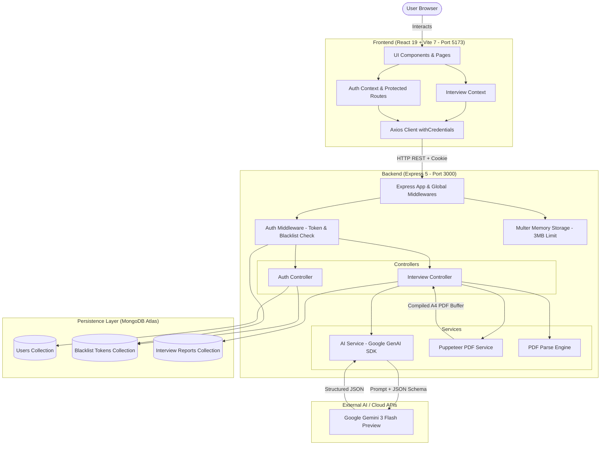
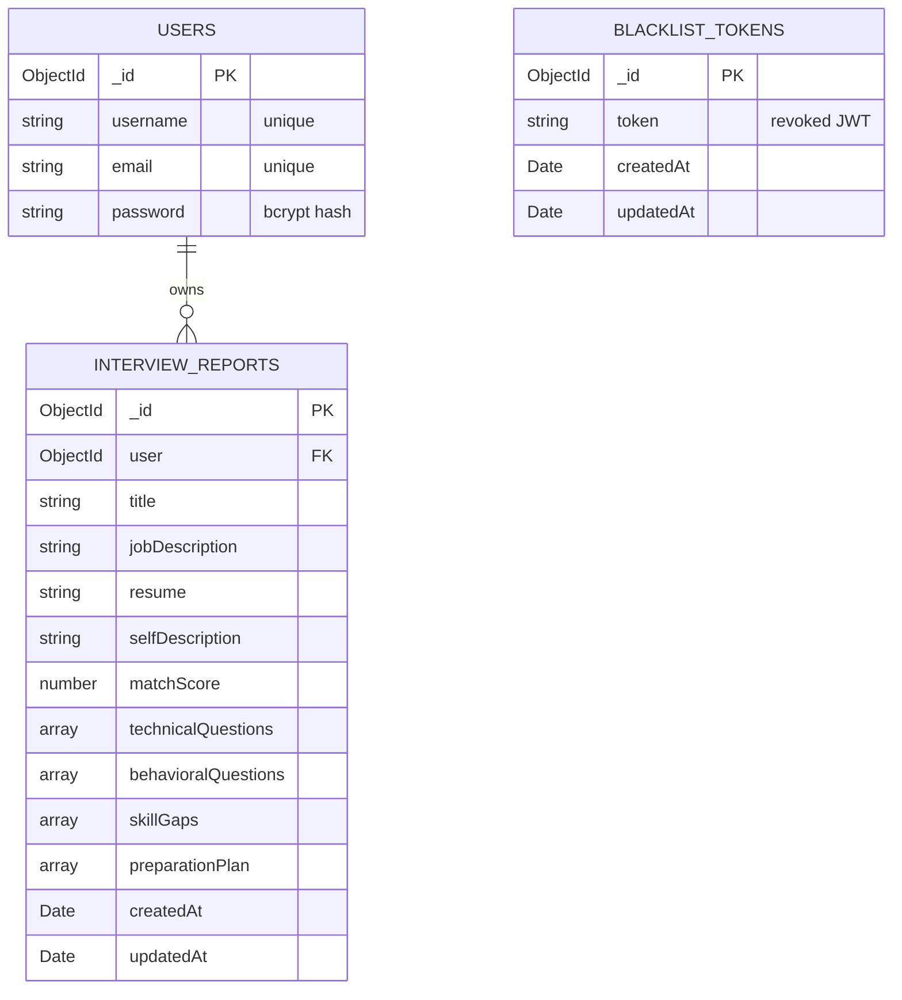

# Career Lens: Comprehensive Project Documentation & Technical Interview Guide

> **Document Type:** Production Engineering Documentation & Technical Interview Preparation Guide  
> **Target Audience:** Software Development Engineer (SDE), Full-Stack Engineer, and AI/GenAI Engineer Candidates  
> **Repository:** `Carrer-Lens`  
> **Tech Stack:** React 19, Vite 7, React Router 7, SCSS, Node.js, Express 5, MongoDB / Mongoose 9, JWT, Google Gemini API (`@google/genai`), Puppeteer, Multer, Zod

---

## Table of Contents
1. [A. Project Overview](#a-project-overview)
2. [B. System Architecture](#b-system-architecture)
3. [C. Complete Feature-by-Feature Explanation](#c-complete-feature-by-feature-explanation)
4. [D. Backend, APIs, and Database](#d-backend-apis-and-database)
5. [E. Important Technical Concepts](#e-important-technical-concepts)
6. [F. Critical Code and Execution Flows](#f-critical-code-and-execution-flows)
7. [G. Security, Performance, and Scalability](#g-security-performance-and-scalability)
8. [H. Design Decisions and Trade-offs](#h-design-decisions-and-trade-offs)
9. [I. Comprehensive Interview Questions & Answers](#i-comprehensive-interview-questions--answers)
10. [J. Limitations and Future Improvements](#j-limitations-and-future-improvements)
11. [K. Final Interview Revision Sheet](#k-final-interview-revision-sheet)

---

## A. Project Overview

### 1. Problem Statement
Job seekers frequently struggle to identify how well their experience matches target job descriptions (JDs), which specific technical or behavioral questions interviewers will ask, and where their critical skill gaps lie. Additionally, tailoring an existing resume to be strictly Applicant Tracking System (ATS) compliant for every distinct job description is time-consuming and often done sub-optimally.

### 2. Solution: Career Lens
**Career Lens** is an end-to-end AI career copilot. A user provides a target job description alongside their resume (uploaded as a PDF) or a text self-description. The platform uses Google's Gemini models with schema-enforced structured outputs to:
- Compute a realistic, quantitative role **Match Score (0–100%)**.
- Identify **Skill Gaps** categorized by severity (`low`, `medium`, `high`).
- Generate **Targeted Technical & Behavioral Questions**, each annotated with the interviewer's hidden intention and an optimal model answer.
- Formulate a day-by-day, step-by-step **Preparation Roadmap**.
- Automatically draft and export a tailored, ATS-friendly, 1–2 page **Resume as an A4 PDF** rendered via a headless Chromium engine.

### 3. Target Users & Use Cases
- **Software Engineers & Tech Professionals:** Preparing for specific technical and behavioral interview loops for particular job openings.
- **Career Switchers & Junior Developers:** Identifying unstated expectations in job descriptions and planning an organized prep schedule.
- **Active Job Applicants:** Generating ATS-optimized PDF resumes tailored specifically to individual job requisitions.

### 4. Technology Stack & Component Justifications

| Layer | Technology | Purpose in This Project |
| :--- | :--- | :--- |
| **Frontend UI** | [React 19](file:///d:/Projects/Carrer%20Lens/Frontend/package.json) | High-performance reactive component tree using the latest React 19 standard. |
| **Build Tool** | [Vite 7](file:///d:/Projects/Carrer%20Lens/Frontend/vite.config.js) | Sub-second Hot Module Replacement (HMR) and optimized ES module bundling. |
| **Routing** | [React Router v7](file:///d:/Projects/Carrer%20Lens/Frontend/src/app.routes.jsx) | Declarative client-side routing, route protection, and dynamic URL params (`/interview/:interviewId`). |
| **Styling** | [Sass (SCSS)](file:///d:/Projects/Carrer%20Lens/Frontend/src/style.scss) | BEM-structured, variable-driven responsive styling without external CSS framework bloat. |
| **HTTP Client** | [Axios](file:///d:/Projects/Carrer%20Lens/Frontend/src/features/interview/services/interview.api.js) | Promise-based HTTP requests with `withCredentials: true` for automatic cookie transmission and blob streaming. |
| **Backend Runtime**| [Node.js & Express 5](file:///d:/Projects/Carrer%20Lens/Backend/src/app.js) | Modern asynchronous REST API server utilizing native Promise handling in Express 5. |
| **Database** | [MongoDB & Mongoose 9](file:///d:/Projects/Carrer%20Lens/Backend/src/config/database.js) | Schema-backed document storage for user accounts, blacklisted tokens, and structured interview reports. |
| **Auth & Security** | [JWT & bcryptjs](file:///d:/Projects/Carrer%20Lens/Backend/src/controllers/auth.controller.js) | One-way salted password hashing and stateless cookie-based JWT sessions with server-side revocation. |
| **File Ingestion** | [Multer](file:///d:/Projects/Carrer%20Lens/Backend/src/middlewares/file.middleware.js) & [pdf-parse](file:///d:/Projects/Carrer%20Lens/Backend/src/controllers/interview.controller.js) | In-memory multipart file parsing and binary text extraction from uploaded PDF resumes. |
| **LLM Orchestration** | [`@google/genai` (Gemini)](file:///d:/Projects/Carrer%20Lens/Backend/src/services/ai.service.js) | Gemini Flash inference utilizing `responseSchema` for guaranteed structured JSON outputs. |
| **Schema Validation**| [Zod & zod-to-json-schema](file:///d:/Projects/Carrer%20Lens/Backend/src/services/ai.service.js) | Compile-time and runtime validation schemas converted to OpenAPI/JSON-Schema for Gemini. |
| **PDF Synthesis** | [Puppeteer](file:///d:/Projects/Carrer%20Lens/Backend/src/services/ai.service.js) | Headless Chromium automation compiling AI-generated HTML/CSS directly to print-accurate A4 PDF buffers. |

### 5. The 30–60 Second Elevator Pitch (For Interviews)
> *"I built **Career Lens**, an AI-powered career assistant and interview preparation platform designed to help job seekers bridge the gap between their experience and target job requirements. Users provide a job description and their resume, and the platform uses Google's Gemini models with strict schema constraints to generate a personalized match score, detect skill gaps, craft technical and behavioral interview questions with model answers, and lay out a day-by-day prep plan.*  
> *It also generates an ATS-optimized, tailored resume rendered server-side as an A4 PDF using Puppeteer. The frontend is built with React 19, Vite, and SCSS, while the backend is an Express 5 and MongoDB service featuring secure cookie-based JWT authentication with token revocation."*

---

## B. System Architecture

### 1. Architectural Style
The project implements a decoupled **Client-Server Architecture**:
- **Presentation Tier:** Single Page Application (SPA) built with React 19 and Vite.
- **Application Tier:** Node.js / Express 5 REST API using a layered **Controller-Service-Repository** pattern.
- **Persistence Tier:** MongoDB Atlas database accessed through Mongoose 9 ODM models.
- **External Services Tier:** Google Gemini API for generative AI reasoning; Headless Chromium (Puppeteer) for programmatic PDF compilation.

### 2. System Architecture Diagram



### 3. Component Responsibilities & Communication
- **Frontend SPA:** Manages UI states, file inputs, client-side routing, and rendering. Communicates strictly over asynchronous HTTP using Axios configured with credentials.
- **Express Backend:** Acts as the API gateway and business logic coordinator. Enforces route authorization, processes binary multipart form uploads in memory, delegates LLM generation, and handles data persistence.
- **Mongoose ODM:** Models entity relationships, enforces field types and validation rules, and executes database queries against MongoDB Atlas.
- **External AI Integration:** Invokes Google's Gemini Flash model via `@google/genai` utilizing JSON Schema definitions to prevent unstructured or hallucinated formats.

---

## C. Complete Feature-by-Feature Explanation

---

### Feature 1: User Authentication & Revocable Session Management

#### 1. What It Does & Why It Exists
Enables users to register an account, log in securely, retrieve their authenticated profile, and log out. Instead of purely stateless JWTs where tokens remain valid until expiration regardless of user intent, this implementation introduces a token blacklist in the database to allow immediate session revocation upon logout.

#### 2. User Interaction
- The user accesses `/register` or `/login`.
- Upon submitting credentials, they are redirected to `/` (Home).
- If an unauthenticated user attempts to access `/` or `/interview/:interviewId`, the [Protected.jsx](file:///d:/Projects/Carrer%20Lens/Frontend/src/features/auth/components/Protected.jsx) wrapper intercepts the route and redirects them to `/login`.

#### 3. Frontend Implementation
- **Components & Pages:** [Login.jsx](file:///d:/Projects/Carrer%20Lens/Frontend/src/features/auth/pages/Login.jsx), [Register.jsx](file:///d:/Projects/Carrer%20Lens/Frontend/src/features/auth/pages/Register.jsx), and [Protected.jsx](file:///d:/Projects/Carrer%20Lens/Frontend/src/features/auth/components/Protected.jsx).
- **State Management:** [auth.context.jsx](file:///d:/Projects/Carrer%20Lens/Frontend/src/features/auth/auth.context.jsx) exposes `user` and `loading`.
- **Custom Hook:** [useAuth.js](file:///d:/Projects/Carrer%20Lens/Frontend/src/features/auth/hooks/useAuth.js) encapsulates `handleLogin`, `handleRegister`, `handleLogout`, and automatically triggers `getMe()` upon initial mount to restore session state from the HTTP cookie.
- **API Client:** [auth.api.js](file:///d:/Projects/Carrer%20Lens/Frontend/src/features/auth/services/auth.api.js) dispatches Axios requests to `/api/auth/*`.

#### 4. Backend Implementation
- **Routes:** [auth.routes.js](file:///d:/Projects/Carrer%20Lens/Backend/src/routes/auth.routes.js) defines:
  - `POST /api/auth/register`
  - `POST /api/auth/login`
  - `GET /api/auth/logout`
  - `GET /api/auth/get-me` (guarded by `authUser`)
- **Controller:** [auth.controller.js](file:///d:/Projects/Carrer%20Lens/Backend/src/controllers/auth.controller.js) handles credential verification, password hashing, JWT generation, cookie setting, and blacklist entry creation.
- **Middleware:** [auth.middleware.js](file:///d:/Projects/Carrer%20Lens/Backend/src/middlewares/auth.middleware.js) extracts the JWT from `req.cookies.token`, checks if the token is present in the `blacklistTokens` collection, and decodes the JWT using `process.env.JWT_SECRET`.

#### 5. Database Models Involved
- **`User` Model** ([user.model.js](file:///d:/Projects/Carrer%20Lens/Backend/src/models/user.model.js)): Stores unique `username`, unique `email`, and bcrypt `password`.
- **`TokenBlacklist` Model** ([blacklist.model.js](file:///d:/Projects/Carrer%20Lens/Backend/src/models/blacklist.model.js)): Stores invalid `token` strings with timestamps.

#### 6. Libraries & External Services
- `bcryptjs`: Password hashing with 10 salt rounds.
- `jsonwebtoken`: Signs JWT with a 1-day expiration payload containing `{ id, username }`.
- `cookie-parser`: Parses the `token` cookie on incoming requests.

#### 7. Complete Execution Flow
```
1. User enters email & password on /login -> clicks Submit.
2. Login.jsx calls handleLogin() in useAuth.js -> calls login() in auth.api.js.
3. POST request sent to Backend /api/auth/login with credentials.
4. auth.controller.js queries User model by email.
5. bcrypt.compare verifies the plaintext password against the stored hash.
6. jwt.sign() creates a signed JWT valid for 24 hours.
7. Server calls res.cookie("token", token) and returns user profile JSON.
8. Frontend stores user in AuthContext and navigates to "/".
9. On logout, GET /api/auth/logout creates a document in blacklistTokens and calls res.clearCookie("token").
```

#### 8. Edge Cases & Limitations
- **Cookie Security:** The cookie is set as `res.cookie("token", token)` without `{ httpOnly: true, secure: true, sameSite: 'lax' }`, meaning the cookie is technically readable by client-side JavaScript (XSS vulnerability).
- **Blacklist Growth:** The `blacklistTokens` collection does not configure a MongoDB TTL index (e.g., `expireAfterSeconds: 86400`), meaning invalid tokens remain in the database indefinitely.

---

### Feature 2: In-Memory Resume Ingestion & PDF Parsing

#### 1. What It Does & Why It Exists
Allows the user to upload their resume in PDF format. Instead of saving files to local disk or configuring third-party S3 bucket credentials, the application holds the file in server memory (`RAM`) during the request lifecycle, extracts raw text content, and passes the text directly to the AI service.

#### 2. User Interaction
On the Home page ([Home.jsx](file:///d:/Projects/Carrer%20Lens/Frontend/src/features/interview/pages/Home.jsx)), the user clicks the dropzone or drags-and-drops a `.pdf` file (max 3MB limit enforced by Multer, 5MB listed on UI).

#### 3. Frontend Implementation
- [Home.jsx](file:///d:/Projects/Carrer%20Lens/Frontend/src/features/interview/pages/Home.jsx) utilizes an HTML `<input type="file" ref={resumeInputRef} accept=".pdf,.docx" hidden />` tied to a stylized drag-and-drop label.
- The file object is appended to a `FormData` instance inside [interview.api.js](file:///d:/Projects/Carrer%20Lens/Frontend/src/features/interview/services/interview.api.js#L14-L18).

#### 4. Backend Implementation
- **Middleware:** [file.middleware.js](file:///d:/Projects/Carrer%20Lens/Backend/src/middlewares/file.middleware.js) configures `multer.memoryStorage()` with a `limits: { fileSize: 3 * 1024 * 1024 }` constraint.
- **Controller:** [interview.controller.js](file:///d:/Projects/Carrer%20Lens/Backend/src/controllers/interview.controller.js#L13) extracts text using `pdf-parse`:
  ```javascript
  const resumeContent = await (new pdfParse.PDFParse(Uint8Array.from(req.file.buffer))).getText()
  ```

#### 5. Edge Cases & Known Code Limitation
> [!IMPORTANT]
> **Crash on Missing Resume:** In [Home.jsx](file:///d:/Projects/Carrer%20Lens/Frontend/src/features/interview/pages/Home.jsx#L108), the UI states: *"Either a Resume or a Self Description is required"*. However, in [interview.controller.js:L13](file:///d:/Projects/Carrer%20Lens/Backend/src/controllers/interview.controller.js#L13), `req.file.buffer` is accessed unconditionally without verifying whether `req.file` exists. If a user submits only a self-description, the backend throws an unhandled `TypeError: Cannot read properties of undefined (reading 'buffer')`.

---

### Feature 3: AI-Driven Strategy & Interview Report Generation

#### 1. What It Does & Why It Exists
Generates a comprehensive interview readiness dossier by analyzing the candidate's background against the target job description. It eliminates unpredictable free-form AI text by enforcing strict JSON output compliance.

#### 2. User Interaction
The user pastes a job description into a textarea (max 5,000 characters), attaches their resume, and clicks **"Generate My Interview Strategy"**. The UI renders a fullscreen loading message while the backend processes the request (~15–30 seconds), then automatically navigates to `/interview/:interviewId`.

#### 3. Technical Implementation & Data Schema
In [ai.service.js](file:///d:/Projects/Carrer%20Lens/Backend/src/services/ai.service.js), a comprehensive Zod schema defines the structure:
- `matchScore`: A number from 0 to 100.
- `technicalQuestions`: Array of objects containing `{ question, intention, answer }`.
- `behavioralQuestions`: Array of objects containing `{ question, intention, answer }`.
- `skillGaps`: Array of objects containing `{ skill, severity: ["low", "medium", "high"] }`.
- `preparationPlan`: Array of objects containing `{ day, focus, tasks: [string] }`.
- `title`: Extracted title of the targeted job.

The Zod schema is converted to standard JSON schema via `zod-to-json-schema` and passed to Gemini:
```javascript
const response = await ai.models.generateContent({
    model: "gemini-3-flash-preview",
    contents: prompt,
    config: {
        responseMimeType: "application/json",
        responseSchema: zodToJsonSchema(interviewReportSchema),
    }
})
```

#### 4. Storage & Association
The backend saves the full response combined with the raw text, job description, and the user's `ObjectId` into the `InterviewReport` collection ([interviewReport.model.js](file:///d:/Projects/Carrer%20Lens/Backend/src/models/interviewReport.model.js)).

---

### Feature 4: Dynamic Interview Report Viewer

#### 1. What It Does & Why It Exists
Provides a dashboard interface for the candidate to review their generated interview strategy.

#### 2. Frontend Components & Layout
Located in [Interview.jsx](file:///d:/Projects/Carrer%20Lens/Frontend/src/features/interview/pages/Interview.jsx):
- **Tabbed Navigation (Left Sidebar):** Allows switching between **Technical Questions**, **Behavioral Questions**, and the **Road Map**.
- **Collapsible Accordion Cards (`QuestionCard`):** Each question card displays the question headline and can be expanded to view:
  - **Intention Badge:** Explains what the interviewer is secretly assessing.
  - **Model Answer Badge:** Practical talking points and response frameworks.
- **Day-by-Day Preparation Plan (`RoadMapDay`):** Renders sequential milestone cards with checklists of actionable daily tasks.
- **Readiness Sidebar (Right Sidebar):**
  - **Match Score Gauge:** Color-coded dynamic ring (`score--high` ≥80%, `score--mid` ≥60%, `score--low` <60%).
  - **Skill Gaps List:** Tag pills colored by severity level (`skill-tag--high`, `skill-tag--medium`, `skill-tag--low`).

---

### Feature 5: Tailored ATS Resume Generation & PDF Export

#### 1. What It Does & Why It Exists
Generates an ATS-compliant, single or two-page resume customized for the specific job description, formatted cleanly in HTML/CSS, and exported as a downloadable PDF.

#### 2. Technical Execution Flow
```
User clicks "Download Resume" in Interview.jsx
  │
  ▼
Frontend triggers getResumePdf(interviewReportId) in useInterview.js
  │
  ▼
POST /api/interview/resume/pdf/:interviewReportId (interview.api.js)
  │
  ▼
Backend fetches InterviewReport from MongoDB to get resume text, JD, and selfDescription
  │
  ▼
ai.service.js calls Gemini with a tailored resume prompt requesting a JSON object: { html: "..." }
  │
  ▼
Puppeteer launches headless Chromium:
  - page.setContent(htmlContent, { waitUntil: "networkidle0" })
  - page.pdf({ format: "A4", margin: { top: "20mm", bottom: "20mm", left: "15mm", right: "15mm" } })
  │
  ▼
Controller sets headers:
  - "Content-Type": "application/pdf"
  - "Content-Disposition": "attachment; filename=resume_<id>.pdf"
  │
  ▼
Express streams raw PDF buffer back to client
  │
  ▼
Frontend converts Axios Blob response to ObjectURL and triggers programmatic download
```

---

### Feature 6: Historical Interview Reports Listing

#### 1. What It Does & Why It Exists
Enables authenticated users to view all previously generated reports so they do not need to re-run expensive AI generation queries for the same job description.

#### 2. Implementation Details
- **Frontend:** [Home.jsx](file:///d:/Projects/Carrer%20Lens/Frontend/src/features/interview/pages/Home.jsx#L125-L139) renders a "Recent Interview Plans" list beneath the main input form.
- **Backend Optimization:** In [interview.controller.js:L63](file:///d:/Projects/Carrer%20Lens/Backend/src/controllers/interview.controller.js#L63), the controller queries MongoDB with field projection:
  ```javascript
  const interviewReports = await interviewReportModel
      .find({ user: req.user.id })
      .sort({ createdAt: -1 })
      .select("-resume -selfDescription -jobDescription -__v -technicalQuestions -behavioralQuestions -skillGaps -preparationPlan")
  ```
  By excluding large text blocks and subdocument arrays, network payload sizes are reduced by over 90%.

---

## D. Backend, APIs, and Database

### 1. Compact API Reference Table

| Method | Endpoint | Access | Request Body / Params | Expected Response | Purpose |
| :--- | :--- | :--- | :--- | :--- | :--- |
| `POST` | `/api/auth/register` | Public | JSON: `{ username, email, password }` | `201 Created` + User JSON + Cookie | Register new user |
| `POST` | `/api/auth/login` | Public | JSON: `{ email, password }` | `200 OK` + User JSON + Cookie | Authenticate existing user |
| `GET` | `/api/auth/logout` | Public | None | `200 OK` + Clear Cookie | Invalidate token & logout |
| `GET` | `/api/auth/get-me` | Private | None | `200 OK` + User JSON | Fetch current user session |
| `POST` | `/api/interview/` | Private | Multipart: `jobDescription`, `selfDescription`, `resume` (file) | `201 Created` + Full InterviewReport JSON | Analyze JD & generate report |
| `GET` | `/api/interview/` | Private | None | `200 OK` + Array of Reports (projected) | List all reports for user |
| `GET` | `/api/interview/report/:interviewId` | Private | Param: `interviewId` | `200 OK` + Single Report JSON | Fetch full report details |
| `POST` | `/api/interview/resume/pdf/:interviewReportId` | Private | Param: `interviewReportId` | `200 OK` + Binary PDF Stream (`application/pdf`) | Generate & stream PDF resume |

---

### 2. Database Schema Specifications



#### Detailed Model Schemas
1. **User Schema** ([user.model.js](file:///d:/Projects/Carrer%20Lens/Backend/src/models/user.model.js)):
   - `username`: String, Required, Unique.
   - `email`: String, Required, Unique.
   - `password`: String, Required (Bcrypt hash).
2. **Blacklist Token Schema** ([blacklist.model.js](file:///d:/Projects/Carrer%20Lens/Backend/src/models/blacklist.model.js)):
   - `token`: String, Required.
   - `timestamps`: Enabled (`createdAt`, `updatedAt`).
3. **Interview Report Schema** ([interviewReport.model.js](file:///d:/Projects/Carrer%20Lens/Backend/src/models/interviewReport.model.js)):
   - `user`: `mongoose.Schema.Types.ObjectId`, references `users`.
   - `title`: String, Required (Job title).
   - `jobDescription`: String, Required.
   - `resume`: String (Extracted plaintext).
   - `selfDescription`: String.
   - `matchScore`: Number (min: 0, max: 100).
   - `technicalQuestions`: `[ { question, intention, answer } ]` (`_id: false`).
   - `behavioralQuestions`: `[ { question, intention, answer } ]` (`_id: false`).
   - `skillGaps`: `[ { skill, severity: enum["low", "medium", "high"] } ]` (`_id: false`).
   - `preparationPlan`: `[ { day, focus, tasks: [String] } ]`.
   - `timestamps`: Enabled (`createdAt`, `updatedAt`).

---

### 3. Environment Variables & Secret Configuration
The backend depends on the following configuration keys (defined in `Backend/.env`):
- `MONGODB_URI`: Connection string to MongoDB Atlas.
- `JWT_SECRET`: Cryptographic secret key used to sign and verify JSON Web Tokens.
- `GOOGLE_GENAI_API_KEY`: Google AI Studio API key used to authenticate `@google/genai` calls.

> [!CAUTION]
> In production environments, never commit the `.env` file to source control. Ensure it is included in `.gitignore` and managed via secure secret managers (e.g., AWS Secrets Manager, Doppler, or platform environment settings).

---

## E. Important Technical Concepts

### 1. Structured AI Outputs with Zod and Gemini
- **What It Is:** By default, LLMs return unstructured natural language strings, which often break JSON parsing when formatting issues occur.
- **How It's Used Here:** The application defines a Zod schema in [ai.service.js](file:///d:/Projects/Carrer%20Lens/Backend/src/services/ai.service.js), compiles it using `zod-to-json-schema`, and sends it in the `responseSchema` configuration parameter of `@google/genai`.
- **Why It Matters:** The Gemini model is constrained at decoding time to only emit tokens that satisfy the grammar of the provided JSON schema. This guarantees valid, type-safe responses without needing manual retry loops.

### 2. Cookie-Based JWT with Database Revocation (Hybrid Auth)
- **What It Is:** Standard JWTs are stateless; once issued, they cannot be revoked before they expire without changing the signing secret.
- **How It's Used Here:** On login, a JWT is issued with a 24-hour expiration and sent as a cookie. When a user logs out, the token string is saved to the `blacklistTokens` MongoDB collection. The `authUser` middleware queries this collection before verifying the token signature.
- **Trade-off:** This reintroduces a database read on protected requests, forfeiting pure statelessness in exchange for immediate revocation control.

### 3. Server-Side Headless PDF Rendering via Puppeteer
- **What It Is:** Running an automated, headless Chromium browser instance on the server to execute HTML layout algorithms and print pages to PDF.
- **Why Not Client-Side (`jsPDF` / `html2canvas`):** Client-side PDF generators struggle with multi-page page breaks, font kerning, and CSS flex/grid layouts. Headless Chromium provides true pixel-perfect print layout matching standard A4 dimensions.

### 4. Memory-Storage Multipart Streaming with Multer
- **What It Is:** Multer's `memoryStorage()` buffers incoming file streams directly into a Node.js `Buffer` object in memory (`req.file.buffer`).
- **Why Chosen:** For small documents (<3MB), in-memory buffering avoids disk I/O latency, eliminates the need for temporary file cleanup routines, and prevents filesystem permission conflicts in containerized deployments.

---

## F. Critical Code and Execution Flows

### 1. User Registration & Cookie Auth Flow

```
[Client: Register.jsx]
       │
       ▼  POST { username, email, password }
[Backend: auth.routes.js -> registerUserController]
       │
       ├─► userModel.findOne({ $or: [{ username }, { email }] })
       │   └─► If found: return 400 "Account already exists"
       │
       ├─► bcrypt.hash(password, 10)
       ├─► userModel.create({ username, email, password: hash })
       ├─► jwt.sign({ id, username }, JWT_SECRET, { expiresIn: "1d" })
       ├─► res.cookie("token", token)
       │
       ▼  201 Created + User JSON
[Client: useAuth.js]
       │
       └─► setUser(data.user) -> navigate("/")
```

### 2. Report Generation & AI Processing Flow

```
[Client: Home.jsx]
       │
       ▼  POST FormData (resume file, jobDescription, selfDescription)
[Backend: file.middleware.js (Multer)]
       │
       ├─► Buffers file to req.file.buffer (max 3MB)
       │
[Backend: interview.controller.js -> generateInterViewReportController]
       │
       ├─► pdfParse(req.file.buffer).getText()
       ├─► ai.service.js: generateInterviewReport({ resume, selfDescription, jobDescription })
       │         │
       │         ▼ Calls Gemini Flash with zodToJsonSchema(interviewReportSchema)
       │         ◄ Returns validated JSON structure
       │
       ├─► interviewReportModel.create({ user: req.user.id, ...aiReport })
       │
       ▼  201 Created + InterviewReport JSON
[Client: Home.jsx]
       │
       └─► navigate(`/interview/${data._id}`)
```

### 3. Dynamic PDF Resume Synthesis & Download Flow

```
[Client: Interview.jsx]
       │
       ▼  POST /api/interview/resume/pdf/:interviewReportId
[Backend: interview.controller.js -> generateResumePdfController]
       │
       ├─► interviewReportModel.findById(interviewReportId)
       ├─► ai.service.js: generateResumePdf({ resume, jobDescription, selfDescription })
       │         │
       │         ├─► Gemini generates ATS-friendly HTML inside { html: "..." }
       │         ├─► puppeteer.launch() -> browser.newPage()
       │         ├─► page.setContent(htmlContent, { waitUntil: "networkidle0" })
       │         ├─► page.pdf({ format: "A4", margin: {...} }) -> pdfBuffer
       │         └─► browser.close()
       │
       ├─► res.set({ "Content-Type": "application/pdf", "Content-Disposition": "attachment; filename=..." })
       ├─► res.send(pdfBuffer)
       │
       ▼  Binary ArrayBuffer Stream
[Client: useInterview.js]
       │
       ├─► window.URL.createObjectURL(new Blob([response], { type: "application/pdf" }))
       └─► Programmatically clicks invisible <a> tag to initiate download
```

---

## G. Security, Performance, and Scalability

### 1. Existing Security Measures
- **Password Salting & Hashing:** Uses `bcryptjs` with a work factor of 10, preventing plaintext storage and rainbow table attacks.
- **JWT Authentication:** Enforces signed tokens for all interview and user inspection endpoints.
- **Token Invalidation:** Implements a token blacklist model preventing revoked tokens from being reused prior to expiration.
- **CORS Restrictions:** Express explicitly locks CORS origin to `http://localhost:5173` with `credentials: true`.
- **Upload File Size Limitation:** Multer rejects multipart streams exceeding 3 megabytes to prevent basic buffer exhaustion attacks.

### 2. Security Vulnerabilities & Recommended Fixes

```
┌─────────────────────────────────┬───────────────────────────────────┬──────────────────────────────────────────┐
│ Vulnerability / Risk            │ Current Code Implementation       │ Production Recommended Fix               │
├─────────────────────────────────┼───────────────────────────────────┼──────────────────────────────────────────┤
│ Missing httpOnly / Secure Flags │ res.cookie("token", token)        │ res.cookie("token", token, {             │
│ (XSS Token Theft)               │ (Accessible to JavaScript)        │   httpOnly: true, secure: true,          │
│                                 │                                   │   sameSite: 'lax' })                     │
├─────────────────────────────────┼───────────────────────────────────┼──────────────────────────────────────────┤
│ Unbounded Blacklist Growth      │ TokenBlacklist documents are      │ Add MongoDB TTL index:                   │
│ (Database Bloat)                │ created with no expiration date   │ tokenSchema.index({ createdAt: 1 },      │
│                                 │                                   │   { expireAfterSeconds: 86400 })         │
├─────────────────────────────────┼───────────────────────────────────┼──────────────────────────────────────────┤
│ Unhandled Controller Rejections │ No try-catch blocks inside        │ Wrap controllers in an async error       │
│ (Server Denial of Service)      │ interview.controller.js           │ handler or Express 5 global error        │
│                                 │                                   │ middleware.                              │
├─────────────────────────────────┼───────────────────────────────────┼──────────────────────────────────────────┤
│ Missing Rate Limiting           │ No limits on /api/interview/      │ Implement express-rate-limit to prevent  │
│ (API Cost Exploitation)         │ or auth endpoints                 │ LLM API quota exhaustion.                │
└─────────────────────────────────┴───────────────────────────────────┴──────────────────────────────────────────┘
```

### 3. Performance & Scalability Considerations
- **Synchronous LLM & Browser Bottlenecks:** Both the Gemini API call (~10–20s) and Puppeteer PDF generation (~3–8s) run synchronously inside the HTTP request cycle. Under heavy concurrent traffic, this monopolizes Node.js event-loop workers and exhausts server RAM.
- **Recommended Architectural Upgrade:** Transition PDF compilation and AI report generation to an asynchronous background worker architecture using **Redis and BullMQ**. The server immediately responds with an `interviewId` and a `status: "processing"` flag, while the client polls or listens via WebSockets/Server-Sent Events (SSE).

---

## H. Design Decisions and Trade-offs

### 1. Memory Storage vs. Cloud Storage (S3 / Cloudinary) for Resumes
- **Decision:** Use Multer's `memoryStorage()` and discard the binary file immediately after text extraction.
- **Why It Makes Sense:** Resumes only serve as raw text context for the prompt. Storing binary PDF files permanently would incur cloud storage costs and create unnecessary data-retention and GDPR/privacy obligations.
- **Trade-off:** Resume files cannot be re-downloaded later in their original format; only the extracted text and reports persist in MongoDB.

### 2. Puppeteer Server-Side PDF vs. Client-Side Libraries (`jsPDF`)
- **Decision:** Render HTML to PDF server-side using headless Chromium.
- **Why It Makes Sense:** Gemini generates HTML with inline styles. Client-side libraries frequently miscalculate CSS flexbox, font metrics, and page splits across page boundaries. Puppeteer replicates the exact desktop Chrome print engine.
- **Trade-off:** Launching Chromium processes requires significant server memory (~100–300MB per instance) and requires extra Linux dependencies when containerized.

### 3. Cookie JWT with Blacklist vs. Stateless JWT vs. Server Sessions
- **Decision:** JWT stored in a cookie, validated against a database blacklist collection.
- **Why It Makes Sense:** Solves the primary security issue of stateless JWTs (the inability to immediately invalidate a stolen or logged-out token) without having to store all full session payloads in server memory.
- **Trade-off:** Requires a database query on every authenticated request, partially negating the performance benefits of stateless tokens.

---

## I. Comprehensive Interview Questions & Answers

### Category 1: Project Overview & Architecture

#### Q1.1: Can you give an architectural overview of your Career Lens application?
> **Answer:**  
> Career Lens follows a decoupled client-server architecture. The frontend is a React 19 Single Page Application built with Vite and SCSS, using React Router v7 for client-side routing. The backend is an Express 5 REST API connected to MongoDB Atlas via Mongoose 9.  
> When a user uploads a resume and job description, Multer buffers the PDF in memory, `pdf-parse` extracts the text, and the payload is sent to Google's Gemini Flash model via `@google/genai`. We enforce strict JSON output using Zod schemas. Once validated, the report is saved in MongoDB and rendered in an interactive dashboard. When exporting a resume, Gemini outputs structured HTML that a server-side headless Puppeteer browser prints to an A4 PDF buffer and streams to the client.

#### Q1.2: What was the primary motivation behind building Career Lens?
> **Answer:**  
> Job hunting is often inefficient because candidates send generic resumes into ATS scanners and enter interviews unprepared for role-specific questions. Generic LLM prompts often return unfocused or hallucinatory advice. I built Career Lens to provide a structured, deterministic platform that systematically analyzes real candidate qualifications against specific job descriptions, surfacing concrete gaps, targeted questions with model answers, and generating an ATS-ready PDF resume.

---

### Category 2: Generative AI & Schema Enforcement

#### Q2.1: How do you prevent Gemini from returning invalid or malformed JSON?
> **Answer:**  
> In [ai.service.js](file:///d:/Projects/Carrer%20Lens/Backend/src/services/ai.service.js), we define the exact desired response structure using a Zod schema (`interviewReportSchema`). We then convert this schema using `zod-to-json-schema` and supply it directly to the Gemini API's `config.responseSchema` parameter, setting `responseMimeType: "application/json"`.  
> This utilizes Gemini's constrained decoding capability, where the model's token-generation probabilities are constrained at the engine level to only output tokens that adhere to the provided JSON Schema specification.

#### Q2.2: Why did you choose `gemini-3-flash-preview` over heavier models or competitors?
> **Answer:**  
> The Flash family is optimized for low-latency reasoning tasks and supports native schema-constrained JSON mode. Analyzing a 2-page resume and a long job description requires processing several thousand tokens; Flash handles this in under 15 seconds at minimal cost while providing sufficient reasoning capability to evaluate skill gaps and write behavioral answers.

---

### Category 3: Backend & Authentication Mechanics

#### Q3.1: How does authentication work in this project, and how do you handle logout?
> **Answer:**  
> When a user registers or logs in, their password is verified or hashed using `bcryptjs` with 10 salt rounds. We sign a JWT containing the user ID and username with a 24-hour expiration and return it in an HTTP cookie named `token`.  
> For logout, purely stateless JWTs cannot be revoked until they expire. To address this, we implemented a hybrid model: the `/api/auth/logout` route takes the current token from the cookie, inserts it into a `blacklistTokens` collection in MongoDB, and clears the cookie. Our `authUser` middleware checks the blacklist on every request before verifying the JWT signature.

#### Q3.2: Why did you use Express 5 rather than Express 4?
> **Answer:**  
> Express 5 features native support for Promises. In Express 4, unhandled promise rejections inside asynchronous route handlers would cause the server process to hang or crash unless explicitly wrapped in try/catch blocks or passed to `next(err)`. Express 5 automatically catches rejected promises from async route handlers and routes them to the default error middleware.

---

### Category 4: PDF Generation & Document Processing

#### Q4.1: Why did you use Puppeteer for PDF export instead of client-side libraries like `jsPDF`?
> **Answer:**  
> Client-side libraries such as `jsPDF` or `html2canvas` render HTML into canvas bitmaps before saving to PDF, resulting in blurry text, broken page boundaries, and inconsistent font rendering across different browsers.  
> Puppeteer runs a server-side headless Chromium instance. By loading the AI-generated HTML and executing `page.pdf({ format: "A4" })`, we leverage Chromium's native desktop printing engine. This produces vector-sharp text, proper margins, selectable text, and reliable pagination necessary for ATS parsers.

#### Q4.2: How does Multer handle uploaded resume files?
> **Answer:**  
> In [file.middleware.js](file:///d:/Projects/Carrer%20Lens/Backend/src/middlewares/file.middleware.js), Multer is configured with `multer.memoryStorage()` and a 3MB file size limit. Instead of writing files to temporary disk storage, Multer buffers the binary file chunks in RAM as a Node.js `Buffer` object available on `req.file.buffer`. We feed this buffer directly into `pdf-parse`, extract the plaintext, and let the buffer be garbage collected.

---

### Category 5: Edge Cases, Bugs & Debugging

#### Q5.1: If an applicant does not have a resume file and only fills out the self-description, what happens in your current codebase?
> **Answer:**  
> In the current implementation of [interview.controller.js:L13](file:///d:/Projects/Carrer%20Lens/Backend/src/controllers/interview.controller.js#L13), there is an unhandled edge case:
> ```javascript
> const resumeContent = await (new pdfParse.PDFParse(Uint8Array.from(req.file.buffer))).getText()
> ```
> If the user submits without attaching a file, `req.file` is `undefined`, and accessing `req.file.buffer` causes an unhandled runtime error (`Cannot read properties of undefined`).  
> **The Fix:** We should verify if `req.file` is present:
> ```javascript
> let resumeText = "";
> if (req.file) {
>     const parsed = await (new pdfParse.PDFParse(Uint8Array.from(req.file.buffer))).getText();
>     resumeText = parsed.text;
> }
> ```

#### Q5.2: What happens if Puppeteer fails to launch on a Linux production server?
> **Answer:**  
> Puppeteer bundles Chromium, which relies on various shared Linux C++ libraries (`libX11`, `libnss3`, `libasound2`, etc.). On minimal Linux distributions or Docker images, Puppeteer will throw an error: `Failed to launch the browser process`.  
> To resolve this, you must install the missing system packages (e.g., via `apt-get install -y libnss3 ...`) and pass container flags such as `puppeteer.launch({ args: ['--no-sandbox', '--disable-setuid-sandbox'] })`.

---

### Category 6: Scalability & System Evolution

#### Q6.1: What is the main bottleneck if Career Lens experiences 1,000 concurrent users?
> **Answer:**  
> The main bottleneck is the synchronous handling of long-running operations in the HTTP request cycle:
> 1. Each AI report request waits 15–20 seconds for Gemini's response.
> 2. Each PDF export launches a Chromium process that consumes 100–300MB of RAM.
> 
> Under 1,000 concurrent requests, Node's event loop would degrade and the server would likely run out of memory.  
> **Solution:** Decouple these tasks using an asynchronous queue (e.g., Redis + BullMQ). The web server accepts the request, enqueues the job, and immediately returns a job ID. Dedicated background worker processes then handle the Gemini API calls and Puppeteer rendering, reporting completion via WebSockets.

---

## J. Limitations and Future Improvements

### Current Limitations Identified in Codebase
1. **Unchecked File Access:** `req.file.buffer` is accessed without verifying if `req.file` exists, causing requests with only a self-description to fail.
2. **Missing Cookie Security Flags:** Auth tokens are set via `res.cookie("token", token)` without `httpOnly: true`, leaving them vulnerable to XSS.
3. **No Automatic TTL on Blacklist:** The `blacklistTokens` collection retains tokens indefinitely rather than using a 24-hour MongoDB TTL index.
4. **Hardcoded API Endpoints:** Frontend API services hardcode `http://localhost:3000`, complicating multi-environment deployments.
5. **Lack of Automated Testing:** The repository lacks unit and integration test suites (e.g., Jest, Supertest, Vitest).

### Prioritized Engineering Roadmap
- [ ] **Phase 1 (Immediate Fixes):** Add safe null-checks for `req.file`, enable `httpOnly` and `sameSite` cookie flags, and add a MongoDB TTL index to `blacklistTokens`.
- [ ] **Phase 2 (Configuration):** Externalize API base URLs using Vite environment variables (`import.meta.env.VITE_API_BASE_URL`).
- [ ] **Phase 3 (Resilience):** Wrap controllers in robust error-handling middleware with user-friendly error responses.
- [ ] **Phase 4 (Asynchronous Architecture):** Introduce Redis and BullMQ job queues for long-running AI generation and Puppeteer PDF rendering.

---

## K. Final Interview Revision Sheet

### 1. 30-Second Elevator Pitch
> *"Career Lens is an AI career copilot built on React 19, Express 5, MongoDB, and Google's Gemini models. It ingests a job description and resume, enforces schema-validated AI outputs to generate an interview strategy with match scores, skill gaps, question prep, and roadmaps, and compiles tailored ATS-compliant PDF resumes using headless Puppeteer."*

### 2. Core Implementation Details to Remember
1. **Gemini Schema Enforcement:** Uses `zod-to-json-schema` passed to Gemini's `config.responseSchema` with `responseMimeType: "application/json"`.
2. **Revocable JWT Auth:** JWT is issued on login and stored in cookies; on logout, the token is written to a MongoDB blacklist collection and validated on subsequent requests.
3. **In-Memory File Ingestion:** Uses Multer's `memoryStorage()` to parse PDF text in RAM, avoiding disk I/O.
4. **Server-Side PDF Synthesis:** Compiles AI-generated HTML to a print-ready A4 PDF buffer using Puppeteer's `page.pdf()`.
5. **Database Projection:** The report history query uses `.select("-resume -technicalQuestions...")` to avoid returning large text blocks when loading lists.

### 3. Essential Source Files to Review
- [`Backend/src/services/ai.service.js`](file:///d:/Projects/Carrer%20Lens/Backend/src/services/ai.service.js): Core prompt design, Zod schema definitions, and Puppeteer PDF synthesis.
- [`Backend/src/controllers/interview.controller.js`](file:///d:/Projects/Carrer%20Lens/Backend/src/controllers/interview.controller.js): File ingestion, AI orchestration, report persistence, and PDF streaming.
- [`Backend/src/middlewares/auth.middleware.js`](file:///d:/Projects/Carrer%20Lens/Backend/src/middlewares/auth.middleware.js): Token extraction and blacklist verification.
- [`Frontend/src/features/interview/pages/Home.jsx`](file:///d:/Projects/Carrer%20Lens/Frontend/src/features/interview/pages/Home.jsx): Form state handling, file uploads, and history rendering.
- [`Frontend/src/features/interview/pages/Interview.jsx`](file:///d:/Projects/Carrer%20Lens/Frontend/src/features/interview/pages/Interview.jsx): Tab navigation, score gauges, collapsible question cards, and PDF download triggers.
