# Yukti (CortexAI): Comprehensive Project Documentation & Technical Interview Guide

---

## Table of Contents
1. [A. Project Overview](#a-project-overview)
2. [B. System Architecture](#b-system-architecture)
3. [C. Complete Feature-by-Feature Explanation](#c-complete-feature-by-feature-explanation)
4. [D. Backend, APIs, and Database Specification](#d-backend-apis-and-database-specification)
5. [E. Important Technical Concepts](#e-important-technical-concepts)
6. [F. Critical Code and Execution Flows](#f-critical-code-and-execution-flows)
7. [G. Security, Performance, and Scalability](#g-security-performance-and-scalability)
8. [H. Design Decisions and Trade-offs](#h-design-decisions-and-trade-offs)
9. [I. Comprehensive Interview Questions & Defensible Answers](#i-comprehensive-interview-questions--defensible-answers)
10. [J. Limitations and Technical Debt](#j-limitations-and-technical-debt)
11. [K. Final Interview Revision Sheet](#k-final-interview-revision-sheet)

---

## A. Project Overview

### 1. Problem Statement & Mission
Modern knowledge workers, developers, and students constantly switch between distinct AI platforms to accomplish daily tasks: one tool for conversational Q&A, another for real-time web search, another for coding and live previews, specialized tools for document Q&A (RAG), and separate generators for presentations, PDFs, and images. 

**CortexAI (Yukti)** solves this context-switching tax by unifying specialized multimodal AI capabilities into an autonomous, multi-agent SaaS platform. Instead of forcing users to guess which model to prompt or manually reformat outputs, CortexAI leverages an autonomous **LangGraph-driven orchestration engine** that analyzes inputs (text, PDF documents, or images), dynamically routes the prompt to domain-specific agents, executes tools, deduplicates credits, and surfaces interactive results (such as an in-browser live-rendered code sandbox, downloadable documents, and multimodal previews).

### 2. Target Users & Core Use Cases
- **Software Engineers & Students**: Generate multi-file frontend applications with real-time in-browser sandboxing, inspect code syntax, and debug scripts.
- **Researchers & Analysts**: Ingest complex PDF documents for grounded similarity-search RAG, explore web search results with image citations, and extract insights from charts and images.
- **Business Professionals**: Generate complete multi-slide PowerPoint presentations (`.pptx`) and branded PDF summary documents on demand via natural language.

### 3. Key Differentiators
- **Intelligent Autonomous Routing**: Eliminates manual agent toggling; incoming requests with file attachments are automatically routed to multimodal analyzers or vector RAG, while text prompts are classified by an LLM router.
- **Interactive Code Artifacts**: Generated HTML/CSS/JavaScript code isn't dumped as raw markdown—it is parsed into an interactive multi-file workspace powered by **Monaco Editor** with a sandboxed, live-rendered `<iframe>` preview.
- **Granular Credit & Monetization Loop**: Built-in pay-per-capability billing powered by **Razorpay** with cryptographically verified webhooks, tiered plans (`Free`, `Starter`, `Pro`), and Redis-backed rate limiting per capability.
- **Distributed Microservices Topology**: Segregates API routing, authentication, persistent chat storage, billing, and AI execution into containerized Node.js services deployed to **AWS ECS**.

### 4. Technology Stack Summary

| Layer | Technologies Used | Primary Purpose |
| :--- | :--- | :--- |
| **Frontend** | React 19, Vite 8, Tailwind CSS v4, Motion (Framer Motion) | Reactive, high-performance dark-mode SPA interface with smooth micro-animations. |
| **Code Editor & UI** | `@monaco-editor/react`, `react-markdown`, `remark-gfm`, `react-syntax-highlighter` | In-browser code editing, Markdown parsing, and syntax-highlighted code blocks. |
| **Client Auth & Speech** | Firebase Client SDK (`signInWithPopup`), Web Speech Recognition API | Google OAuth login and real-time voice-to-text transcript generation. |
| **State Management** | Redux Toolkit (`@reduxjs/toolkit`, `react-redux`) | Predictable centralized state for users, conversations, messages, and code artifacts. |
| **API Gateway** | Express 5, `express-http-proxy`, `cookie-parser`, `morgan` | Central reverse proxy, cookie-based session verification, and header propagation (`x-user-id`). |
| **Backend Services** | Node.js (ES Modules), Express 5, Mongoose 9, Docker | Distributed microservices architecture (`gateway`, `auth`, `chat`, `billing`, `agent`). |
| **AI Orchestration** | LangGraph (`@langchain/langgraph`), LangChain Core | Cyclic/acyclic state machines, state annotations, and dynamic router conditional edges. |
| **LLMs & Inference** | Groq (`@langchain/groq`), OpenRouter (`@langchain/openrouter`), Google GenAI (`@langchain/google-genai`) | Multi-model routing: DeepSeek Chat for coding, Gemini 2.5 Flash for vision, Groq for fast routing/chat. |
| **Vector DB & Search** | Qdrant (`@langchain/qdrant`), Google Generative AI Embeddings, Tavily Search | Vector embeddings (`gemini-embedding-001`), document similarity search, and web search tool. |
| **Binary Generation** | `pdfkit`, `pptxgenjs`, `pdf-parse` (v2.4.5), Pollinations.ai API | Native PDF compilation, 16:9 widescreen presentation generation, and text-to-image synthesis. |
| **Caching & Storage** | Redis (via `ioredis`), MongoDB Atlas, AWS S3 (`@aws-sdk/client-s3`) | Sliding-window rate limiting, session store, conversational cache, persistent storage, and S3 pre-signed downloads. |
| **DevOps & Cloud** | Docker, AWS ECS, Amazon ECR, AWS S3, AWS CloudFront, GitHub Actions | Automated CI/CD pipeline, containerized deployments, and static asset CDN distribution. |

### 5. 30–60 Second Interview Elevator Pitch
> *"CortexAI is a production-grade, full-stack multi-agent AI platform built using a microservices architecture. On the frontend, it uses React 19, Redux Toolkit, and Tailwind CSS v4, featuring a live in-browser Monaco code sandbox, real-time voice input, and markdown rendering. The backend consists of an Express API Gateway that authenticates requests using Redis session stores and proxies traffic to four decoupled microservices: Auth, Chat, Billing, and Agent. The core AI engine is orchestrated with LangGraph, routing tasks across Groq, DeepSeek, and Gemini models. Depending on user intent and uploaded media, the system autonomously triggers vector similarity search over PDFs using Qdrant, image analysis via Gemini 2.5 Flash, code generation, presentation building with pptxgenjs, or PDF compilation with pdfkit uploaded to S3. The entire platform features a Razorpay-backed monetization loop with credit tracking and Redis rate-limiting, fully containerized and deployed to AWS ECS via GitHub Actions."*

---

## B. System Architecture

```mermaid
flowchart TB
    subgraph ClientLayer["Frontend Client (React 19 + Vite + Tailwind CSS v4)"]
        UI["User Interface (Chat Area & Message List)"]
        Voice["Web Speech Recognition Engine"]
        Sandbox["Artifact Preview (Monaco Editor + Sandboxed iframe)"]
        BillDrawer["Billing Drawer (Razorpay Checkout)"]
        OAuthModal["Firebase Google OAuth"]
    end

    subgraph GatewayLayer["API Gateway (Port 8000)"]
        Proxy["express-http-proxy"]
        AuthMiddleware["protect Middleware (Redis Session Validation)"]
        Enricher["proxyWithHeader (Inject x-user-id Header)"]
    end

    subgraph ServiceLayer["Containerized Microservices (AWS ECS)"]
        AuthSvc["Auth Service (:5001)\n- Firebase Admin Token Verify\n- User Model & Credit Balances\n- Session Lifecycle in Redis"]
        ChatSvc["Chat Service (:5002)\n- Conversation Management\n- Message & Artifact History\n- MongoDB Persistence"]
        BillingSvc["Billing Service (:5004)\n- Razorpay Order Creation\n- HMAC SHA-256 Signature Verify\n- Credit Top-ups"]
        AgentSvc["Agent Service (:5003)\n- LangGraph State Workflow\n- Dynamic Router & Sub-Agents\n- Redis Rate Limiter & Memory"]
    end

    subgraph DataStore["Data, Cache & Object Stores"]
        RedisStore[("Redis Cluster\n- Session Store (TTL 7d)\n- Rate Limiting (TTL 60s)\n- Conversation Cache (TTL 24h)")]
        MongoStore[("MongoDB Database\n- Users Collection\n- Conversations Collection\n- Messages Collection\n- Payments Collection")]
        QdrantStore[("Qdrant Vector DB\n- PDF Chunk Embeddings")]
        S3Bucket[("AWS S3 Bucket\n- Generated PDFs\n- Generated Presentations\n- Generated Images")]
    end

    subgraph ExternalVendors["External AI & Cloud Services"]
        GroqAPI["Groq Cloud API (Router / General Chat)"]
        OpenRouterAPI["OpenRouter (DeepSeek Coding Model)"]
        GeminiAPI["Google Gemini 2.5 Flash & Embeddings"]
        TavilyAPI["Tavily Search API"]
        PollinationsAPI["Pollinations.ai Image Service"]
        RazorpayGateway["Razorpay Payments Gateway"]
    end

    %% Client Interactions
    UI -->|HTTP Requests with Cookie| GatewayLayer
    OAuthModal -->|Google ID Token| GatewayLayer
    BillDrawer -->|Initialize Payment| RazorpayGateway

    %% Gateway Routing
    Proxy --> AuthMiddleware
    AuthMiddleware <-->|Validate Session| RedisStore
    AuthMiddleware --> Enricher

    GatewayLayer -->|/api/auth/*| AuthSvc
    GatewayLayer -->|/api/chat/*| ChatSvc
    GatewayLayer -->|/api/billing/*| BillingSvc
    GatewayLayer -->|/api/agent/*| AgentSvc

    %% Service Operations
    AuthSvc <--> MongoStore
    AuthSvc <--> RedisStore

    ChatSvc <--> MongoStore

    BillingSvc <--> MongoStore
    BillingSvc -->|POST /update-plan| AuthSvc

    AgentSvc -->|Rate Limit Check| RedisStore
    AgentSvc -->|Conversation Context| RedisStore
    AgentSvc -->|POST /save-message| ChatSvc
    AgentSvc -->|POST /deduct-credits| AuthSvc

    %% AI Integrations
    AgentSvc <--> QdrantStore
    AgentSvc --> S3Bucket
    AgentSvc --> GroqAPI
    AgentSvc --> OpenRouterAPI
    AgentSvc --> GeminiAPI
    AgentSvc --> TavilyAPI
    AgentSvc --> PollinationsAPI
```



### Component Responsibilities & Communication
1. **API Gateway (`gateway/index.js`)**:
   - Single point of ingress for all frontend requests, preventing direct public exposure of internal microservices.
   - Enforces CORS policies (`credentials: true`, origins matched to `FRONTEND_URL`).
   - Parses the `session` cookie and verifies validity against Redis (`session-${sessionId}`).
   - Utilizes `proxyWithHeader` to decorate downstream requests with the internal `x-user-id` HTTP header, ensuring microservices remain stateless with respect to session cookies.
2. **Auth Service (`services/auth`)**:
   - Validates Firebase ID tokens using `firebase-admin`.
   - Creates or retrieves MongoDB `User` documents.
   - Generates cryptographically secure session IDs via `crypto.randomUUID()`, writing session state to Redis with a 7-day TTL.
   - Handles credit deduction (`/deduct-credits`) and payment-triggered credit updates (`/update-plan`).
3. **Chat Service (`services/chat`)**:
   - Manages user conversation threads (`Conversation` schema).
   - Persists every turn (user prompt and assistant response, along with artifact and image metadata) to the `Message` collection.
4. **Billing Service (`services/billing`)**:
   - Interfaces directly with Razorpay to create orders in INR.
   - Records payment transaction intents (`Payment` schema).
   - Validates payment callbacks using HMAC-SHA256 signature verification (`crypto.createHmac`), subsequently dispatching an internal HTTP call to update user plan and credit balances.
5. **Agent Orchestrator Service (`services/agent`)**:
   - Implements a compiled LangGraph `StateGraph`.
   - Enforces Redis-backed capability-specific rate limits before invoking external APIs.
   - Connects to Groq, OpenRouter, and Gemini for reasoning, Tavily for live search, Qdrant for RAG, and AWS S3 for artifact distribution.

---

## C. Complete Feature-by-Feature Explanation

### 1. Google OAuth & Session Management
- **Purpose**: Provides passwordless, frictionless user sign-in and session durability across distributed instances.
- **User Flow**: User clicks *"Continue with Google"*, selects their Google account via a popup, and is authenticated immediately.
- **Frontend**: [Home.jsx](file:///d:/Projects/Yukti/frontend/src/pages/Home.jsx) invokes Firebase `signInWithPopup(auth, googleProvider)`, retrieves the JWT ID Token, and sends it to `POST /api/auth/login`. On response, user data is dispatched to `userSlice`.
- **Backend**: [auth.controller.js](file:///d:/Projects/Yukti/backend/services/auth/controllers/auth.controller.js) verifies token via `firebase-admin/auth`. Finds or creates user in MongoDB, generates a UUIDv4 `sessionId`, sets `session-${sessionId}` in Redis (7 days TTL), and sets an `httpOnly` cookie named `session`.
- **Data Models**: [user.model.js](file:///d:/Projects/Yukti/backend/services/auth/models/user.model.js) stores `firebaseUid`, `name`, `email`, `avatar`, `plan`, `credits`, `totalCredits`, and `planExpiresAt`.
- **Edge Cases**: Token expiry on client handled by Firebase; session expiration on server returns 400 from Gateway middleware, clearing client credentials.

### 2. Autonomous Intent Routing & LangGraph Workflow
- **Purpose**: Removes the cognitive burden of manually selecting models or agent tools.
- **User Flow**: User enters a prompt or attaches a file in "Auto" mode; the system routes to the optimal agent automatically.
- **Implementation**:
  - [router.js](file:///d:/Projects/Yukti/backend/services/agent/graph/router.js) inspects `state.file`: if mimetype is `application/pdf`, routes immediately to `pdfRag`; if `image/*`, routes to `imageAnalyzer`.
  - If text-only, prompts an LLM classifier with concise rules returning a single word: `chat`, `search`, `coding`, `pdf`, `ppt`, or `vision`.
  - [graph.js](file:///d:/Projects/Yukti/backend/services/agent/graph/graph.js) compiles the `StateGraph` with conditional edges based on `state.agent`.
- **Edge Cases**: If LLM returns an unlisted string, the router defaults gracefully to `chat`.

### 3. Interactive Code Generation & Live Sandbox Artifacts
- **Purpose**: Generates production-ready frontend web apps and previews them instantly inside a browser sandbox.
- **User Flow**: User requests *"Build a modern portfolio"*; the assistant generates code and automatically opens a Monaco editor workspace with live preview.
- **Frontend Implementation**:
  - [Artifact.jsx](file:///d:/Projects/Yukti/frontend/src/components/Artifact.jsx) listens to `messageSlice.artifacts`.
  - Renders a multi-tab interface (`index.html`, `style.css`, `script.js`) using `@monaco-editor/react`.
  - Combines files into a unified document string and injects it into a sandboxed `<iframe>` for safe real-time rendering.
- **Backend Implementation**:
  - [coding.agent.js](file:///d:/Projects/Yukti/backend/services/agent/agents/coding.agent.js) classifies intent: `CODE_GENERATION` vs. explanations/reviews.
  - In `CODE_GENERATION`, uses OpenRouter (`deepseek/deepseek-chat`) with a strict JSON schema returning `files: [{name, content}]`.
  - Deducts 10 credits via internal HTTP call and returns artifacts array with timestamp ID.

### 4. Document Similarity Search (PDF RAG via Qdrant)
- **Purpose**: Grounded, hallucination-free document interrogation from user-uploaded PDFs.
- **User Flow**: User uploads a PDF and asks specific questions; the agent quotes and answers exclusively from the document content.
- **Implementation**:
  - [pdfRag.agent.js](file:///d:/Projects/Yukti/backend/services/agent/agents/pdfRag.agent.js) reads uploaded file buffer via `pdf-parse` (v2.4.5) `PDFParse` class.
  - Splits text with `RecursiveCharacterTextSplitter` (chunk size: 1000, overlap: 200).
  - Embeds chunks with Google Generative AI Embeddings (`gemini-embedding-001`) into **Qdrant Vector DB** ([vectorDb.js](file:///d:/Projects/Yukti/backend/services/agent/config/vectorDb.js)).
  - Runs similarity search for top 5 relevant document chunks, passing context to the LLM with strict instructions never to hallucinate.
  - Automatically unlinks and cleans up the temporary file in a `finally` block.

### 5. Multimodal Image Analysis
- **Purpose**: Extracts text, deciphers charts, and analyzes visual media.
- **User Flow**: User uploads a JPG/PNG and enters a question; the agent provides a detailed breakdown.
- **Implementation**:
  - [imageAnalyzer.agent.js](file:///d:/Projects/Yukti/backend/services/agent/agents/imageAnalyzer.agent.js) loads image buffer, converts to base64 data URL, and passes multimodal messages to `ChatGoogleGenerativeAI` (`gemini-2.5-flash`).
  - Charges 10 credits and removes local temporary file from disk.

### 6. Automated Document & Presentation Synthesis (PDF & PPTX)
- **Purpose**: Eliminates manual formatting by generating styled business documents and presentations.
- **Implementation**:
  - [pdf.agent.js](file:///d:/Projects/Yukti/backend/services/agent/agents/pdf.agent.js): Prompts LLM for JSON structure containing title, subtitle, and sections. Invokes [generatePdf.js](file:///d:/Projects/Yukti/backend/services/agent/utils/generatePdf.js) utilizing `pdfkit` to build an A4 document with headers, bullet points, and footer.
  - [ppt.agent.js](file:///d:/Projects/Yukti/backend/services/agent/agents/ppt.agent.js): Prompts LLM for 6-slide presentation structure. Invokes [generatePpt.js](file:///d:/Projects/Yukti/backend/services/agent/utils/generatePpt.js) utilizing `pptxgenjs` to format 16:9 widescreen slides with modern color palettes (`2563EB` primary).
  - Both agents buffer binary output, upload directly to **AWS S3** via [uploadToS3.js](file:///d:/Projects/Yukti/backend/services/agent/utils/uploadToS3.js), generate pre-signed S3 download URLs (valid for 24 hours), and return downloadable markdown links.

### 7. Real-Time Web Search & Synthesis
- **Purpose**: Provides up-to-date factual information and image citations beyond LLM training cutoff.
- **Implementation**:
  - [search.agent.js](file:///d:/Projects/Yukti/backend/services/agent/agents/search.agent.js) queries Tavily API ([tavily.js](file:///d:/Projects/Yukti/backend/services/agent/config/tavily.js)) with the user prompt.
  - Stores retrieved results and image URLs in LangGraph state.
  - In [graph.js](file:///d:/Projects/Yukti/backend/services/agent/graph/graph.js), edge connects `search` -> `chat`, allowing `chatAgent` to synthesize findings with clear markdown headings and image cards rendered by [MessageBubble.jsx](file:///d:/Projects/Yukti/frontend/src/components/MessageBubble.jsx).

### 8. Voice Recognition (Speech-to-Text)
- **Purpose**: Enables hands-free prompt dictation.
- **Implementation**: [ChatInput.jsx](file:///d:/Projects/Yukti/frontend/src/components/ChatInput.jsx) wraps browser-native `window.SpeechRecognition` / `webkitSpeechRecognition`. Toggles continuous listening with interim results appended directly to the input state.

### 9. Monetization, Billing & Credits System
- **Purpose**: Restricts system abuse and provides tiered monetization.
- **Implementation**:
  - [Plans.js](file:///d:/Projects/Yukti/backend/services/billing/config/Plans.js) defines tiers:
    - `Free`: ₹0, 100 credits, 30 days.
    - `Starter`: ₹199, 500 credits, 30 days.
    - `Pro`: ₹499, 1000 credits, 30 days.
  - [billing.controller.js](file:///d:/Projects/Yukti/backend/services/billing/controllers/billing.controller.js) creates Razorpay order. Frontend opens Razorpay modal via [BillingDrawer.jsx](file:///d:/Projects/Yukti/frontend/src/components/BillingDrawer.jsx).
  - Signature verified on backend via HMAC-SHA256 (`crypto.createHmac("sha256", secret)`). Updates payment status to `paid` and calls `/update-plan` on Auth service.
  - Capability costs deducted per request: `chat`: 1, `search`: 5, `coding`: 10, `pdf`: 10, `ppt`: 10, `vision`: 10.

---

## D. Backend, APIs, and Database Specification

### 1. Unified API Reference Table

| Service | Method | Route | Auth Required | Request Body / Params | Response Description |
| :--- | :---: | :--- | :---: | :--- | :--- |
| **Gateway** | `GET` | `/` | No | None | `{ message: "hello from gateway v5" }` |
| **Gateway** | `GET` | `/api/me` | Yes (`protect`) | None (Cookie `session`) | User session payload cached from Redis |
| **Auth** | `POST` | `/api/auth/login` | No | `{ token: string }` | Returns User document; sets `session` cookie |
| **Auth** | `GET` | `/api/auth/logout` | No | Cookie `session` | Destroys Redis session; clears `session` cookie |
| **Auth** | `POST` | `/api/auth/deduct-credits` | Internal | `{ userId: string, agent: string }` | Deducts cost from user balance; updates session |
| **Auth** | `POST` | `/api/auth/update-plan` | Internal | `{ userId: string, plan: string, credits: number }` | Upgrades user plan & increments credits |
| **Chat** | `GET` | `/api/chat/create-conversation` | Yes (`x-user-id`) | None | Creates new `Conversation` document |
| **Chat** | `GET` | `/api/chat/get-conversations` | Yes (`x-user-id`) | None | Lists user conversations sorted by `updatedAt` desc |
| **Chat** | `POST`| `/api/chat/update-conversation` | Yes (`x-user-id`) | `{ id: string, title: string }` | Updates conversation title |
| **Chat** | `POST`| `/api/chat/save-message` | Internal / Yes | `{ conversationId, role, content, images, artifacts }` | Inserts new message record into MongoDB |
| **Chat** | `GET` | `/api/chat/get-messages/:conversationId` | Yes (`x-user-id`) | URL Param: `conversationId` | Returns array of messages for the active thread |
| **Agent** | `POST`| `/api/agent/chat` | Yes (`x-user-id`) | `multipart/form-data`: `prompt`, `conversationId`, `agent`, `file?` | `{ answer, images, artifacts }` |
| **Billing**| `POST`| `/api/billing/create` | Yes (`x-user-id`) | `{ plan: "starter" \| "pro" }` | Returns Razorpay Order payload and plan info |
| **Billing**| `POST`| `/api/billing/verify` | Yes (`x-user-id`) | `{ razorpay_order_id, razorpay_payment_id, razorpay_signature }` | Verifies HMAC signature, marks paid, credits user |

### 2. Database Schemas (MongoDB / Mongoose)

#### User Schema ([user.model.js](file:///d:/Projects/Yukti/backend/services/auth/models/user.model.js))
```javascript
{
  firebaseUid:   { type: String, unique: true, index: true },
  name:          { type: String },
  email:         { type: String },
  avatar:        { type: String },
  plan:          { type: String, default: "free" },
  credits:       { type: Number, default: 100 },
  totalCredits:  { type: Number, default: 100 },
  planExpiresAt: { type: Date },
  timestamps:    true
}
```

#### Conversation Schema ([coversation.model.js](file:///d:/Projects/Yukti/backend/services/chat/models/coversation.model.js))
```javascript
{
  userId:     { type: mongoose.Schema.Types.ObjectId, ref: "User", index: true },
  title:      { type: String, default: "New Chat" },
  timestamps: true
}
```

#### Message Schema ([message.model.js](file:///d:/Projects/Yukti/backend/services/chat/models/message.model.js))
```javascript
{
  conversationId: { type: mongoose.Schema.Types.ObjectId, ref: "Conversation", index: true },
  role:           { type: String, enum: ["user", "assistant"], required: true },
  content:        { type: String },
  images:         [{ type: String }],
  artifacts:      [{ type: Object }], // Holds { id, type, files: [{ name, content }], title }
  timestamps:     true
}
```

#### Payment Schema ([payment.model.js](file:///d:/Projects/Yukti/backend/services/billing/models/payment.model.js))
```javascript
{
  userId:     { type: mongoose.Schema.Types.ObjectId, ref: "User", required: true },
  orderId:    { type: String, required: true, unique: true },
  paymentId:  { type: String },
  amount:     { type: Number, required: true },
  currency:   { type: String, default: "INR" },
  status:     { type: String, enum: ["created", "paid", "failed"], default: "created" },
  plan:       { type: String, required: true },
  credits:    { type: Number, required: true },
  timestamps: true
}
```

### 3. Middleware & Gateway Pipeline
1. **`cors`**: Whitelists `FRONTEND_URL` and permits cross-origin credential passing.
2. **`morgan("dev")`**: Logs HTTP status, method, URL, and response latency.
3. **`cookieParser()`**: Extracts the `session` cookie from request headers.
4. **`protect` Middleware ([auth.middleware.js](file:///d:/Projects/Yukti/backend/gateway/middleware/auth.middleware.js))**:
   - Reads `sessionId` from `req.cookies?.session`.
   - Fetches cached session from Redis: `redis.get("session-" + sessionId)`.
   - If missing, halts request with `400 Unauthorized` / `session expired`.
   - Attaches parsed user payload to `req.user`.
5. **`proxyWithHeader` ([proxyWithHeader.js](file:///d:/Projects/Yukti/backend/gateway/utils/proxyWithHeader.js))**:
   - Hooks into `express-http-proxy` request decorator.
   - Forwards `req.user.userId` as HTTP header `x-user-id` to downstream internal services.

---

## E. Important Technical Concepts

### 1. LangGraph StateGraph & State Annotations
- **What it is**: LangGraph is an orchestration framework designed to coordinate multi-actor AI workflows as cyclical or acyclic state machines.
- **How Yukti uses it**: In [state.js](file:///d:/Projects/Yukti/backend/services/agent/graph/state.js) and [graph.js](file:///d:/Projects/Yukti/backend/services/agent/graph/graph.js), CortexAI defines an `agentState` root annotation tracking `prompt`, `aiResponse`, `agent`, `conversationId`, `searchResults`, `images`, `artifacts`, `userId`, and `file`.
- **Why chosen**: Traditional sequential chains cannot dynamically branch, route conditionally based on file mimetypes or intent, or cycle intermediate results (e.g., routing `search` output into `chat` for final synthesis).
- **Trade-offs**: Slightly higher initialization complexity compared to simple prompt chains, but provides unmatched determinism and modularity.

### 2. Retrieval-Augmented Generation (RAG) with Vector DB
- **What it is**: RAG combines search over dense vector embeddings with generative LLMs to ground responses on private document context without fine-tuning.
- **How Yukti uses it**: In [pdfRag.agent.js](file:///d:/Projects/Yukti/backend/services/agent/agents/pdfRag.agent.js), uploaded PDFs are text-extracted with `pdf-parse`, chunked with `RecursiveCharacterTextSplitter`, embedded using `gemini-embedding-001`, and indexed in a dynamic collection inside **Qdrant Vector DB**. The query performs cosine similarity search, extracting top-5 chunks as context.
- **Why Qdrant**: High-performance Rust-backed vector search engine accessible via clean LangChain bindings (`@langchain/qdrant`), supporting dynamic collections per document.

### 3. Sandboxed Browser Execution & Monaco Editor Integration
- **What it is**: An isolated client execution environment allowing untrusted user- or LLM-generated code to run safely.
- **How Yukti uses it**: [Artifact.jsx](file:///d:/Projects/Yukti/frontend/src/components/Artifact.jsx) renders code using `@monaco-editor/react` (the engine powering VS Code) and constructs an in-memory HTML document combining HTML, CSS, and JS. This is rendered inside an `<iframe>` lacking parent DOM access.
- **Advantages**: Users experience immediate feedback with real CSS rendering, dynamic scripts, and Unsplash images without needing a server-side container runner (like Docker/WebContainers).

### 4. Sliding/Fixed Window Rate Limiting via Redis
- **What it is**: A distributed counter pattern preventing abuse across stateless application instances.
- **How Yukti uses it**: In [agentLimit.js](file:///d:/Projects/Yukti/backend/services/agent/config/agentLimit.js), keys formatted as `rate:${userId}:${agent}` are incremented via `redis.incr()`. On initial creation, a 60-second TTL is established. If `count > maxLimit`, a `429` error is thrown with calculated remaining cooldown seconds.
- **Why chosen**: Atomic Redis commands (`INCR`, `EXPIRE`, `TTL`) guarantee zero race conditions even under concurrent requests across multiple backend pods.

### 5. Cryptographic Webhook Verification (HMAC-SHA256)
- **What it is**: A mathematical mechanism ensuring payment notification integrity and authenticity using a shared secret.
- **How Yukti uses it**: In [billing.controller.js](file:///d:/Projects/Yukti/backend/services/billing/controllers/billing.controller.js), `crypto.createHmac("sha256", secret).update(orderId + "|" + paymentId).digest("hex")` is compared to the `razorpay_signature` submitted by the client.
- **Why chosen**: Prevents malicious clients from fabricating payment confirmations to obtain unauthorized credits.

---

## F. Critical Code and Execution Flows

### 1. User Authentication & Session Creation Flow

```
[User] -> Clicks 'Continue with Google'
  │
  ▼
[Frontend: Home.jsx]
  │──> signInWithPopup(auth, googleProvider) -> Receives Firebase ID Token
  │──> POST /api/auth/login { token }
  │
  ▼
[API Gateway: index.js]
  │──> Reverse proxies /api/auth/* to Auth Service (:5001)
  │
  ▼
[Auth Service: auth.controller.js]
  │──> admin.auth().verifyIdToken(token) -> Decodes { uid, email, name, picture }
  │──> User.findOne({ firebaseUid }) || User.create(...)
  │──> sessionId = crypto.randomUUID()
  │──> Redis.set("user-session-" + user._id, sessionId, "EX", 7 days)
  │──> Redis.set("session-" + sessionId, JSON(userData), "EX", 7 days)
  │──> Set-Cookie: session=sessionId; HttpOnly; SameSite=Strict;
  └──> Responds 200 OK with User Profile JSON
```

### 2. Multi-Agent Prompt & File Processing Flow

```
[User] -> Submits prompt + optional PDF/Image
  │
  ▼
[Frontend: ChatInput.jsx]
  │──> Constructs FormData: prompt, conversationId, agent, file
  │──> POST /api/agent/chat
  │
  ▼
[API Gateway: index.js]
  │──> protect middleware reads req.cookies.session -> Redis get
  │──> proxyWithHeader injects 'x-user-id' -> Forwards to Agent Service (:5003)
  │
  ▼
[Agent Service: agent.controller.js]
  │──> POST to Chat Service (:5002) /save-message (Role: "user")
  │──> graph.invoke({ prompt, conversationId, agent, userId, file })
  │      │
  │      ▼
  │   [router.js]
  │      ├── Has PDF? ────────────> Route to 'pdfRag'
  │      ├── Has Image? ──────────> Route to 'imageAnalyzer'
  │      └── Text Only? ──────────> LLM classifies intent (chat/coding/search/pdf/ppt/vision)
  │      │
  │      ▼
  │   [Selected Sub-Agent Execution]
  │      ├── checkAgentLimit(userId, agent) via Redis
  │      ├── Execute agent-specific tools (LLM, Tavily, S3, Qdrant)
  │      └── deductCredits(userId, agent) via Auth Service
  │
  │──> addMessage(conversationId, user/assistant) in Redis memory (max 20 turns)
  │──> POST to Chat Service (:5002) /save-message (Role: "assistant", artifacts, images)
  └──> Responds 200 OK with { answer, images, artifacts }
```

### 3. Payment & Plan Upgrade Flow

```
[User] -> Selects 'Pro' Plan in Billing Drawer
  │
  ▼
[Frontend: BillingDrawer.jsx]
  │──> POST /api/billing/create { plan: "pro" }
  │
  ▼
[Billing Service: billing.controller.js]
  │──> razorpay.orders.create({ amount: 49900, currency: "INR" })
  │──> Payment.create({ userId, orderId, plan, credits: 1000, status: "created" })
  │──> Returns order object to client
  │
  ▼
[Frontend: Razorpay SDK]
  │──> User completes checkout modal
  │──> Handler receives { razorpay_order_id, razorpay_payment_id, razorpay_signature }
  │──> POST /api/billing/verify
  │
  ▼
[Billing Service: billing.controller.js]
  │──> generatedSig = HMAC_SHA256(order_id + "|" + payment_id, SECRET)
  │──> generatedSig === razorpay_signature ?
  │      │
  │      ├── YES:
  │      │    Payment.status = "paid"
  │      │    POST to Auth Service /update-plan { userId, plan, credits }
  │      │    Auth Service increments user.credits & refreshes Redis session
  │      │    Returns 200 "Payment Verified"
  │      │
  │      └── NO: Returns 400 "Payment Verification Failed"
```

---

## G. Security, Performance, and Scalability

### 1. Implemented Security Controls vs. Identified Vulnerabilities

| Security Domain | Implemented Controls | Current Gaps & Vulnerabilities | Recommended Hardening |
| :--- | :--- | :--- | :--- |
| **Authentication** | Firebase Admin token verification; UUIDv4 session identifiers stored in Redis. | Session cookie in [auth.controller.js:L44](file:///d:/Projects/Yukti/backend/services/auth/controllers/auth.controller.js#L44) has `secure: false`. | Set `secure: process.env.NODE_ENV === "production"`. |
| **Service-to-Service** | Gateway strips public cookies and transmits trusted `x-user-id` downstream. | Downstream internal endpoints (`/deduct-credits`, `/update-plan`, `/save-message`) lack shared secret validation. | Implement internal HMAC or pre-shared secret header (`x-internal-secret`). |
| **Payment Integrity** | Strict HMAC-SHA256 signature verification preventing forged payment confirmations. | Razorpay webhook endpoint is not implemented; relies solely on client-side callback handler. | Add an authoritative server-to-server Razorpay webhook listener. |
| **Abuse Prevention** | Redis-backed sliding-window rate limiters per agent type (`chat`: 20/min, others: 5/min). | No global IP rate limiting on public gateway endpoints (`/api/auth/login`). | Add `express-rate-limit` on API Gateway ingress routes. |
| **Data Sanitation** | Mongoose models enforce type schemas and reject arbitrary key-value assignments. | LLM responses in coding/pdf/ppt agents are directly parsed via `JSON.parse` without sanitization. | Strip markdown code fences before calling `JSON.parse`. |
| **Local File Handling** | Multer uploads files to temporary directory; deleted after processing. | In [pdfRag.agent.js:L75](file:///d:/Projects/Yukti/backend/services/agent/agents/pdfRag.agent.js#L75), `fs.unlinkSync` in `finally` will crash if parsing fails prior to file creation. | Use `fs.promises.unlink` guarded by `fs.existsSync`. |

### 2. Performance & Caching Optimizations
- **Session Caching**: User profiles, plans, and credit balances are cached in Redis. Requests hitting `/api/me` or Gateway route protection bypass MongoDB entirely, serving cached payloads in < 2ms.
- **Conversational Memory Caching**: [memory.js](file:///d:/Projects/Yukti/backend/services/agent/config/memory.js) caches recent messages in Redis under `messages-${conversationId}` with a 24-hour TTL, capped at the last 20 messages to prevent LLM context-window saturation.
- **S3 Pre-Signed URLs**: Generated presentations, PDFs, and images are directly downloaded from AWS S3 via pre-signed links rather than streaming large binary buffers through Node.js web threads.

### 3. Scalability Analysis & Bottlenecks
- **Stateless Web Tiers**: The API Gateway and microservices store zero local in-memory session state, allowing them to horizontally scale across multiple AWS ECS tasks behind an Application Load Balancer.
- **Synchronous LLM Bottleneck**: Calls to `/api/agent/chat` are synchronous blocking HTTP requests. Large tasks (such as deep code generation or RAG) can tie up Node.js HTTP worker connections for 10–20 seconds.
  - *Target Solution*: Migrate to Server-Sent Events (SSE) or WebSockets to stream generated tokens progressively to the client.

---

## H. Design Decisions and Trade-offs

### 1. Reverse Proxy Gateway vs. Direct Client-to-Service Calls
- **Decision**: All traffic routes through a single API Gateway (`gateway/index.js`) using `express-http-proxy`.
- **Why chosen**: Keeps client code simple, consolidates CORS and authentication logic, and shields microservices from direct public exposure.
- **Trade-off**: The Gateway represents a single point of failure and adds a minor hop in latency (~1-3ms).

### 2. LangGraph vs. Linear Chain (LangChain `RunnableSequence`)
- **Decision**: Implemented agent execution via LangGraph `StateGraph`.
- **Why chosen**: Supports cyclical workflows (e.g., executing a web search, storing images and text in state, then routing to `chat` for synthesis) and handles branching logic cleanly.
- **Alternative**: Hardcoded `if/else` procedural functions.
- **Trade-off**: Slightly higher boilerplate, but significantly greater extensibility as new sub-agents are introduced.

### 3. Redis Session Store vs. Pure Stateless JWTs
- **Decision**: Authenticated sessions are stored as Redis hashes (`session-${sessionId}`) with a session cookie.
- **Why chosen**: Enables instant revocation upon logout or password change, and allows immediate credit balance updates across all tabs when payments clear.
- **Alternative**: Self-contained JWT tokens.
- **Trade-off**: Requires an active Redis instance; if Redis is down, auth checks fail across all services.

### 4. Client-Side Sandboxed Preview vs. Server-Side Execution (e.g., WebContainers / Docker)
- **Decision**: Code is executed client-side inside an `<iframe>` with combined HTML, CSS, and JS.
- **Why chosen**: Completely free of server computing overhead, zero cold-start latency, and completely immune to server-side code execution vulnerabilities (RCE).
- **Trade-off**: Limited to frontend-only code; cannot execute server-side Node.js, Python, or database scripts.

---

## I. Comprehensive Interview Questions & Defensible Answers

### Category 1: Project Overview & Architecture

#### Q1.1: Can you walk me through the overall architecture of CortexAI?
> **Answer**: CortexAI is built as a microservices architecture. Client requests from our React 19 single-page application hit an Express 5 API Gateway. The Gateway parses the session cookie, verifies it against Redis, extracts the user ID, and proxies the request to the appropriate microservice (`auth`, `chat`, `billing`, or `agent`) while injecting an `x-user-id` header. The Agent Service uses LangGraph to orchestrate multiple LLMs (DeepSeek via OpenRouter, Gemini 2.5 Flash, Groq) along with external tools like Qdrant for vector RAG, Tavily for web search, and AWS S3 for document storage. MongoDB handles persistence for users, conversations, and billing records, while Redis acts as a high-speed session, cache, and rate-limiting layer.

#### Q1.2: Why did you choose microservices instead of a monolithic backend?
> **Answer**: In an AI application, different services have wildly divergent resource profiles. The `agent` service is I/O-intensive, performs long-running network calls to external LLM providers, and processes vector embeddings. In contrast, the `chat` and `auth` services perform fast, lightweight CRUD operations. In a monolith, long-running AI requests could starve simple chat history or auth requests of event loop ticks and connection pool slots. Decoupling into microservices allows us to scale ECS tasks for the Agent service independently during high usage without over-provisioning database CRUD services.

---

### Category 2: Feature Implementation & AI Orchestration

#### Q2.1: How does the autonomous agent routing work under the hood?
> **Answer**: In [router.js](file:///d:/Projects/Yukti/backend/services/agent/graph/router.js), routing follows a deterministic fallback hierarchy:
> 1. If the user explicitly selects an agent (e.g., "coding"), that agent is respected immediately.
> 2. If a file is uploaded, we inspect its MIME type: `application/pdf` routes to `pdfRag`, and `image/*` routes to `imageAnalyzer`.
> 3. If it's a text prompt in "Auto" mode, we pass the prompt to a fast LLM router (Groq) with strict system instructions to classify intent into one of six keywords: `chat`, `search`, `coding`, `pdf`, `ppt`, or `vision`.
> This string determines the conditional edge taken in the LangGraph `StateGraph`.

#### Q2.2: How does the PDF RAG feature work from upload to similarity retrieval?
> **Answer**: When a PDF is received by the agent controller via Multer, it routes to `pdfRag.agent.js`. We read the file into a buffer and extract plain text using the `PDFParse` class from `pdf-parse`. The text is split into chunks of 1,000 characters with 200-character overlap using `RecursiveCharacterTextSplitter`. These chunks are converted into 768-dimensional dense vector embeddings using Google's `gemini-embedding-001` model and inserted into a dynamic Qdrant collection named `pdf-<timestamp>`. When the user asks a question, Qdrant performs cosine similarity search to retrieve the top 5 most relevant chunks. These chunks are inserted into a strict `SystemMessage` instructing the LLM to answer solely based on that context. Once the query resolves, the local temporary PDF is unlinked.

#### Q2.3: How does the coding agent generate and live-preview applications?
> **Answer**: In `coding.agent.js`, the agent determines if the prompt requires full project generation. If so, it instructs `deepseek/deepseek-chat` via OpenRouter to return a strict JSON payload matching `{"files": [{"name": "index.html", "content": "..."}, {"name": "style.css", "content": "..."}, {"name": "script.js", "content": "..."}]}` with modern CSS and real Unsplash image links. The JSON is stored in MongoDB inside `Message.artifacts`. On the frontend, [Artifact.jsx](file:///d:/Projects/Yukti/frontend/src/components/Artifact.jsx) renders the files in Monaco Editor and dynamically injects the HTML, CSS, and JS into an in-memory document string fed to an `<iframe>` via `srcDoc`, rendering a functional, isolated application.

---

### Category 3: Security, Edge Cases & Debugging

#### Q3.1: How did you implement rate limiting, and why did you choose Redis?
> **Answer**: Rate limiting is enforced in [agentLimit.js](file:///d:/Projects/Yukti/backend/services/agent/config/agentLimit.js) before any LLM or paid external tool is triggered. We use Redis keys structured as `rate:${userId}:${agent}`. When a request arrives, we execute atomic `redis.incr(key)`. If the resulting count is 1, we set a 60-second expiration via `redis.expire(key, 60)`. If the count exceeds the threshold (e.g., 5 requests/min for coding or search), we calculate the remaining cooldown using `redis.ttl(key)` and reject the request with HTTP 429. Redis is essential here because in a distributed multi-container environment, local memory counters would fail to sync across instances.

#### Q3.2: How do you prevent payment tampering in the Razorpay integration?
> **Answer**: We never trust the client's confirmation of a payment. When an order is created, Razorpay gives us an `order_id`. After the user completes payment on the client modal, Razorpay passes back `razorpay_order_id`, `razorpay_payment_id`, and `razorpay_signature`. On our backend in [billing.controller.js](file:///d:/Projects/Yukti/backend/services/billing/controllers/billing.controller.js), we reconstruct the HMAC-SHA256 signature using our private `RAZORPAY_KEY_SECRET` over `${razorpay_order_id}|${razorpay_payment_id}`. Only if the generated signature strictly equals the provided signature do we mark the transaction as `paid` and credit the user's account.

#### Q3.3: What happens if an LLM returns invalid JSON in the coding or presentation agent?
> **Answer**: In the current codebase, calling `JSON.parse(res.content)` directly is an edge case vulnerability. If the LLM includes conversational filler or wraps the JSON in ````json ... ```` code blocks, a syntax error is thrown. In our code, this error is caught by the `try/catch` block, logged, and returns a fallback message `"failed to generate code"`. To make this production-resilient, we should sanitize the output using regular expressions to strip out markdown backticks, or configure structured output schemas using LangChain's `.withStructuredOutput()` method.

---

### Category 4: Performance, Scalability & Scenarios

#### Q4.1: How does the system handle high concurrency if hundreds of users submit prompts simultaneously?
> **Answer**: At the gateway level, stateless instances scale horizontally on AWS ECS. At the agent level, Redis sliding-window limits protect downstream APIs from being flooded by individual users. To scale further, the synchronous HTTP pattern between Gateway and Agent service would be converted to an asynchronous worker queue (such as BullMQ on Redis). The gateway would enqueue prompt jobs and immediately return a job ID; worker pods would process the graph asynchronously and stream tokens back to the frontend via WebSockets or Server-Sent Events.

#### Q4.2: What happens if an external dependency like Tavily Search or Qdrant fails?
> **Answer**: In [search.agent.js](file:///d:/Projects/Yukti/backend/services/agent/agents/search.agent.js), the search tool call is wrapped in a `try/catch`. If Tavily throws an error or times out, the catch block sets `searchResults: []` and returns a clean error string, allowing the LangGraph workflow to continue without crashing the entire Node process. Similarly, if S3 upload fails during PDF or PPT generation, the agent catches the rejection and returns `"failed to generate pdf"`.

---

## J. Limitations and Technical Debt

1. **Synchronous Request-Response Cycle for AI Workflows**: The frontend makes a standard `axios.post` call to `/api/agent/chat` and waits for the complete response. If an agent takes 15 seconds to split a PDF, embed it into Qdrant, and synthesize an answer, the user sees a loading animation rather than progressive token streaming.
2. **Missing Server-Side Webhook for Razorpay**: If a user completes payment on Razorpay but closes their browser tab before the client handler calls `/api/billing/verify`, the payment succeeds at the bank but the user's credits are not credited. A dedicated server-to-server webhook endpoint is required.
3. **Internal Microservice Trust**: Internal endpoints (`/deduct-credits`, `/save-message`, `/update-plan`) assume any request arriving with an `x-user-id` header is authentic. While safe in a private VPC, they should be hardened with internal pre-shared API keys or mutual TLS.
4. **Qdrant Collection Lifecycle**: In `pdfRag.agent.js`, dynamic collections (`pdf-${Date.now()}`) are created on the fly. However, there is currently no cleanup cron or retention policy to delete old vector collections after conversation termination, which could cause vector storage bloating over time.
5. **Session Cookie Security Flag**: In [auth.controller.js:L44](file:///d:/Projects/Yukti/backend/services/auth/controllers/auth.controller.js#L44), `secure: false` is hardcoded, meaning session cookies could theoretically be sent over unencrypted HTTP if deployed without SSL termination.

---

## K. Final Interview Revision Sheet

### 1. 30-Second Elevator Pitch
> *"CortexAI is a full-stack, multi-agent AI workspace built on a Node.js microservices architecture and React 19. It uses an Express API Gateway with Redis session management to route requests across Auth, Chat, Billing, and Agent services. The core AI engine uses LangGraph to autonomously classify user intent and execute specialized workflows: frontend code generation with a live-rendered Monaco sandbox, grounded PDF RAG using Qdrant vector search, vision inspection with Gemini 2.5 Flash, presentation generation with pptxgenjs, and real-time search with Tavily. It features a complete Razorpay monetization loop with Redis-backed rate limiting, fully containerized on AWS ECS."*

### 2. Must-Remember Architecture Facts
- **Gateway Port**: 8000. Uses `express-http-proxy` and injects `x-user-id` header.
- **Session Lifespan**: 7 days in Redis (`session-${sessionId}`).
- **Memory Buffer**: Last 20 messages cached in Redis (`messages-${conversationId}`).
- **Rate Limits**: 20 requests/min for general chat; 5 requests/min for coding, PDF, PPT, image, and search.
- **Credit Costs**: Chat: 1 | Search: 5 | Coding: 10 | PDF: 10 | PPT: 10 | Vision: 10.
- **Payment Verification**: HMAC-SHA256 over `${orderId}|${paymentId}` with Razorpay secret.
- **Vector Search Stack**: `RecursiveCharacterTextSplitter` (1000/200), `gemini-embedding-001`, Qdrant Vector Store.

### 3. Key Files to Revisit Before an Interview
- [gateway/index.js](file:///d:/Projects/Yukti/backend/gateway/index.js): Reverse proxy setup and route guarding.
- [gateway/middleware/auth.middleware.js](file:///d:/Projects/Yukti/backend/gateway/middleware/auth.middleware.js): Redis cookie session validation.
- [services/agent/graph/graph.js](file:///d:/Projects/Yukti/backend/services/agent/graph/graph.js): LangGraph compiled state machine and conditional routing.
- [services/agent/agents/coding.agent.js](file:///d:/Projects/Yukti/backend/services/agent/agents/coding.agent.js): DeepSeek prompt schema, credit deduction, artifact synthesis.
- [services/agent/agents/pdfRag.agent.js](file:///d:/Projects/Yukti/backend/services/agent/agents/pdfRag.agent.js): Document text splitting, embedding generation, Qdrant similarity search.
- [services/billing/controllers/billing.controller.js](file:///d:/Projects/Yukti/backend/services/billing/controllers/billing.controller.js): Razorpay order generation and HMAC signature check.
- [frontend/src/components/Artifact.jsx](file:///d:/Projects/Yukti/frontend/src/components/Artifact.jsx): Monaco Editor integration and live `<iframe>` code sandboxing.
