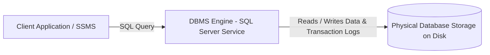
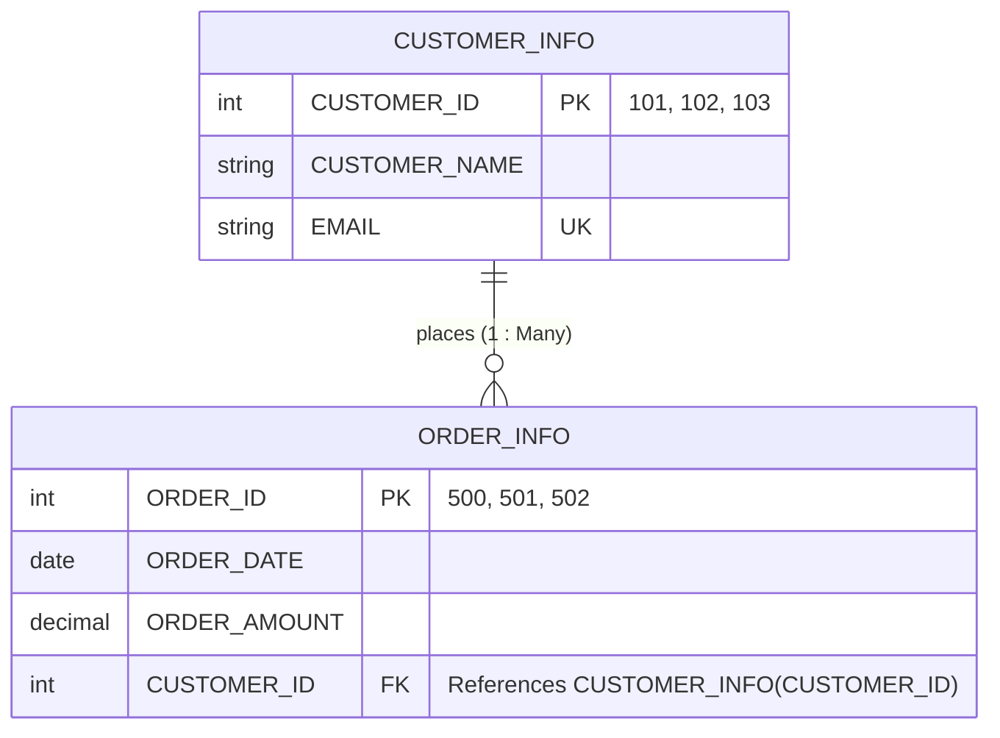
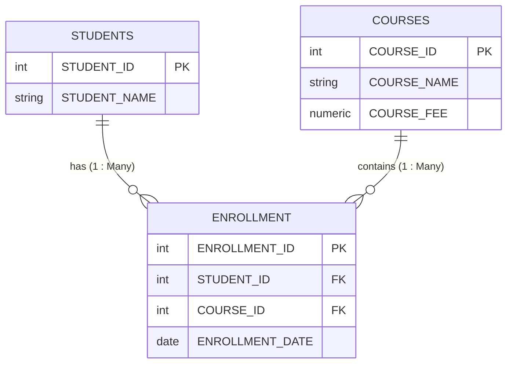
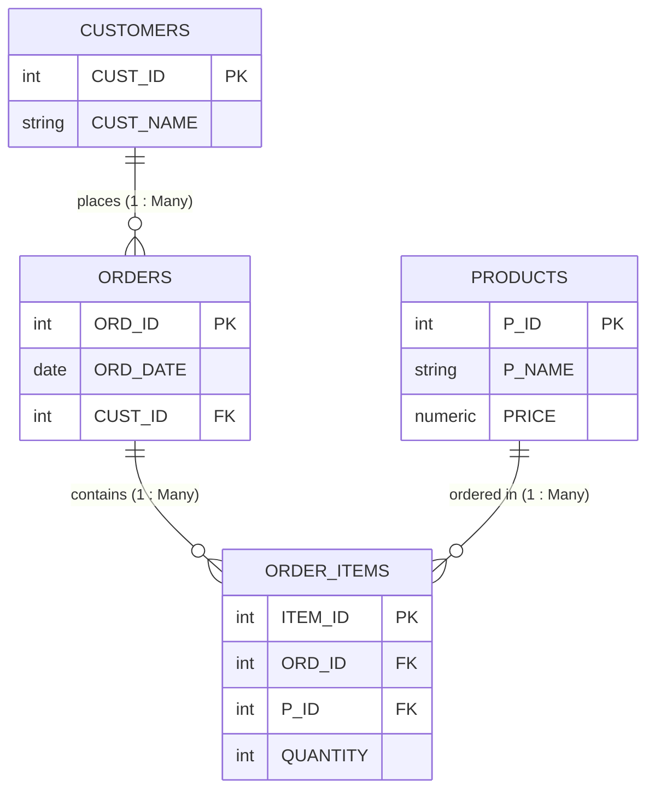
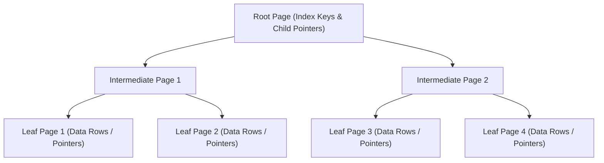

# COMPLETE MICROSOFT SQL SERVER (T-SQL) MASTER REFERENCE MANUAL
### Comprehensive Engineering Guide, Syntax Almanac, and Concept Repository

---

## Document Metadata & Scope

* **Repository / Workspace:** `d:\SQL` (`veer973/MSSQL_LEARNING`)
* **Primary SQL Dialect:** Microsoft SQL Server (Transact-SQL / T-SQL)
* **Authoritative Source Materials Consolidated:**
  1. `01_SQL_Server_Database_and_Table_CRUD.sql`
  2. `02_SQL_Server_Constraints_and_Query_Clauses.sql`
  3. `03_SQL_Server_Aggregations_Grouping_and_Subqueries.sql`
  4. `04_SQL_Server_String_Functions.sql`
  5. `05_SQL_Server_Date_and_Time_Functions.sql`
  6. `06_SQL_Server_Alter_Table_and_Constraints.sql`
  7. `07_SQL_Server_Foreign_Keys_Relationships_and_Joins_Union_And_Except.sql`
  8. `08_SQL_Server_Many_to_Many_Relationship_and_Multi_Table_Joins.sql`
  9. `09_SQL_Server_Table_Inspection_and_Views.sql`
  10. `10_SQL_Server_Window_Functions.sql`
  11. `11_SQL_Common_Table_Expression_CTE.sql`
  12. `12_SQL_Server_Stored_Procedures_and_User_Defined_Functions.sql`
  13. `13_SQL_Server_Indexes_Triggers_and_Normalization.sql`
  14. `TASK.sql` (Comprehensive 4-Tier E-Commerce Schema Implementation)
  15. `COMPLETE SQL NOTES.pdf` (389 Pages, Sections 1 through 8, Visual Slide Deck and Reference Guide)
  16. `README.md`
* **Target Audience:** Database Engineers, Backend Developers, Data Analysts, and SQL Learners seeking zero-to-hero mastery with production-grade rigor.

---

## Master Source Inventory & Concept Mapping

| Chapter | Core Concepts Covered | Primary Source Files & Reference Sections |
| :--- | :--- | :--- |
| **Ch. 1** | Relational Database Theory, DBMS vs RDBMS, SQL vs T-SQL, SSMS Architecture | `COMPLETE SQL NOTES.pdf` (Section 1, pp. 1–28) |
| **Ch. 2** | Database Lifecycle, Catalogs (`sys.databases`, `sp_databases`), Physical Separation | `01_...CRUD.sql`, `COMPLETE SQL NOTES.pdf` (Section 2, pp. 29–36) |
| **Ch. 3** | T-SQL Data Types, Precision & Scale, Storage Footprint (`INT`, `DECIMAL`, `VARCHAR`, `DATE`) | `02_...Clauses.sql`, `COMPLETE SQL NOTES.pdf` (Section 3, pp. 57–66) |
| **Ch. 4** | Integrity Constraints (`PRIMARY KEY`, `FOREIGN KEY`, `UNIQUE`, `NOT NULL`, `DEFAULT`, `CHECK`, `IDENTITY`) | `02_...Clauses.sql`, `06_...Constraints.sql`, `07_...Foreign_Keys.sql`, `PDF` (Section 3 & 7) |
| **Ch. 5** | Fundamental CRUD Operations, Metadata Inspection (`sp_help`), `TRUNCATE` vs `DELETE` vs `DROP` | `01_...CRUD.sql`, `COMPLETE SQL NOTES.pdf` (Section 2, pp. 37–56) |
| **Ch. 6** | Query Clauses & Execution Order, Filtering (`WHERE`, Relational Operators), Sorting, `LIKE`, `TOP`, `OFFSET`/`FETCH` | `01_...CRUD.sql`, `02_...Clauses.sql`, `COMPLETE SQL NOTES.pdf` (Section 4.1, pp. 82–99) |
| **Ch. 7** | Logical Predicates (`AND`/`OR`), Set Inclusion (`IN`), Ranges (`BETWEEN`), `NULL` Handling (`COALESCE`), `CASE` Logic | `02_...Clauses.sql`, `COMPLETE SQL NOTES.pdf` (Section 4.2, pp. 100–126) |
| **Ch. 8** | Aggregations (`COUNT`, `SUM`, `AVG`, `MIN`, `MAX`), Grouping, `HAVING` Filtering, `GROUP BY ROLLUP` | `03_...Aggregations...sql`, `COMPLETE SQL NOTES.pdf` (Section 5.1, pp. 127–153) |
| **Ch. 9** | Subquery Engineering (Scalar, Multi-Row `IN`, Correlated Subqueries, Inline Derived Tables) | `03_...Aggregations...sql`, `COMPLETE SQL NOTES.pdf` (Section 5, pp. 154–165) |
| **Ch. 10** | Relational Joins (`INNER`, `LEFT`, `RIGHT`, `FULL OUTER`, `CROSS`), Self Joins, `APPLY` (`CROSS`/`OUTER`), Set Operators (`UNION`, `EXCEPT`) | `07_...Foreign_Keys...sql`, `COMPLETE SQL NOTES.pdf` (Section 8, pp. 271–301) |
| **Ch. 11** | Many-to-Many Architecture, Junction/Bridge Tables, Multi-Table Joins, E-Store Enterprise Model | `08_...Many_to_Many...sql`, `TASK.sql`, `COMPLETE SQL NOTES.pdf` (pp. 302–316) |
| **Ch. 12** | Built-in Functions: String Formatting & Extraction, Temporal Date Math & Formatting | `04_...String_Functions.sql`, `05_...Date_and_Time...sql`, `PDF` (Sections 6 & 7) |
| **Ch. 13** | Schema Evolution: `ALTER TABLE`, Column Alterations, System Renaming (`sp_rename`), Constraint Management | `06_...Alter_Table...sql`, `COMPLETE SQL NOTES.pdf` (Section 7, pp. 218–236) |
| **Ch. 14** | Views & Metadata Engineering: `CREATE VIEW`, Security Abstraction, Catalog Views, Batching with `GO` | `09_...Table_Inspection_and_Views.sql`, `COMPLETE SQL NOTES.pdf` (pp. 317–321) |
| **Ch. 15** | Window (Analytic) Functions: `OVER()`, `PARTITION BY`, Ranking, Value Navigators (`LAG`/`LEAD`), Window Frames | `10_...Window_Functions.sql`, `COMPLETE SQL NOTES.pdf` (Section 5, pp. 166–187) |
| **Ch. 16** | Common Table Expressions (CTE): Single & Chained CTEs, Readability, Statement-Scoped Abstraction | `11_...CTE.sql`, `COMPLETE SQL NOTES.pdf` (Section 5, pp. 188–197) |
| **Ch. 17** | Programmability: Stored Procedures (Input/Output Params, Control Flow), User-Defined Functions (Scalar & ITVF) | `12_...Stored_Procedures...sql`, `COMPLETE SQL NOTES.pdf` (pp. 322–352) |
| **Ch. 18** | High-Performance Engineering: B-Trees, Clustered vs Non-Clustered Indexes, Profiling, 500k Bulk Synthetic Data | `13_...Indexes...sql`, `COMPLETE SQL NOTES.pdf` (pp. 362–372) |
| **Ch. 19** | DML Triggers: `AFTER UPDATE` Audit Trails, Logical Tables (`INSERTED`/`DELETED`), `INSTEAD OF` Business Rules | `13_...Indexes...sql`, `COMPLETE SQL NOTES.pdf` (pp. 353–361) |
| **Ch. 20** | Relational Database Design & Normalization Theory: Anomalies, 1NF, 2NF, 3NF, BCNF, Denormalization Trade-offs | `13_...Indexes...sql`, `COMPLETE SQL NOTES.pdf` (pp. 373–381) |
| **Ch. 21** | Database Administration: Backup (`.bak`), Database Restore, Flat-File CSV Ingestion | `COMPLETE SQL NOTES.pdf` (pp. 382–389) |
| **Ch. 22** | Enterprise SQL Interview Traps, Conceptual Distinctions, and Deep Technical Answers | All Scripts, Notes & Enterprise Best Practices |
| **Ch. 23** | Complete Glossary of Relational Database & T-SQL Terminology | Comprehensive Reference Index |

---

## Table of Contents

1. [Chapter 1: Introduction to SQL and Relational Database Architecture](#chapter-1-introduction-to-sql-and-relational-database-architecture)
2. [Chapter 2: Database Creation, Lifecycle, and Administration](#chapter-2-database-creation-lifecycle-and-administration)
3. [Chapter 3: SQL Data Types & Column Storage Specifications](#chapter-3-sql-data-types--column-storage-specifications)
4. [Chapter 4: Constraints, Keys, and Referential Integrity Rules](#chapter-4-constraints-keys-and-referential-integrity-rules)
5. [Chapter 5: Table Creation, CRUD Operations, and Inspection](#chapter-5-table-creation-crud-operations-and-inspection)
6. [Chapter 6: Query Clauses, Logical Execution Order, and Filtering](#chapter-6-query-clauses-logical-execution-order-and-filtering)
7. [Chapter 7: Logical Operators, Range Filtering, and Conditional Expressions](#chapter-7-logical-operators-range-filtering-and-conditional-expressions)
8. [Chapter 8: Aggregate Functions, Grouping, and Hierarchical Rollups](#chapter-8-aggregate-functions-grouping-and-hierarchical-rollups)
9. [Chapter 9: Subquery Engineering & Derived Tables](#chapter-9-subquery-engineering--derived-tables)
10. [Chapter 10: Relational Joins, Hierarchical Self-Joins, APPLY Operators, and Set Operators](#chapter-10-relational-joins-hierarchical-self-joins-apply-operators-and-set-operators)
11. [Chapter 11: Many-to-Many Architecture & Multi-Table Relational Modeling](#chapter-11-many-to-many-architecture--multi-table-relational-modeling)
12. [Chapter 12: Built-in Scalar Functions: String Manipulation & Temporal Mathematics](#chapter-12-built-in-scalar-functions-string-manipulation--temporal-mathematics)
13. [Chapter 13: Schema Evolution: Table Alterations, System Renaming, and Constraint Management](#chapter-13-schema-evolution-table-alterations-system-renaming-and-constraint-management)
14. [Chapter 14: Views, Virtualization, and Metadata Inspection](#chapter-14-views-virtualization-and-metadata-inspection)
15. [Chapter 15: Window (Analytic) Functions & Advanced Partitioning](#chapter-15-window-analytic-functions--advanced-partitioning)
16. [Chapter 16: Common Table Expressions (CTE)](#chapter-16-common-table-expressions-cte)
17. [Chapter 17: Database Programmability: Stored Procedures & User-Defined Functions (UDF)](#chapter-17-database-programmability-stored-procedures--user-defined-functions-udf)
18. [Chapter 18: High-Performance Engineering: Indexing, Execution Profiling, and Bulk Generation](#chapter-18-high-performance-engineering-indexing-execution-profiling-and-bulk-generation)
19. [Chapter 19: Event-Driven Automation: DML Triggers & Audit Logging](#chapter-19-event-driven-automation-dml-triggers--audit-logging)
20. [Chapter 20: Relational Database Design, Normalization Theory, and Anomalies](#chapter-20-relational-database-design-normalization-theory-and-anomalies)
21. [Chapter 21: Database Administration: Backup, Recovery, and Data Ingestion](#chapter-21-database-administration-backup-recovery-and-data-ingestion)
22. [Chapter 22: Comprehensive SQL Technical Interview Traps & Solutions](#chapter-22-comprehensive-sql-technical-interview-traps--solutions)
23. [Chapter 23: Complete Glossary of Relational Database & T-SQL Terminology](#chapter-23-complete-glossary-of-relational-database--t-sql-terminology)

---

---

## Chapter 1: Introduction to SQL and Relational Database Architecture

> **Primary Source Mapping:** `COMPLETE SQL NOTES.pdf` (Section 1: Slides 1–28)

### 1.1 What is a Database?
A **database** is an organized, persistent collection of logically structured data designed for efficient retrieval, updating, storage, and management.

#### The Problem with Flat Files (Spreadsheets / CSVs)
Before relational databases, organizations relied on flat spreadsheets (Excel, CSV) and text files. As systems scale, flat files break down due to:
1. **Data Redundancy:** The same customer address or department name is duplicated across thousands of rows.
2. **Data Inconsistency (Anomalies):** Updating an employee's department in one file leaves outdated records in another.
3. **Lack of Concurrency Control:** Two users writing to the same file simultaneously causes file locks or corrupted overwrites.
4. **Poor Security:** Flat files lack granular, role-based column- or row-level permissions.
5. **Slow Retrieval:** Finding a record in a multi-gigabyte flat file requires scanning every line sequentially ($O(N)$).

### 1.2 Database vs. DBMS
* **Database:** The physical and logical repository where raw bytes, tables, logs, and indexes reside on disk.
* **Database Management System (DBMS):** The software layer and engine that manages the database, processes queries, enforces integrity constraints, coordinates transactions (ACID properties), and controls security.



### 1.3 DBMS vs. RDBMS
* **DBMS (Traditional / Flat):** Stores data as independent files or hierarchical trees. It does not enforce relational algebra or formal integrity between entities (e.g., file systems, early XML stores).
* **RDBMS (Relational DBMS):** Built upon Dr. E.F. Codd’s Relational Model. Data is structured into two-dimensional tables (**relations**) composed of rows (**tuples**) and columns (**attributes**). Tables are joined using mathematical relations via **Keys** (Primary Key $	o$ Foreign Key).

| Characteristic | DBMS (Traditional) | RDBMS (Relational) |
| :--- | :--- | :--- |
| **Data Organization** | Hierarchical, file-based, or key-value | 2D Tables (Rows and Columns) |
| **Relationship Enforcement** | Manual in application code | Strict structural Foreign Keys & Schema Constraints |
| **Data Redundancy** | High | Low (Eliminated via Normalization) |
| **Data Integrity** | Weak / Application-dependent | High (Enforced by DBMS Engine) |
| **Distributed Transactions** | Limited | Robust ACID (Atomicity, Consistency, Isolation, Durability) |
| **Examples** | XML, File Systems, dBase | Microsoft SQL Server, PostgreSQL, Oracle, MySQL |

### 1.4 SQL vs. Microsoft SQL Server (T-SQL)
* **SQL (Structured Query Language):** The ANSI/ISO standard declarative language used to communicate with relational database engines.
* **Microsoft SQL Server (MSSQL):** An enterprise-grade RDBMS developed by Microsoft.
* **Transact-SQL (T-SQL):** Microsoft's proprietary and powerful procedural extension to SQL. T-SQL adds procedural programming elements such as:
  * Local variables (`DECLARE @name VARCHAR(50)`)
  * Control-of-flow statements (`IF ... ELSE`, `WHILE`, `RETURN`, `BEGIN ... END`)
  * System stored procedures (`sp_help`, `sp_databases`, `sp_rename`)
  * Built-in analytic and system functions (`NEWID()`, `CHECKSUM()`, `DATEADD()`, `ROW_NUMBER()`)

### 1.5 Modern Database Engine Landscape
1. **Microsoft SQL Server:** Leading enterprise database with tight Windows/Azure integration, SSMS, advanced indexing, and columnstore technology.
2. **PostgreSQL:** Open-source object-relational database known for strict standards compliance and extensible data types.
3. **Oracle Database:** Enterprise monolith dominant in massive banking and ERP workloads.
4. **MySQL:** Widespread open-source web application database (LAMP stack).
5. **MongoDB / Redis:** NoSQL document and in-memory key-value stores optimized for unstructured data or ultra-low latency caching.

### 1.6 Environment Setup & SSMS
To interact with Microsoft SQL Server, the ecosystem utilizes:
* **SQL Server Database Engine:** The background Windows service (`MSSQLSERVER` or named instance `SQLEXPRESS`) running the relational database management process.
* **SQL Server Management Studio (SSMS):** The graphical IDE used by administrators and developers to write queries, inspect schemas, generate execution plans, configure security, and manage backups.

---

## Chapter 2: Database Creation, Lifecycle, and Administration

> **Primary Source Mapping:** `01_SQL_Server_Database_and_Table_CRUD.sql` (Lines 1–20), `COMPLETE SQL NOTES.pdf` (Section 2: Slides 29–36)

### 2.1 System Databases in SQL Server
Every SQL Server instance automatically runs four vital system databases:
1. `master`: Records all system-level configuration, logins, server roles, and metadata for user databases.
2. `model`: The template database used as a blueprint whenever a new user database is created.
3. `msdb`: Used by the SQL Server Agent for scheduling alerts, recurring backup jobs, and replication.
4. `tempdb`: A temporary workspace recreated every time SQL Server restarts; stores global/local temporary tables, sort buffers, and row versioning.

### 2.2 System Catalogs & Catalog Procedures
To inspect existing databases on an instance:
```sql
-- Querying the system catalog view (Recommended ANSI standard in SQL Server)
SELECT name, database_id, create_date 
FROM sys.databases;

-- Executing the built-in system stored procedure
EXEC sp_databases;
```

### 2.3 Creating Databases
To create a dedicated storage environment:
```sql
CREATE DATABASE school_db;
CREATE DATABASE MY_COMPANY;
CREATE DATABASE INSTITUTE;
CREATE DATABASE SUPERMARKET;
CREATE DATABASE TEST_BULK;
```
*Behind the scenes:* SQL Server copies the `model` database, allocates physical data files (`.mdf` - Primary Master Data File) and transaction log files (`.ldf` - Log Data File) onto the local filesystem.

### 2.4 Switching Database Context
SQL statements execute within the context of a specific database:
```sql
-- Switch active session context
USE school_db;

-- Verify currently active database context
SELECT DB_NAME() AS ActiveDatabase;
```

### 2.5 Dropping Databases
To delete an entire database and wipe its physical disk files:
```sql
DROP DATABASE demo;
```
> [!CAUTION]
> **Active Connection Lock:** In SQL Server, `DROP DATABASE` will fail if another session (or SSMS window) has the database open. To force closure of active connections, use:
> ```sql
> ALTER DATABASE demo SET SINGLE_USER WITH ROLLBACK IMMEDIATE;
> DROP DATABASE demo;
> ```

---

## Chapter 3: SQL Data Types & Column Storage Specifications

> **Primary Source Mapping:** `02_SQL_Server_Constraints_and_Query_Clauses.sql` (Lines 4–15), `12_...Stored_Procedures...sql` (Lines 154–157, 190), `13_...Indexes...sql` (Lines 4–10), `COMPLETE SQL NOTES.pdf` (Section 3: Slides 57–66)

Columns in a relational table must be strongly typed. Selecting the optimal data type minimizes disk I/O, optimizes memory buffer cache utilization, and enforces domain integrity.

### 3.1 Integer & Numeric Types
| Data Type | Storage | Range | Typical Use Case |
| :--- | :--- | :--- | :--- |
| `TINYINT` | 1 Byte | `0` to `255` | Age, months, small status flags |
| `SMALLINT`| 2 Bytes | `-32,768` to `32,767` | Days in year, room numbers |
| `INT` | 4 Bytes | `-2,147,483,648` to `2,147,483,647` | Standard primary keys, quantities, counts |
| `BIGINT` | 8 Bytes | `~ -9.22 × 10^18` to `~ 9.22 × 10^18` | Global transaction IDs, high-volume sensor data |

### 3.2 Fixed-Point Decimals: `DECIMAL(p, s)` vs. `NUMERIC(p, s)`
In financial, retail, and payroll domains, floating-point approximations cannot be tolerated. Fixed-point numeric types are mandatory.

#### Syntax & Parameters
`DECIMAL(p, s)` or `NUMERIC(p, s)`:
* `p` (Precision): The **total number of decimal digits** stored (both to the left and to the right of the decimal point). Ranges from `1` to `38`.
* `s` (Scale): The **number of decimal digits** stored to the right of the decimal point. $0 \le s \le p$.

```sql
-- Salary definition in EMPLOYEE table
SALARY DECIMAL(10, 2)
```
*Total digits allowed:* 10  
*Digits after decimal:* 2  
*Maximum value:* `99,999,999.99` (8 digits before decimal, 2 after).

> [!IMPORTANT]
> **Technical Clarification on `DECIMAL` vs. `NUMERIC`:**
> A widespread misconception (even recorded in informal notes) claims that `NUMERIC` and `DECIMAL` handle precision or scale differently. In **Microsoft SQL Server, `NUMERIC` and `DECIMAL` are 100% functionally and physically identical synonyms**. They share identical byte storage algorithms, validation constraints, and execution plan behaviors.

### 3.3 String & Character Types: Single-Byte vs. Unicode
| Data Type | Storage Cost | Unicode? | Max Length | Recommended Usage |
| :--- | :--- | :--- | :--- | :--- |
| `CHAR(n)` | Fixed $n$ bytes | No | 8,000 chars | Fixed-length codes (e.g., ISO Country `CHAR(2)`) |
| `VARCHAR(n)` | Variable: Actual chars + 2 bytes | No | 8,000 chars (or `MAX`) | Standard ASCII strings, emails, URLs |
| `NCHAR(n)` | Fixed $2n$ bytes | Yes (UTF-16) | 4,000 chars | Fixed-length multilingual text |
| `NVARCHAR(n)`| Variable: $2 	imes 	ext{chars} + 2$ bytes | Yes (UTF-16) | 4,000 chars (or `MAX`) | Global names, multilingual characters, international text |

### 3.4 Temporal (Date & Time) Types
* `DATE`: Stores date only (`YYYY-MM-DD`). Storage: 3 bytes. Range: `0001-01-01` to `9999-12-31`.
* `TIME`: Stores time only (`hh:mm:ss[.nnnnnnn]`). Storage: 3–5 bytes.
* `DATETIME`: Legacy date and time with 3.33ms accuracy (`YYYY-MM-DD hh:mm:ss.mmm`). Storage: 8 bytes.
* `DATETIME2`: Modern high-precision temporal storage with 100ns accuracy. Storage: 6–8 bytes.

---

## Chapter 4: Constraints, Keys, and Referential Integrity Rules

> **Primary Source Mapping:** `02_...Clauses.sql` (Lines 4–15), `06_...Constraints.sql` (Lines 22–38), `07_...Foreign_Keys...sql` (Lines 1–22), `TASK.sql` (Lines 1–55), `COMPLETE SQL NOTES.pdf` (Sections 3, 7 & 8)

Constraints are declarative rules enforced by the SQL Server engine to ensure data validity, prevent corruption, and maintain referential integrity.

### 4.1 Primary Key (`PRIMARY KEY`)
A **Primary Key** uniquely identifies each row in a table.
* **Rules:**
  1. A table can have **only one** Primary Key.
  2. Columns in a Primary Key cannot contain `NULL` values.
  3. By default in SQL Server, creating a Primary Key automatically creates a unique **Clustered Index** on the column.

```sql
-- Single Column Primary Key with IDENTITY
CREATE TABLE CUSTOMERS (
    CUST_ID INT IDENTITY(1,1) PRIMARY KEY,
    CUST_NAME VARCHAR(100) NOT NULL
);
```

#### Composite Primary Keys
When an entity is uniquely identified only by the combination of two or more columns:
```sql
CREATE TABLE ProjectAssignments (
    EmployeeID INT NOT NULL,
    ProjectID INT NOT NULL,
    AssignmentDate DATE NOT NULL,
    CONSTRAINT PK_ProjectAssignments PRIMARY KEY (EmployeeID, ProjectID)
);
```

### 4.2 Auto-Incrementing Identity (`IDENTITY`)
The `IDENTITY(seed, increment)` property generates auto-incrementing surrogate numeric keys:
* `seed`: Value assigned to the very first row inserted (e.g., `101`).
* `increment`: Value added to the previous identity value (e.g., `1`).

```sql
EMP_ID INT IDENTITY(101, 1) PRIMARY KEY
```
*Working:* When inserting records, the user **omits** the `EMP_ID` column; SQL Server computes and inserts `101`, `102`, `103` automatically.

### 4.3 Unique Constraint (`UNIQUE`)
Enforces that all values in a column or set of columns are distinct across the table.
* **Difference from Primary Key:**
  1. A table can have **multiple** `UNIQUE` constraints.
  2. In SQL Server, a standard `UNIQUE` constraint permits **at most one `NULL` value** (unlike ANSI SQL, which treats each NULL as distinct).
  3. By default, `UNIQUE` creates a **Non-Clustered Index**.

```sql
EMAIL VARCHAR(100) NOT NULL UNIQUE
```

### 4.4 Mandatory Presence (`NOT NULL`)
Prevents missing, undefined, or empty values from entering a column.
```sql
FNAME VARCHAR(50) NOT NULL,
LNAME VARCHAR(50) NOT NULL
```

### 4.5 Default Constraint (`DEFAULT`)
Supplies an automated fallback value when an `INSERT` statement does not specify a value.
```sql
SALARY DECIMAL(10,2) DEFAULT 30000.00,
HIRE_DATE DATE NOT NULL DEFAULT CONVERT(DATE, GETDATE())
```

### 4.6 Check Constraint (`CHECK`)
Validates that values meet a boolean predicate before an insert or update succeeds.
```sql
-- Inline check constraint
SALARY DECIMAL(10, 2) CHECK (SALARY > 0)

-- Out-of-line named table constraint
ALTER TABLE EMPLOYEE 
ADD CONSTRAINT CHECK_EMPLOYEE_POSITIVE_SALARY CHECK (SALARY > 0);
```

### 4.7 Foreign Key (`FOREIGN KEY`) & Referential Integrity
A **Foreign Key** is a column (or combination of columns) that establishes a link between data in two tables. It ensures that data in the child table references an existing Primary Key in the parent table.



#### DDL Implementation with `ON DELETE CASCADE`
```sql
CREATE TABLE ORDER_INFO (
    ORDER_ID INT IDENTITY(500,1) PRIMARY KEY,
    ORDER_DATE DATE NOT NULL DEFAULT CONVERT(DATE, GETDATE()),
    ORDER_AMOUNT DECIMAL(10,2),
    CUSTOMER_ID INT,
    CONSTRAINT ORDER_INFO_FK FOREIGN KEY (CUSTOMER_ID) 
        REFERENCES CUSTOMER_INFO(CUSTOMER_ID) 
        ON DELETE CASCADE
);
```

#### Cascading Referential Actions
* `ON DELETE NO ACTION` (Default): If a user attempts to delete a customer who has orders, SQL Server throws error 547 and rolls back the operation.
* `ON DELETE CASCADE`: Deleting customer `101` will automatically cause SQL Server to delete all matching rows in `ORDER_INFO`.
* `ON DELETE SET NULL`: Sets the foreign key column to `NULL` in all child rows when the parent is deleted.

---

## Chapter 5: Table Creation, CRUD Operations, and Inspection

> **Primary Source Mapping:** `01_SQL_Server_Database_and_Table_CRUD.sql` (Lines 20–106), `COMPLETE SQL NOTES.pdf` (Section 2: Slides 37–56)

### 5.1 Defining Tables & Schema
A table is the foundational relational container where records are stored across structured attributes.
```sql
USE school_db;

CREATE TABLE students (
    student_id INT,
    name VARCHAR(100),
    age INT,
    grade INT
);
```

### 5.2 Table Inspection with System Stored Procedures
To inspect columns, datatypes, identity seeds, primary keys, and constraints:
```sql
-- Comprehensive metadata inspection
EXEC sp_help 'students';

-- Listing all user tables in the active database
SELECT NAME 
FROM SYS.TABLES;
```

### 5.3 Inserting Records (`INSERT INTO`)
Records can be added using explicit column lists or positional values.
```sql
-- Approach A: Explicit column mapping (Best Practice for production stability)
INSERT INTO students (student_id, name, age, grade)
VALUES (101, 'raju', 10, 5);

-- Approach B: Multi-row batch insertion (Higher performance, reduces transaction log overhead)
INSERT INTO students VALUES (102, 'kaju', 10, 4);
INSERT INTO students VALUES (103, 'sham', 10, 5);
INSERT INTO students VALUES (104, 'baburao', 10, 5);
```

### 5.4 Reading Records (`SELECT`)
```sql
-- Retrieve all columns and all rows
SELECT * FROM students;

-- Projected retrieval (Transfers only required columns across the network)
SELECT name, age FROM students;

-- Filtered retrieval for a specific entity
SELECT * FROM students WHERE name = 'sham';
SELECT age FROM students WHERE name = 'raju';
```

### 5.5 Modifying Records (`UPDATE`)
The `UPDATE` statement alters column values in existing rows:
```sql
UPDATE students
SET grade = 9
WHERE student_id = 102;
```
> [!CAUTION]
> **Omission of `WHERE` Clause:**
> If `WHERE` is omitted, `UPDATE students SET grade = 9;` will overwrite the grade of **every single student in the table**. Always verify criteria or execute inside a transaction block (`BEGIN TRAN ... ROLLBACK TRAN`).

### 5.6 Deleting Records (`DELETE`)
Removes specific rows matching a predicate:
```sql
DELETE FROM students
WHERE student_id = 102;
```

### 5.7 Table Cleanup: `TRUNCATE` vs. `DELETE` vs. `DROP`
```sql
TRUNCATE TABLE students;
```
A deep engineering comparison of data removal commands:

| Feature | `DELETE FROM Table` | `TRUNCATE TABLE` | `DROP TABLE` |
| :--- | :--- | :--- | :--- |
| **Command Category** | DML (Data Manipulation Language) | DDL (Data Definition Language) | DDL (Data Definition Language) |
| **Row Filtering** | Supported (`WHERE condition`) | Not supported (Removes all rows) | Not applicable |
| **Transaction Logging** | Logs every deleted row individually | Deallocates data pages (Minimal logging) | Logs page deallocations and catalog drop |
| **Speed & Resource Usage** | Slow on large tables; high lock escalation | Extremely fast; minimal transaction log usage | Near instantaneous |
| **Identity Reset** | Preserves identity counter sequence | Resets `IDENTITY` counter to seed value | Completely destroys identity definition |
| **Triggers Fired** | Fires `DELETE` triggers | Does **NOT** fire DML delete triggers | Fires DDL triggers only (if configured) |
| **Table Structure** | Preserved (Empty table remains) | Preserved (Empty table remains) | Completely destroyed from system catalog |
| **Foreign Key Constraints** | Allowed if no referencing child rows | Disallowed if referenced by any FK | Allowed only after foreign keys are dropped |

---

## Chapter 6: Query Clauses, Logical Execution Order, and Filtering

> **Primary Source Mapping:** `01_SQL_Server_Database_and_Table_CRUD.sql` (Lines 76–106), `02_SQL_Server_Constraints_and_Query_Clauses.sql` (Lines 36–66, 106–147), `COMPLETE SQL NOTES.pdf` (Section 4.1: Slides 82–99)

### 6.1 The Cardinal Rule: Lexical Writing Order vs. Logical Execution Order
One of the most profound concepts in database engineering is that SQL queries are **not executed in the order they are written**.

```
Lexical (Writing) Order:
  SELECT → FROM → WHERE → GROUP BY → HAVING → ORDER BY → OFFSET / FETCH

Logical Query Processing Order:
  1. FROM        (Identifies and joins the source tables)
  2. WHERE       (Filters rows prior to grouping)
  3. GROUP BY    (Aggregates rows into buckets)
  4. HAVING      (Filters aggregated groups)
  5. SELECT      (Computes expressions, window functions, and column projections)
  6. DISTINCT    (Eliminates duplicate projection rows)
  7. ORDER BY    (Sorts the final result set)
  8. OFFSET/FETCH(Paginates and skips rows)
```
*Why this matters:* You cannot use a column alias defined in the `SELECT` clause inside the `WHERE` clause because `WHERE` executes before `SELECT` has evaluated the alias!

### 6.2 The `WHERE` Clause & Relational Operators
Evaluates boolean predicates row-by-row:
```sql
SELECT * FROM EMPLOYEE WHERE EMP_ID = 110;
SELECT * FROM EMPLOYEE WHERE DEPARTMENT = 'Sales';
SELECT * FROM EMPLOYEE WHERE DEPARTMENT != 'Sales';  -- Or <>
SELECT * FROM EMPLOYEE WHERE SALARY > 100000;
SELECT * FROM EMPLOYEE WHERE HIRE_DATE > '2020-12-31';
```

### 6.3 Eliminating Duplicates (`DISTINCT`)
Collapses identical rows in the projected output:
```sql
-- Returns 15 rows with repeated departments
SELECT DEPARTMENT FROM EMPLOYEE;

-- Returns distinct unique department values
SELECT DISTINCT DEPARTMENT FROM EMPLOYEE;
```

### 6.4 Sorting Results (`ORDER BY`)
Sorts rows in ascending (`ASC`, default) or descending (`DESC`) order:
```sql
-- Ascending salary sort
SELECT * FROM EMPLOYEE ORDER BY SALARY;

-- Descending hire date sort
SELECT * FROM EMPLOYEE ORDER BY HIRE_DATE DESC;

-- Multi-column hierarchical sort: Department alphabetically, then first name
SELECT DEPARTMENT, FNAME 
FROM EMPLOYEE 
ORDER BY DEPARTMENT ASC, FNAME ASC;
```

### 6.5 String Pattern Matching (`LIKE`)
Pattern matching via regular wildcard operators:
```sql
-- Starts with 'A'
SELECT * FROM EMPLOYEE WHERE FNAME LIKE 'A%';

-- Contains 'GUPTA' anywhere in the string
SELECT * FROM EMPLOYEE WHERE EMAIL LIKE '%GUPTA%';

-- Character Set Matching: Starts with A, V, or B
SELECT * FROM EMPLOYEE WHERE FNAME LIKE '[AVB]%';

-- Negated Character Set: Does NOT start with A
SELECT * FROM EMPLOYEE WHERE FNAME LIKE '[^A]%';

-- Positional Match: Exactly one character followed by 'I'
SELECT * FROM EMPLOYEE WHERE FNAME LIKE '_I%';

-- Starts explicitly with 'DI'
SELECT * FROM EMPLOYEE WHERE FNAME LIKE '[D][I]%';

-- Exactly 4 characters long (four underscores)
SELECT * FROM EMPLOYEE WHERE FNAME LIKE '____';
```

### 6.6 Restricting Rows (`TOP`)
Restricts the returned result count (often paired with `ORDER BY`):
```sql
-- Retrieve the top 3 highest paid employees
SELECT TOP 3 * 
FROM EMPLOYEE 
ORDER BY SALARY DESC;

-- Retrieve the 5 most recently hired employees
SELECT TOP 5 * 
FROM EMPLOYEE 
ORDER BY HIRE_DATE DESC;
```

### 6.7 Modern Result Pagination (`OFFSET` & `FETCH NEXT`)
The ANSI SQL standard mechanism for paginating through large datasets:
```sql
-- Skip the first 5 records and fetch the next 5 (Page 2)
SELECT * 
FROM EMPLOYEE 
ORDER BY EMP_ID 
OFFSET 5 ROWS 
FETCH NEXT 5 ROWS ONLY;
```
*Rules:* `OFFSET ... FETCH` **strictly requires** an `ORDER BY` clause; otherwise, SQL Server throws syntax error 10744 because skipping rows is meaningless without deterministic ordering.

---

## Chapter 7: Logical Operators, Range Filtering, and Conditional Expressions

> **Primary Source Mapping:** `02_SQL_Server_Constraints_and_Query_Clauses.sql` (Lines 67–105), `COMPLETE SQL NOTES.pdf` (Section 4.2: Slides 100–126)

### 7.1 Compound Logic: `AND` vs. `OR`
```sql
-- Both predicates must evaluate to TRUE
SELECT * FROM EMPLOYEE WHERE SALARY > 80000 AND DEPARTMENT = 'Sales';

-- At least one predicate must evaluate to TRUE
SELECT * FROM EMPLOYEE WHERE SALARY > 80000 OR DEPARTMENT = 'Sales';
```

### 7.2 Set Membership (`IN` / `NOT IN`)
Simplifies chained `OR` comparisons:
```sql
-- Concise equivalent of DEPARTMENT = 'Tech' OR DEPARTMENT = 'Sales' OR ...
SELECT * FROM EMPLOYEE 
WHERE DEPARTMENT IN ('Tech', 'Sales', 'Management');

-- Negative set membership
SELECT * FROM EMPLOYEE 
WHERE DEPARTMENT NOT IN ('Tech', 'Sales', 'Management');
```

### 7.3 Boundary Evaluation (`BETWEEN`)
Tests whether a value falls within an inclusive boundary $[a, b]$:
```sql
-- Evaluates: SALARY >= 75000 AND SALARY <= 100000
SELECT * FROM EMPLOYEE 
WHERE SALARY BETWEEN 75000 AND 100000;
```

### 7.4 Handling Missing Data: The `NULL` Concept
In relational theory, `NULL` does **not** represent zero or an empty string `""`; it represents **unknown, unassigned, or missing information**.

#### Three-Valued Logic (3VL)
Because `NULL` is unknown, mathematical equality comparisons (`SALARY = NULL` or `SALARY != NULL`) evaluate to **`UNKNOWN`** rather than `TRUE` or `FALSE`. In SQL Server, rows where `WHERE` evaluates to `UNKNOWN` are filtered out.
```sql
-- Correct syntax for testing NULL
SELECT * FROM EMPLOYEE WHERE DEPARTMENT IS NULL;
SELECT * FROM EMPLOYEE WHERE DEPARTMENT IS NOT NULL;
```

### 7.5 Replacing NULL Values (`COALESCE`)
`COALESCE(val1, val2, ..., valN)` returns the **first non-NULL expression** in its parameter list from left to right:
```sql
SELECT FNAME, COALESCE(DEPARTMENT, 'Unassigned') AS DEPARTMENT 
FROM EMPLOYEE;
```

### 7.6 Conditional Query Logic (`CASE` Expressions)
SQL's inline conditional expression allows programmatic branching within queries.

#### Categorizing Rows into Salary Bands
```sql
SELECT FNAME, LNAME, SALARY,
    CASE
        WHEN SALARY > 100000 THEN 'HIGH EARNER'
        WHEN SALARY BETWEEN 80000 AND 99999 THEN 'MEDIUM EARNER'
        ELSE 'STANDARD EARNER'
    END AS SALARY_BAND
FROM EMPLOYEE;
```

#### Calculating Departmental Bonuses Dynamically
```sql
SELECT FNAME, LNAME, SALARY, DEPARTMENT,
    CASE
        WHEN DEPARTMENT = 'Tech' THEN 0.12 * SALARY
        WHEN DEPARTMENT IN ('Sales', 'Marketing') THEN 0.10 * SALARY
        ELSE 0.05 * SALARY
    END AS BONUS_AMOUNT
FROM EMPLOYEE;
```

---

## Chapter 8: Aggregate Functions, Grouping, and Hierarchical Rollups

> **Primary Source Mapping:** `03_SQL_Server_Aggregations_Grouping_and_Subqueries.sql` (Lines 1–40), `COMPLETE SQL NOTES.pdf` (Section 5.1: Slides 127–153)

Aggregate functions perform a calculation on a set of values and return a single summary scalar.

### 8.1 The Core Aggregate Functions
```sql
-- Total number of employees (non-null EMP_ID)
SELECT COUNT(EMP_ID) AS TotalEmployees FROM EMPLOYEE;

-- Total payroll cost across company
SELECT SUM(SALARY) AS TotalPayroll FROM EMPLOYEE;

-- Average salary
SELECT AVG(SALARY) AS AverageSalary FROM EMPLOYEE;

-- Lowest and highest salaries
SELECT MIN(SALARY) AS MinSalary, MAX(SALARY) AS MaxSalary FROM EMPLOYEE;
```

### 8.2 Partitioning Rows with `GROUP BY`
`GROUP BY` collapses raw rows sharing common values into summary groups.
```sql
-- Employee count by department
SELECT DEPARTMENT, COUNT(EMP_ID) AS TotalEmps
FROM EMPLOYEE 
GROUP BY DEPARTMENT;

-- Average salary per department
SELECT DEPARTMENT, AVG(SALARY) AS AvgSalary
FROM EMPLOYEE 
GROUP BY DEPARTMENT;
```

> [!IMPORTANT]
> **The `GROUP BY` Select List Rule:**
> Every column in the `SELECT` list must either be:
> 1. Included in the `GROUP BY` clause, or
> 2. Enclosed within an aggregate function (`COUNT`, `SUM`, `AVG`, `MIN`, `MAX`).
> 
> *Invalid Query:*
> ```sql
> SELECT DEPARTMENT, FNAME, COUNT(EMP_ID) FROM EMPLOYEE GROUP BY DEPARTMENT;
> ```
> *Why it fails:* `DEPARTMENT` is grouped, but `FNAME` is neither grouped nor aggregated. SQL Server cannot decide which employee's name to return when multiple employees belong to the same department.

### 8.3 Multi-Level Column Grouping
Groups data across multiple hierarchical dimensions:
```sql
SELECT DEPARTMENT, CITY, COUNT(EMP_ID) AS EmployeeCount
FROM EMPLOYEE 
GROUP BY DEPARTMENT, CITY 
ORDER BY DEPARTMENT, CITY;
```

### 8.4 Filtering Aggregated Groups (`HAVING` vs. `WHERE`)
* **`WHERE`:** Filters individual base records **before** grouping and aggregations occur.
* **`HAVING`:** Filters grouped summary records **after** `GROUP BY` and aggregations evaluate.

```sql
-- Departments with more than 2 employees
SELECT DEPARTMENT, COUNT(EMP_ID) AS EMPLOYEE_COUNT
FROM EMPLOYEE
GROUP BY DEPARTMENT
HAVING COUNT(EMP_ID) > 2;

-- Departments whose cumulative payroll exceeds 200,000
SELECT DEPARTMENT, SUM(SALARY) AS TotalPayroll
FROM EMPLOYEE
GROUP BY DEPARTMENT
HAVING SUM(SALARY) > 200000;
```

### 8.5 Hierarchical Aggregation with `GROUP BY ROLLUP`
`ROLLUP` generates hierarchical subtotals and an overall grand total in a single query pass.
```sql
SELECT 
    COALESCE(DEPARTMENT, 'GRAND TOTAL') AS DEPARTMENT, 
    COALESCE(CITY, 'SUBTOTAL') AS CITY, 
    COUNT(EMP_ID) AS EMPLOYEE_COUNT
FROM EMPLOYEE 
GROUP BY ROLLUP(DEPARTMENT, CITY);
```
*How it computes:*
1. Calculates count for each `(DEPARTMENT, CITY)` pair.
2. Rolls up to calculate subtotal for each `DEPARTMENT` across all cities (`CITY` becomes `NULL`).
3. Rolls up to calculate the `GRAND TOTAL` across all departments (`DEPARTMENT` & `CITY` become `NULL`).

---

## Chapter 9: Subquery Engineering & Derived Tables

> **Primary Source Mapping:** `03_SQL_Server_Aggregations_Grouping_and_Subqueries.sql` (Lines 40–78), `COMPLETE SQL NOTES.pdf` (Section 5: Slides 154–165)

A **subquery** (nested query or inner query) is a `SELECT` statement embedded inside another SQL statement.

### 9.1 Single-Row (Scalar) Subqueries
Returns exactly one value (one row, one column) and pairs with standard comparison operators (`=`, `>`, `<`, `>=`, `<=`, `!=`):
```sql
-- Retrieve all employees whose salary exceeds the company-wide average
SELECT * 
FROM EMPLOYEE 
WHERE SALARY > (
    SELECT AVG(SALARY) 
    FROM EMPLOYEE
);
```
*Execution flow:*
1. The inner query evaluates first: `SELECT AVG(SALARY) FROM EMPLOYEE` $\to$ yields `97,400.00`.
2. The outer query evaluates: `SELECT * FROM EMPLOYEE WHERE SALARY > 97400.00`.

### 9.2 Multi-Row Subqueries
Returns a list of values (single column, multiple rows) and pairs with set operators such as `IN` or `NOT IN`:
```sql
-- Retrieve employees working in departments that have at least one employee in Mumbai
SELECT * 
FROM EMPLOYEE 
WHERE DEPARTMENT IN (
    SELECT DISTINCT DEPARTMENT 
    FROM EMPLOYEE 
    WHERE CITY = 'Mumbai'
);
```

### 9.3 Correlated Subqueries
A **correlated subquery** depends on values from the current row of the outer query. It cannot be executed independently because SQL Server evaluates the inner subquery conceptually once for **every candidate row** processed by the outer query.

```sql
-- Find the highest-paid employee(s) within each department
SELECT * 
FROM EMPLOYEE E1 
WHERE SALARY = (
    SELECT MAX(SALARY) 
    FROM EMPLOYEE E2 
    WHERE E1.DEPARTMENT = E2.DEPARTMENT
);
```
*How it works:*
For each employee row evaluated by `E1`, SQL Server passes `E1.DEPARTMENT` to `E2`, computes the department's maximum salary, and checks if `E1.SALARY` matches that maximum.

### 9.4 Inline Views (Derived Tables)
A derived table is a subquery in the `FROM` clause that produces a temporary, named result set during query execution:
```sql
-- Retrieve departments whose calculated average salary exceeds 90,000
SELECT DEPARTMENT, AVG_SALARY 
FROM (
    SELECT DEPARTMENT, AVG(SALARY) AS AVG_SALARY
    FROM EMPLOYEE 
    GROUP BY DEPARTMENT
) AS DEPT_AVG 
WHERE AVG_SALARY > 90000;
```
*Rules:* In SQL Server, every derived table in the `FROM` clause **must be given a table alias** (`AS DEPT_AVG`); otherwise, error 1038 is thrown.

---

## Chapter 10: Relational Joins, Hierarchical Self-Joins, APPLY Operators, and Set Operators

> **Primary Source Mapping:** `07_SQL_Server_Foreign_Keys_Relationships_and_Joins_Union_And_Except.sql` (Lines 1–161), `COMPLETE SQL NOTES.pdf` (Section 8: Slides 271–301)

Joins combine columns from one or more tables based on logical relationships between related columns.

### 10.1 Schema Context: `SUPERMARKET`
```sql
CREATE TABLE CUSTOMER_INFO (
    CUSTOMER_ID INT IDENTITY(101,1) PRIMARY KEY,
    CUSTOMER_NAME VARCHAR(100) NOT NULL,
    EMAIL VARCHAR(100) UNIQUE
);

CREATE TABLE ORDER_INFO (
    ORDER_ID INT IDENTITY(500,1) PRIMARY KEY,
    ORDER_DATE DATE NOT NULL DEFAULT CONVERT(DATE, GETDATE()),
    ORDER_AMOUNT DECIMAL(10,2),
    CUSTOMER_ID INT,
    CONSTRAINT ORDER_INFO_FK FOREIGN KEY (CUSTOMER_ID) 
        REFERENCES CUSTOMER_INFO(CUSTOMER_ID) 
        ON DELETE CASCADE
);

-- Insert Sample Data
INSERT INTO CUSTOMER_INFO VALUES 
('Paul', 'paul@example.com'),   -- ID 101
('Raju', 'raju@example.com'),   -- ID 102
('Sham', 'sham@example.com'),   -- ID 103
('Baburao', 'baburao@example.com'); -- ID 104 (No orders placed)

INSERT INTO ORDER_INFO (ORDER_AMOUNT, CUSTOMER_ID) VALUES 
(1500.00, 101), 
(800.00, 102),  
(2200.00, 101),
(500.00, 103),  
(1200.00, 102);  

INSERT INTO ORDER_INFO (ORDER_AMOUNT) VALUES (3000.00); -- ID 505 (Orphan order: CUSTOMER_ID is NULL)
```

### 10.2 Cross Join (`CROSS JOIN`)
Produces the Cartesian product of two tables. Every row from table 1 is paired with every row from table 2.
```sql
SELECT * FROM CUSTOMER_INFO CROSS JOIN ORDER_INFO;
```
*Result Cardinality:* If `CUSTOMER_INFO` has 4 rows and `ORDER_INFO` has 6 rows, the result contains $4 \times 6 = 24$ rows. No `ON` condition is permitted.

### 10.3 Inner Join (`INNER JOIN`)
Returns only rows where the join condition matches in **both** tables.
```sql
SELECT 
    CUSTOMER_INFO.CUSTOMER_NAME, 
    COUNT(ORDER_INFO.ORDER_ID) AS NUMBER_OF_ORDERS
FROM CUSTOMER_INFO 
INNER JOIN ORDER_INFO 
    ON CUSTOMER_INFO.CUSTOMER_ID = ORDER_INFO.CUSTOMER_ID 
GROUP BY CUSTOMER_INFO.CUSTOMER_NAME;
```
*Exclusions:* Baburao (no orders) and the orphan order (no customer) are completely excluded.

### 10.4 Left Outer Join (`LEFT JOIN`)
Returns **all** rows from the left table (`CUSTOMER_INFO`), plus matching rows from the right table (`ORDER_INFO`). If no match exists, right-table columns populate with `NULL`.
```sql
SELECT C.CUSTOMER_ID, C.CUSTOMER_NAME, O.ORDER_ID, O.ORDER_AMOUNT
FROM CUSTOMER_INFO C 
LEFT JOIN ORDER_INFO O 
    ON C.CUSTOMER_ID = O.CUSTOMER_ID;
```
*Result:* Baburao appears with `ORDER_ID = NULL` and `ORDER_AMOUNT = NULL`.

### 10.5 Right Outer Join (`RIGHT JOIN`)
Returns **all** rows from the right table (`ORDER_INFO`), plus matching rows from the left table (`CUSTOMER_INFO`).
```sql
SELECT C.CUSTOMER_ID, C.CUSTOMER_NAME, O.ORDER_ID, O.ORDER_AMOUNT
FROM CUSTOMER_INFO C 
RIGHT JOIN ORDER_INFO O 
    ON C.CUSTOMER_ID = O.CUSTOMER_ID;
```
*Result:* Order `505` ($3,000.00) appears with `CUSTOMER_NAME = NULL`.

### 10.6 Full Outer Join (`FULL OUTER JOIN`)
Combines the behavior of `LEFT JOIN` and `RIGHT JOIN`. Returns all matching rows, all unmatched left rows (with right-side NULLs), and all unmatched right rows (with left-side NULLs).
```sql
SELECT C.CUSTOMER_ID, C.CUSTOMER_NAME, O.ORDER_ID, O.ORDER_AMOUNT
FROM CUSTOMER_INFO C 
FULL OUTER JOIN ORDER_INFO O 
    ON C.CUSTOMER_ID = O.CUSTOMER_ID;
```

### 10.7 The `APPLY` Operator: `CROSS APPLY` vs. `OUTER APPLY`
In T-SQL, the `APPLY` operator evaluates a right-side table expression or correlated table-valued function **for each row** of the left-side table. It allows queries that are impossible with standard ANSI joins (e.g., retrieving the "Top 1 most recent order" per customer).

#### `OUTER APPLY` (Analogous to `LEFT JOIN`)
Preserves the left-side row even if the right-side subquery returns 0 rows:
```sql
SELECT C.CUSTOMER_ID, C.CUSTOMER_NAME, O.ORDER_ID, O.ORDER_DATE, O.ORDER_AMOUNT 
FROM CUSTOMER_INFO AS C 
OUTER APPLY (
    SELECT TOP 1 * 
    FROM ORDER_INFO AS O 
    WHERE O.CUSTOMER_ID = C.CUSTOMER_ID 
    ORDER BY O.ORDER_DATE DESC
) AS O;
```
*Result:* All customers appear, including Baburao (with NULL order columns).

#### `CROSS APPLY` (Analogous to `INNER JOIN`)
Eliminates left-side rows if the right-side expression returns 0 rows:
```sql
SELECT C.CUSTOMER_ID, C.CUSTOMER_NAME, O.ORDER_ID, O.ORDER_DATE, O.ORDER_AMOUNT 
FROM CUSTOMER_INFO AS C 
CROSS APPLY (
    SELECT TOP 1 * 
    FROM ORDER_INFO AS O 
    WHERE O.CUSTOMER_ID = C.CUSTOMER_ID 
    ORDER BY O.ORDER_DATE DESC
) AS O;
```
*Result:* Returns only customers who have at least one order.

### 10.8 Hierarchical Self Joins (`SELF JOIN`)
A **Self Join** joins a table to itself. It models recursive, unary relationships such as organizational hierarchies (Employee $\to$ Manager).

```sql
CREATE TABLE SUPERMARKET_HIERARCHY (
    EMPLOYEE_ID INT PRIMARY KEY,
    NAME VARCHAR(100),
    MANAGER_ID INT
);

INSERT INTO SUPERMARKET_HIERARCHY (EMPLOYEE_ID, NAME, MANAGER_ID) VALUES
(1, 'Sonia Verma', NULL),   -- The CEO (Has no manager)
(2, 'Rohan Gupta', 1),      -- Reports to Sonia
(3, 'Amit Sharma', 2),      -- Reports to Rohan
(4, 'Priya Singh', 1),      -- Reports to Sonia
(5, 'Kabir Shah', 2);       -- Reports to Rohan

-- Self Join Query
SELECT 
    E.NAME AS EmployeeName, 
    COALESCE(M.NAME, 'TOP EXECUTIVE / NO MANAGER') AS ManagerName 
FROM SUPERMARKET_HIERARCHY AS E 
LEFT JOIN SUPERMARKET_HIERARCHY AS M 
    ON E.MANAGER_ID = M.EMPLOYEE_ID;
```
*Output Mapping:*
* Sonia Verma $\to$ `TOP EXECUTIVE / NO MANAGER`
* Rohan Gupta $\to$ Sonia Verma
* Amit Sharma $\to$ Rohan Gupta
* Priya Singh $\to$ Sonia Verma
* Kabir Shah $\to$ Rohan Gupta

### 10.9 Set Operators: `UNION` vs. `EXCEPT`
Set operators combine or compare the complete result sets of two independent queries.
* **Prerequisites:**
  1. Both queries must select the **same number of columns**.
  2. Data types of corresponding columns must be compatible.

```sql
-- UNION: Combines datasets and removes duplicate rows
SELECT EMP_ID, FNAME, DEPARTMENT FROM EMPLOYEE WHERE CITY = 'Mumbai'
UNION 
SELECT EMP_ID, FNAME, DEPARTMENT FROM EMPLOYEE WHERE CITY = 'Delhi';

-- UNION ALL: Concatenates datasets without deduplication (Much faster!)
SELECT EMP_ID, FNAME, DEPARTMENT FROM EMPLOYEE WHERE CITY = 'Mumbai'
UNION ALL 
SELECT EMP_ID, FNAME, DEPARTMENT FROM EMPLOYEE WHERE CITY = 'Delhi';

-- EXCEPT: Returns rows that exist in the first query but NOT in the second
SELECT EMP_ID, FNAME, DEPARTMENT FROM EMPLOYEE WHERE CITY = 'Mumbai'
EXCEPT 
SELECT EMP_ID, FNAME, DEPARTMENT FROM EMPLOYEE WHERE SALARY > 100000;
```

---

## Chapter 11: Many-to-Many Architecture & Multi-Table Relational Modeling

> **Primary Source Mapping:** `08_SQL_Server_Many_to_Many_Relationship_and_Multi_Table_Joins.sql` (Lines 1–88), `TASK.sql` (Lines 1–68), `COMPLETE SQL NOTES.pdf` (Slides 302–316)

### 11.1 The Many-to-Many Dilemma
In relational modeling, a **Many-to-Many ($M:N$) relationship** occurs when:
* One student enrolls in multiple courses.
* One course contains multiple students.

You **cannot** store comma-separated course IDs inside the `STUDENTS` table (`"Math, Physics"`) because it violates First Normal Form (1NF), prevents indexing, and makes foreign key integrity impossible.

### 11.2 Junction / Bridge Table Architecture
To implement an $M:N$ relationship, database engineers decompose it into **two One-to-Many ($1:M$) relationships** linked through an intermediate **Junction Table** (also known as a bridge, associative, or cross-reference table).



```sql
CREATE DATABASE INSTITUTE;
USE INSTITUTE;

CREATE TABLE COURSES (
    COURSE_ID INT IDENTITY(1,1) PRIMARY KEY,
    COURSE_NAME VARCHAR(100) NOT NULL,
    COURSE_FEE NUMERIC(10, 2) NOT NULL
);

CREATE TABLE STUDENTS (
    STUDENT_ID INT IDENTITY(1,1) PRIMARY KEY,
    STUDENT_NAME VARCHAR(100) NOT NULL
);

CREATE TABLE ENROLLMENT (
    ENROLLMENT_ID INT IDENTITY(1,1) PRIMARY KEY,
    STUDENT_ID INT NOT NULL,
    COURSE_ID INT NOT NULL,
    ENROLLMENT_DATE DATE NOT NULL,
    FOREIGN KEY (STUDENT_ID) REFERENCES STUDENTS(STUDENT_ID),
    FOREIGN KEY (COURSE_ID) REFERENCES COURSES(COURSE_ID)
);

-- Seed Data
INSERT INTO COURSES (COURSE_NAME, COURSE_FEE) VALUES
('Mathematics', 500.00),
('Physics', 600.00),
('Chemistry', 700.00);

INSERT INTO STUDENTS (STUDENT_NAME) VALUES
('Raju'), ('Sham'), ('Baburao'), ('Alex');

INSERT INTO ENROLLMENT (STUDENT_ID, COURSE_ID, ENROLLMENT_DATE) VALUES
(1, 1, '2025-01-01'), -- Raju enrolled in Mathematics
(1, 2, '2025-01-02'), -- Raju enrolled in Physics
(2, 1, '2025-02-01'), -- Sham enrolled in Mathematics
(2, 3, '2025-02-15'), -- Sham enrolled in Chemistry
(3, 3, '2025-03-25'); -- Baburao enrolled in Chemistry
```

> [!NOTE]
> **Data Correction Note:** In the original comment of `08_...sql`, row `(3, 3, '2025-03-25')` was noted as "Alex enrolled in Chemistry". However, because identity generation begins at 1, `STUDENT_ID = 3` belongs to **Baburao**, while Alex is `STUDENT_ID = 4`.

### 11.3 Multi-Table Inner Join & Aggregation
To aggregate revenue and student enrollments across all three tables:
```sql
SELECT 
    C.COURSE_NAME, 
    COUNT(S.STUDENT_ID) AS TotalEnrolledStudents, 
    SUM(C.COURSE_FEE) AS TotalCourseRevenue
FROM ENROLLMENT E
INNER JOIN STUDENTS S ON E.STUDENT_ID = S.STUDENT_ID
INNER JOIN COURSES C ON E.COURSE_ID = C.COURSE_ID
GROUP BY C.COURSE_NAME;
```

### 11.4 Enterprise E-Commerce 4-Tier Schema (`TASK.sql`)
The repository contains an enterprise e-commerce model demonstrating multi-tier relationships:



```sql
-- CUSTOMERS
CREATE TABLE CUSTOMERS (
    CUST_ID INT IDENTITY(1,1) PRIMARY KEY,
    CUST_NAME VARCHAR(100) NOT NULL
);

INSERT INTO CUSTOMERS (CUST_NAME) VALUES
('Raju'), ('Sham'), ('Paul'), ('Alex'), ('Baburao');

-- ORDERS
CREATE TABLE ORDERS (
    ORD_ID INT IDENTITY(1,1) PRIMARY KEY,
    ORD_DATE DATE NOT NULL,
    CUST_ID INT NOT NULL,
    FOREIGN KEY (CUST_ID) REFERENCES CUSTOMERS(CUST_ID) ON DELETE CASCADE
);

INSERT INTO ORDERS (ORD_DATE, CUST_ID) VALUES
('2025-01-01', 1),  -- Raju first order
('2025-02-01', 2),  -- Sham first order
('2025-03-01', 3),  -- Paul first order
('2025-04-04', 2);  -- Sham second order

-- PRODUCTS
CREATE TABLE PRODUCTS (
    P_ID INT IDENTITY(1,1) PRIMARY KEY,
    P_NAME VARCHAR(100) NOT NULL,
    PRICE NUMERIC(10,2) NOT NULL
);

INSERT INTO PRODUCTS (P_NAME, PRICE) VALUES
('Laptop', 55000.00),
('Mouse', 500.00),
('Keyboard', 800.00),
('Cable', 250.00),
('Monitor', 12000.00);

-- ORDER_ITEMS (Junction Table between ORDERS and PRODUCTS with Line-Item Quantity)
CREATE TABLE ORDER_ITEMS (
    ITEM_ID INT IDENTITY(1,1) PRIMARY KEY,
    ORD_ID INT NOT NULL,
    P_ID INT NOT NULL,
    QUANTITY INT NOT NULL,
    FOREIGN KEY (ORD_ID) REFERENCES ORDERS(ORD_ID),
    FOREIGN KEY (P_ID) REFERENCES PRODUCTS(P_ID)
);

INSERT INTO ORDER_ITEMS (ORD_ID, P_ID, QUANTITY) VALUES
(1, 1, 1),  -- Raju ordered 1 Laptop
(1, 4, 2),  -- Raju ordered 2 Cables
(2, 1, 1),  -- Sham ordered 1 Laptop
(3, 2, 1),  -- Paul ordered 1 Mouse
(3, 4, 5),  -- Paul ordered 5 Cables
(4, 3, 1);  -- Sham ordered 1 Keyboard
```

#### Joining the Entire E-Commerce Hierarchy
```sql
SELECT 
    C.CUST_NAME AS Customer,
    O.ORD_ID AS OrderID,
    O.ORD_DATE AS OrderDate,
    P.P_NAME AS Product,
    OI.QUANTITY AS Qty,
    P.PRICE AS UnitPrice,
    (OI.QUANTITY * P.PRICE) AS LineItemTotal
FROM CUSTOMERS C
INNER JOIN ORDERS O ON C.CUST_ID = O.CUST_ID
INNER JOIN ORDER_ITEMS OI ON O.ORD_ID = OI.ORD_ID
INNER JOIN PRODUCTS P ON OI.P_ID = P.P_ID
ORDER BY O.ORD_ID, LineItemTotal DESC;
```

---

## Chapter 12: Built-in Scalar Functions: String Manipulation & Temporal Mathematics

> **Primary Source Mapping:** `04_SQL_Server_String_Functions.sql` (Lines 1–47), `05_SQL_Server_Date_and_Time_Functions.sql` (Lines 1–29), `COMPLETE SQL NOTES.pdf` (Sections 6 & 7)

### 12.1 Built-in String Functions
```sql
-- CONCAT: Joins multiple strings, converting NULLs to empty strings automatically
SELECT CONCAT(FNAME, ' ', LNAME) AS FullName FROM EMPLOYEE;

-- CONCAT_WS: "Concatenate With Separator"
SELECT CONCAT_WS(':', FNAME, LNAME, DEPARTMENT) FROM EMPLOYEE;

-- SUBSTRING: 1-based extraction: SUBSTRING(string, start_pos, length)
SELECT SUBSTRING('HEY BUDDY', 1, 4); -- Returns 'HEY '
SELECT SUBSTRING('HEY BUDDY', 5, 5); -- Returns 'BUDDY'

-- REPLACE: Searches and replaces occurrences
SELECT REPLACE('HEY BUDDY', 'HEY', 'HELLO'); -- Returns 'HELLO BUDDY'

-- REVERSE: Inverts character sequence
SELECT REVERSE('HELLO'); -- Returns 'OLLEH'

-- LEN: Returns character count (ignoring trailing whitespace)
SELECT LEN('HELLO WORLD'); -- Returns 11

-- UPPER / LOWER: Case standardization
SELECT UPPER('veeraj'); -- 'VEERAJ'
SELECT LOWER('VEERAJ'); -- 'veeraj'

-- LEFT / RIGHT: Substring extraction from boundaries
SELECT LEFT('ABCDEFGHIJK', 3);  -- 'ABC'
SELECT RIGHT('ABCDEFGHIJK', 3); -- 'IJK'

-- TRIM: Cleans leading and trailing whitespace
SELECT TRIM('   ALRIGHT!   '); -- 'ALRIGHT!'

-- CHARINDEX: Returns 1-based index position of substring inside a string
SELECT CHARINDEX('OM', 'THOMAS'); -- Returns 3
```

### 12.2 Built-in Temporal (Date & Time) Functions
```sql
-- GETDATE: Current system timestamp
SELECT GETDATE();

-- DATEADD(datepart, number, date): Adds/subtracts intervals
SELECT DATEADD(YEAR, 2, GETDATE())   AS PlusTwoYears;
SELECT DATEADD(MONTH, 3, GETDATE())  AS PlusThreeMonths;
SELECT DATEADD(DAY, -10, GETDATE())  AS MinusTenDays;

-- DATEDIFF(datepart, startdate, enddate): Calculates boundary crossings between two dates
SELECT DATEDIFF(DAY, '2025-01-01', GETDATE())   AS DaysElapsed;
SELECT DATEDIFF(MONTH, '2025-01-01', GETDATE()) AS MonthsElapsed;
SELECT DATEDIFF(YEAR, '2020-01-01', GETDATE())  AS YearsElapsed;

-- DATEPART(datepart, date): Extracts integer date component
SELECT DATEPART(YEAR, GETDATE())  AS CurrentYear;
SELECT DATEPART(MONTH, GETDATE()) AS CurrentMonth;
SELECT DATEPART(DAY, GETDATE())   AS CurrentDay;

-- FORMAT(value, format_pattern): Formats date as string mask
SELECT FORMAT(GETDATE(), 'MM/dd/yyyy') AS US_Format;    -- e.g. 10/24/2026
SELECT FORMAT(GETDATE(), 'dd/MM/yyyy') AS Euro_Format;  -- e.g. 24/10/2026
SELECT FORMAT(GETDATE(), 'yyyy-MM-dd') AS ISO_Format;   -- e.g. 2026-10-24
```

---

## Chapter 13: Schema Evolution: Table Alterations, System Renaming, and Constraint Management

> **Primary Source Mapping:** `06_SQL_Server_Alter_Table_and_Constraints.sql` (Lines 1–50), `COMPLETE SQL NOTES.pdf` (Section 7: Slides 218–236)

As business requirements shift, database schemas must evolve without destroying existing production data. T-SQL provides DDL statements to alter table definitions, adjust columns, rename objects, and attach constraints dynamically.

### 13.1 Adding and Dropping Columns
```sql
-- Adding a column
ALTER TABLE EMPLOYEE 
ADD PHONE VARCHAR(15);

-- Dropping a column
ALTER TABLE EMPLOYEE 
DROP COLUMN PHONE;
```

### 13.2 Modifying Column Definitions (`ALTER COLUMN`)
Used to expand column length or alter nullability:
```sql
-- Expanding length from VARCHAR(50) to VARCHAR(100)
ALTER TABLE EMPLOYEE 
ALTER COLUMN LNAME VARCHAR(100) NOT NULL;
```
> [!WARNING]
> **Data Truncation Hazard:** You cannot reduce the size of a column (e.g., from `VARCHAR(100)` to `VARCHAR(10)`) if existing records contain strings exceeding the new target length. SQL Server will abort with error 8152.

### 13.3 Renaming Columns and Tables (`sp_rename`)
In SQL Server, renaming is performed via the system stored procedure `sp_rename`:
```sql
-- Renaming a column: sp_rename 'Schema.Table.OldColumn', 'NewColumn', 'COLUMN'
EXEC sp_rename 'dbo.EMPLOYEE.FNAME', 'FIRST_NAME', 'COLUMN';

-- Reverting column name
EXEC sp_rename 'dbo.EMPLOYEE.FIRST_NAME', 'FNAME', 'COLUMN';

-- Renaming an entire table: sp_rename 'OldTable', 'NewTable'
EXEC sp_rename 'EMPLOYEE', 'STAFF';
EXEC sp_rename 'STAFF', 'EMPLOYEE';
```

### 13.4 Managing Constraints Dynamically
Constraints can be attached to existing columns:
```sql
-- Adding a DEFAULT constraint
ALTER TABLE EMPLOYEE 
ADD CONSTRAINT DEFAULT_DEPT DEFAULT 'TRAINER' FOR DEPARTMENT;

-- Adding a CHECK constraint
ALTER TABLE EMPLOYEE 
ADD CONSTRAINT CHECK_EMPLOYEE_POSITIVE_SALARY CHECK (SALARY > 0);

-- Dropping a constraint by name
ALTER TABLE EMPLOYEE 
DROP CONSTRAINT CHECK_EMPLOYEE_POSITIVE_SALARY;
```

---

## Chapter 14: Views, Virtualization, and Metadata Inspection

> **Primary Source Mapping:** `09_SQL_Server_Table_Inspection_and_Views.sql` (Lines 1–79), `COMPLETE SQL NOTES.pdf` (Slides 317–321)

A **View** is a virtual table defined by an underlying stored SQL query. It does not store physical copies of data rows on disk (unless indexed/materialized); instead, it queries the underlying base tables dynamically whenever called.

### 14.1 Purpose of Views
1. **Query Simplification:** Encapsulates complex, multi-table `JOIN` logic into a single reusable object.
2. **Security & Column-Level Access Control:** Grants users permission to view specific columns (e.g., hiding employee SSNs or base salaries) without granting access to the base table.
3. **Legacy Schema Stability:** Exposes a constant view interface even when underlying physical tables are refactored or normalized.

### 14.2 The Role of `GO` as a Batch Separator
In SQL Server tooling (SSMS, sqlcmd, ADO.NET), `GO` is **not a T-SQL command**; it is an instruction sent to the client utility to package the preceding statements and transmit them to SQL Server as a separate **execution batch**.

> [!IMPORTANT]
> **`CREATE VIEW` Batch Rule:**
> SQL Server requires `CREATE VIEW`, `CREATE PROCEDURE`, `CREATE FUNCTION`, and `CREATE TRIGGER` to be the **first statement in a batch**. Placing queries immediately before `CREATE VIEW` without `GO` will cause error 111.

### 14.3 Defining and Querying Views
```sql
USE INSTITUTE;
GO

CREATE VIEW ENROLLMENT_DETAILS AS 
SELECT 
    S.STUDENT_NAME, 
    C.COURSE_NAME, 
    E.ENROLLMENT_DATE, 
    C.COURSE_FEE
FROM ENROLLMENT E
INNER JOIN STUDENTS S ON E.STUDENT_ID = S.STUDENT_ID
INNER JOIN COURSES C ON E.COURSE_ID = C.COURSE_ID;
GO

-- Querying the view just like a regular physical table
SELECT * FROM ENROLLMENT_DETAILS;
SELECT STUDENT_NAME, COURSE_NAME FROM ENROLLMENT_DETAILS WHERE COURSE_FEE > 500;
```

### 14.4 Metadata Inspection for Programmable Objects
```sql
-- Listing all views defined in the active database
SELECT TABLE_SCHEMA, TABLE_NAME 
FROM INFORMATION_SCHEMA.VIEWS;

-- Inspecting the raw T-SQL definition text of the view
EXEC sp_helptext 'ENROLLMENT_DETAILS';

-- Dropping a view
DROP VIEW ENROLLMENT_DETAILS;
```

---

## Chapter 15: Window (Analytic) Functions & Advanced Partitioning

> **Primary Source Mapping:** `10_SQL_Server_Window_Functions.sql` (Lines 1–77), `COMPLETE SQL NOTES.pdf` (Section 5: Slides 166–187)

Window functions perform calculations across a set of table rows that are related to the current row, **without collapsing individual rows into a single summary row**.

### 15.1 Group By vs. Window Functions
* **`GROUP BY`:** Collapses data into summary buckets. Row-level identifiers (`EMP_ID`, `FNAME`) are destroyed.
* **Window Functions:** Calculate running sums, ranks, or moving averages while **preserving every single underlying row**.

### 15.2 The `OVER()` Clause Architecture
The `OVER()` clause defines the window of rows that the function operates upon. It supports three components:
1. `PARTITION BY`: Divides rows into independent groups (partitions). The calculation resets for each partition.
2. `ORDER BY`: Defines the logical sequence of rows within each partition.
3. `ROWS BETWEEN`: Defines the physical window frame boundaries relative to the current row.

### 15.3 Global Aggregation vs. Partitioned Windows
```sql
-- Global Aggregation: Calculates total salary across the whole company and employee proportion
SELECT 
    FNAME, 
    EMP_ID, 
    SALARY,
    SUM(SALARY) OVER() AS TotalCompanySalary, 
    CAST(SALARY * 100.0 / SUM(SALARY) OVER() AS DECIMAL(10,2)) AS SalaryProportionPercent
FROM EMPLOYEE;

-- Partitioned Window: Calculates total salary inside each department
SELECT 
    FNAME, 
    DEPARTMENT, 
    SALARY, 
    SUM(SALARY) OVER(PARTITION BY DEPARTMENT) AS DeptTotalSalary 
FROM EMPLOYEE;
```

### 15.4 Ranking Functions: `ROW_NUMBER()`, `RANK()`, `DENSE_RANK()`
Used to score and order rows within partitions:

| Ranking Function | Behavior with Tied Values | Leaves Gaps in Sequence? | Example Ranks for Tied Values (100, 100, 80) |
| :--- | :--- | :--- | :--- |
| **`ROW_NUMBER()`** | Strictly unique sequential integers | Never | `1, 2, 3` |
| **`RANK()`** | Tied rows receive the same rank | **Yes** (Gaps left after ties) | `1, 1, 3` |
| **`DENSE_RANK()`** | Tied rows receive the same rank | **No** (Continuous sequence) | `1, 1, 2` |

```sql
-- Ranking employees by salary within each department
SELECT 
    FNAME, 
    DEPARTMENT, 
    SALARY,
    ROW_NUMBER() OVER(PARTITION BY DEPARTMENT ORDER BY SALARY DESC) AS RowNum,
    RANK() OVER(PARTITION BY DEPARTMENT ORDER BY SALARY DESC)       AS RankVal,
    DENSE_RANK() OVER(PARTITION BY DEPARTMENT ORDER BY SALARY DESC) AS DenseRankVal
FROM EMPLOYEE;
```

### 15.5 Value Navigation Functions: `LAG()` and `LEAD()`
Permit row-to-row comparisons without performing costly self-joins:
* `LAG(col, offset)`: Accesses data from a preceding row.
* `LEAD(col, offset)`: Accesses data from a subsequent row.

```sql
SELECT 
    FNAME, 
    DEPARTMENT, 
    SALARY,
    LAG(SALARY) OVER(ORDER BY SALARY DESC)  AS PrevHigherSalary,
    LEAD(SALARY) OVER(ORDER BY SALARY DESC) AS NextLowerSalary
FROM EMPLOYEE;
```

### 15.6 Cumulative Running Totals & Window Framing (`ROWS BETWEEN`)
A cumulative running total accumulates values continuously from the start of the partition up to the current row.

```sql
-- Running total across entire company ordered by salary
SELECT 
    FNAME, 
    DEPARTMENT, 
    SALARY,
    SUM(SALARY) OVER(
        ORDER BY SALARY DESC 
        ROWS BETWEEN UNBOUNDED PRECEDING AND CURRENT ROW
    ) AS RunningTotalSalary
FROM EMPLOYEE;

-- Running total resetting within each department
SELECT 
    FNAME, 
    DEPARTMENT, 
    SALARY,
    SUM(SALARY) OVER(
        PARTITION BY DEPARTMENT 
        ORDER BY EMP_ID 
        ROWS BETWEEN UNBOUNDED PRECEDING AND CURRENT ROW
    ) AS DeptRunningTotal
FROM EMPLOYEE;
```

#### Moving Average Calculation
Calculates a rolling 3-row moving average (1 row preceding + current row + 1 row following):
```sql
SELECT 
    FNAME, 
    HIRE_DATE, 
    SALARY,
    AVG(SALARY) OVER(
        ORDER BY HIRE_DATE 
        ROWS BETWEEN 1 PRECEDING AND 1 FOLLOWING
    ) AS ThreeRowMovingAverage
FROM EMPLOYEE;
```

### 15.7 Boundary & Quantile Functions: `FIRST_VALUE`, `LAST_VALUE`, `NTILE`
* `FIRST_VALUE(col) OVER(...)`: Returns the first value in the window.
* `LAST_VALUE(col) OVER(...)`: Returns the last value in the window frame.
  > [!CAUTION]
  > **The `LAST_VALUE` Default Frame Trap:**
  > By default, an `ORDER BY` clause inside `OVER()` creates a frame of `ROWS BETWEEN UNBOUNDED PRECEDING AND CURRENT ROW`. Consequently, `LAST_VALUE()` will simply return the **current row's value**! To find the true partition maximum or final value, you must explicitly expand the frame:
  > ```sql
  > LAST_VALUE(SALARY) OVER(
  >     PARTITION BY DEPARTMENT ORDER BY SALARY 
  >     ROWS BETWEEN UNBOUNDED PRECEDING AND UNBOUNDED FOLLOWING
  > )
  > ```
* `NTILE(n)`: Divides an ordered partition into $n$ equal groups (quartiles, deciles, percentiles):
  ```sql
  -- Divide employees into 4 salary quartiles (1 = Top 25%, 4 = Bottom 25%)
  SELECT FNAME, SALARY, NTILE(4) OVER(ORDER BY SALARY DESC) AS SalaryQuartile
  FROM EMPLOYEE;
  ```

---

## Chapter 16: Common Table Expressions (CTE)

> **Primary Source Mapping:** `11_SQL_Common_Table_Expression_CTE.sql` (Lines 1–47), `COMPLETE SQL NOTES.pdf` (Section 5: Slides 188–197)

A **Common Table Expression (CTE)** is a temporary, named result set defined within the execution scope of a single `SELECT`, `INSERT`, `UPDATE`, `DELETE`, or `MERGE` statement.

### 16.1 Syntax & Anatomy
Defined using the `WITH` keyword:
```sql
WITH CTE_Name (Optional_Column_Aliases) AS (
    -- Anchor / Inner query definition
    SELECT ...
)
-- Outer statement immediately consuming the CTE
SELECT ... 
FROM CTE_Name;
```
> [!TIP]
> **Preceding Semicolon Requirement:**
> T-SQL requires that the statement preceding a `WITH` clause must terminate with a semicolon (`;`). To prevent syntax errors when chaining scripts, developers conventionally prefix CTEs with a semicolon: `;WITH MyCTE AS (...)`.

### 16.2 CTE vs. VIEW: The Definitive Distinction
| Feature | Common Table Expression (CTE) | View (`CREATE VIEW`) |
| :--- | :--- | :--- |
| **Persistence** | None (Exists in memory only for the single statement) | Persistent database object in `SYS.VIEWS` |
| **Scope & Lifetime** | Destroyed immediately after the query executes | Persists permanently until explicitly dropped |
| **Reusability** | Can be referenced multiple times within that *one* query | Can be referenced across any query, session, or app |
| **Permissions** | Inherits permissions of the underlying statement | Can have dedicated security permissions |
| **Primary Purpose** | Query readability, recursion, factoring complex subqueries | Standardization, reusable metrics, security abstraction |

### 16.3 Real-World Problem: Department Average Comparison Query
*Problem:* Find all employees who earn **more than the average salary of their respective department**.

```sql
;WITH AVGSAL AS (
    SELECT 
        DEPARTMENT,
        AVG(SALARY) AS DEPT_AVG
    FROM EMPLOYEE
    GROUP BY DEPARTMENT
)
SELECT 
    E.FNAME,
    E.DEPARTMENT,
    E.SALARY,
    A.DEPT_AVG AS DepartmentAverage
FROM EMPLOYEE E
JOIN AVGSAL A
    ON E.DEPARTMENT = A.DEPARTMENT
WHERE E.SALARY > A.DEPT_AVG;
```
*Why CTE excels here:* Rather than writing a correlated subquery that re-evaluates the department average for every employee row, the CTE aggregates each department's average **once**, and joins the resulting derived relation cleanly.

---

## Chapter 17: Database Programmability: Stored Procedures & User-Defined Functions (UDF)

> **Primary Source Mapping:** `12_SQL_Server_Stored_Procedures_and_User_Defined_Functions.sql` (Lines 1–209), `COMPLETE SQL NOTES.pdf` (Slides 322–352)

A **Stored Routine** is a collection of compiled Transact-SQL statements and procedural logic stored directly on the database server.

### 17.1 Stored Procedures Architecture
A **Stored Procedure (SP)** is an executable programmatic object capable of accepting input parameters, returning output parameters, executing full DML statements (`INSERT`, `UPDATE`, `DELETE`), controlling transactions, and encapsulating complex procedural logic (`IF/ELSE`, `WHILE`).

#### Benefits of Stored Procedures:
1. **Security & Data Abstraction:** End-user applications can be granted `EXECUTE` permissions on a procedure without granting direct read/write permissions to underlying tables.
2. **Network Traffic Reduction:** Calling `EXEC UpdateSalary 101, 95000` transmits a few bytes across the network rather than sending hundreds of lines of raw SQL scripts.
3. **Plan Caching & Performance:** SQL Server compiles the execution plan upon first execution and stores it in the buffer pool, accelerating subsequent executions.

### 17.2 Stored Procedure Without Parameters
```sql
USE MY_COMPANY;
GO

CREATE OR ALTER PROCEDURE GET_EMPLOYEE_DATA_STORED_ROUTINE 
AS
BEGIN 
    SET NOCOUNT ON;
    SELECT EMP_ID, FNAME, LNAME, DEPARTMENT, HIRE_DATE, CITY 
    FROM EMPLOYEE;
END;
GO

-- Execution
EXEC GET_EMPLOYEE_DATA_STORED_ROUTINE;
```

### 17.3 Stored Procedure with Input Parameters
```sql
GO
CREATE OR ALTER PROCEDURE GET_EMPLOYEE_DATA_STORED_ROUTINE_INPUT_PARAMETER 
    @P_DEPARTMENT VARCHAR(100)
AS
BEGIN 
    SET NOCOUNT ON;
    SELECT EMP_ID, FNAME, LNAME, DEPARTMENT, HIRE_DATE, CITY 
    FROM EMPLOYEE
    WHERE DEPARTMENT = @P_DEPARTMENT;
END;
GO

-- Execution passing positional or named parameter
EXEC GET_EMPLOYEE_DATA_STORED_ROUTINE_INPUT_PARAMETER @P_DEPARTMENT = 'Tech';
```

### 17.4 Stored Procedure with INPUT and OUTPUT Parameters
Output parameters return computed values, counts, or status codes directly back to the caller's calling scope:
```sql
GO
CREATE OR ALTER PROCEDURE GET_DEPT_AVG_SALARY
    @P_DEPT VARCHAR(100),
    @DEPT_AVG DECIMAL(10,2) OUTPUT
AS
BEGIN
    SET NOCOUNT ON;
    SELECT @DEPT_AVG = AVG(SALARY)
    FROM EMPLOYEE
    WHERE DEPARTMENT = @P_DEPT;
END;
GO

-- Calling the procedure and receiving the output scalar
DECLARE @AvgSalaryResult DECIMAL(10,2);

EXEC GET_DEPT_AVG_SALARY
    @P_DEPT = 'Tech',
    @DEPT_AVG = @AvgSalaryResult OUTPUT;

SELECT @AvgSalaryResult AS CalculatedTechAverage;
```

### 17.5 Advanced Procedural Logic & Defensive DML
Stored procedures can execute complex validation, error trapping, and state checking prior to mutating data:
```sql
GO
CREATE OR ALTER PROCEDURE UPDATE_EMP_SALARY_SAFELY
    @EMP_ID INT,
    @P_NEW_SALARY NUMERIC(10,2),
    @DISPLAY_MESSAGE VARCHAR(200) OUTPUT
AS
BEGIN
    SET NOCOUNT ON;
    
    -- 1. Existence Validation
    IF NOT EXISTS (SELECT 1 FROM EMPLOYEE WHERE EMP_ID = @EMP_ID)
    BEGIN 
        SET @DISPLAY_MESSAGE = 'ERROR: Invalid Employee ID specified.';
        RETURN;
    END;

    -- 2. Business Logic Rule Verification
    DECLARE @CurrentSalary NUMERIC(10,2);
    SELECT @CurrentSalary = SALARY FROM EMPLOYEE WHERE EMP_ID = @EMP_ID;

    IF (@P_NEW_SALARY > @CurrentSalary)
    BEGIN 
        UPDATE EMPLOYEE
        SET SALARY = @P_NEW_SALARY
        WHERE EMP_ID = @EMP_ID;

        SET @DISPLAY_MESSAGE = CONCAT('SUCCESS: Salary updated to ', @P_NEW_SALARY);
    END
    ELSE
    BEGIN 
        SET @DISPLAY_MESSAGE = 'REJECTED: Proposed new salary must be strictly greater than current salary.';
    END;
END;
GO

-- Executing the defensive procedure
DECLARE @ResponseMsg VARCHAR(200);
EXEC UPDATE_EMP_SALARY_SAFELY 101, 195000.00, @ResponseMsg OUTPUT;
SELECT @ResponseMsg AS ExecutionResult;
```

### 17.6 User-Defined Functions (UDF): Scalar Functions
A **Scalar UDF** accepts zero or more parameters and returns **exactly one scalar value**. It can be directly embedded into `SELECT`, `WHERE`, and `HAVING` clauses.
```sql
GO
CREATE OR ALTER FUNCTION dbo.DOUBLE_VALUE (
    @P_NUM NUMERIC(10,2)
)
RETURNS NUMERIC(10,2)
AS
BEGIN
    DECLARE @RESULT NUMERIC(10,2);
    SET @RESULT = @P_NUM * 2.0;
    RETURN @RESULT;
END;
GO

-- Using scalar UDF in queries (Requires two-part naming: dbo.DOUBLE_VALUE)
SELECT FNAME, SALARY, dbo.DOUBLE_VALUE(SALARY) AS DoubledSalary
FROM EMPLOYEE;
```

### 17.7 Inline Table-Valued Functions (ITVF)
An **ITVF** accepts parameters and returns an **entire result set (a table)** defined by a single `RETURN (SELECT ...)` statement. Because SQL Server treats ITVFs like parameterized views, the query optimizer inlines their execution plans directly into the calling query!

```sql
GO
CREATE OR ALTER FUNCTION dbo.DEPT_MAX_EMP (
    @P_DEPT VARCHAR(100)
)
RETURNS TABLE
AS
RETURN (
    SELECT EMP_ID, FNAME, LNAME, DEPARTMENT, SALARY
    FROM EMPLOYEE
    WHERE DEPARTMENT = @P_DEPT
      AND SALARY = (
          SELECT MAX(SALARY)
          FROM EMPLOYEE
          WHERE DEPARTMENT = @P_DEPT
      )
);
GO

-- Querying the ITVF just like a standard table
SELECT * FROM dbo.DEPT_MAX_EMP('Sales');
```

### 17.8 Stored Procedures vs. User-Defined Functions: Master Matrix
| Feature | Stored Procedure (`PROCEDURE`) | User-Defined Function (`FUNCTION`) |
| :--- | :--- | :--- |
| **Invocation** | Standalone statement via `EXEC procedure_name` | Inside SQL expressions: `SELECT dbo.fn(col)` |
| **Return Type** | Returns 0 or more result sets, status code, OUTPUT params | Must return a single scalar value OR a `TABLE` |
| **DML Modifications** | Fully supports `INSERT`, `UPDATE`, `DELETE` | **Strictly prohibited** from altering database state |
| **Parameters** | Accepts `INPUT` and `OUTPUT` parameters | Accepts input parameters only (no `OUTPUT` params) |
| **Transaction Control**| Can initiate, commit, and roll back transactions (`BEGIN TRAN`) | Cannot initiate or control transactions |
| **Join Integration** | Cannot be joined in the `FROM` clause | Table-valued functions can be joined via `JOIN` or `APPLY` |
| **Primary Purpose** | Workflows, business operations, data modification | Calculations, transformations, reusable query filters |

---

## Chapter 18: High-Performance Engineering: Indexing, Execution Profiling, and Bulk Generation

> **Primary Source Mapping:** `13_SQL_Server_Indexes_Triggers_and_Normalization.sql` (Lines 1–50, 131–146), `COMPLETE SQL NOTES.pdf` (Slides 362–372)

As tables grow from hundreds of rows to millions of records, sequential table scans degrade query throughput. Proper indexing is the primary lever of relational database performance tuning.

### 18.1 Synthetic Bulk Data Generation (500,000 Rows)
To benchmark indexing in a controlled lab, `13_...sql` generates a realistic 500k-row enterprise table using SQL Server's Cartesian join across `SYS.OBJECTS`:

```sql
CREATE DATABASE TEST_BULK;
USE TEST_BULK;

CREATE TABLE EMPLOYEE (
    EMP_ID INT IDENTITY(100,1) PRIMARY KEY, -- Automatically creates Clustered Index
    FNAME VARCHAR(200),
    LNAME VARCHAR(200),
    DEPARTMENT VARCHAR(200),
    SALATY INT
);

-- Insert 500,000 randomized records
INSERT INTO EMPLOYEE (FNAME, LNAME, DEPARTMENT, SALATY)
SELECT TOP (500000)
    LEFT(NEWID(), 8), -- Generates 8-character random string
    LEFT(NEWID(), 8),
    CASE ABS(CHECKSUM(NEWID())) % 5
        WHEN 0 THEN 'IT'
        WHEN 1 THEN 'HR'
        WHEN 2 THEN 'FINANCE'
        WHEN 3 THEN 'MARKETING'
        ELSE 'SALES'
    END,
    ABS(CHECKSUM(NEWID())) % 100000 + 30000 -- Random salary between 30,000 and 130,000
FROM SYS.OBJECTS A
CROSS JOIN SYS.OBJECTS B
CROSS JOIN SYS.OBJECTS C;
```

### 18.2 What is an Index? B-Tree Internals
An **Index** is an on-disk data structure that enables SQL Server to locate specific rows without reading through every page in the table. SQL Server organizes standard rowstore indexes into a **B-Tree (Balanced Tree)** structure:
1. **Root Node:** The single top-level entry page examined by the query engine.
2. **Intermediate Levels:** Navigation pages containing index keys and page pointers directing the engine down the tree.
3. **Leaf Level:** The bottom tier of the tree.
   * In a **Clustered Index**, the leaf level *is the actual table data rows*.
   * In a **Non-Clustered Index**, the leaf level contains the indexed key values plus a **Row Locator** (a pointer to the clustered index key or file heap RID).



### 18.3 Clustered Index vs. Non-Clustered Index
| Characteristic | Clustered Index | Non-Clustered Index |
| :--- | :--- | :--- |
| **Physical Storage** | Dictates the physical sort order of data on disk | Separate structure; does not alter table data layout |
| **Leaf Level Contents** | Contains the actual data rows of the table | Contains index key columns + row pointer/locator |
| **Quantity per Table** | **Exactly 1** (A table cannot be sorted in two orders) | **Multiple** (Up to 999 non-clustered indexes per table) |
| **Default Creation** | Automatically created when defining `PRIMARY KEY` | Created manually or via `UNIQUE` constraint |
| **Best For** | High-volume range queries (`BETWEEN`), `ORDER BY` | Specific column lookups, `JOIN` keys, `WHERE` predicates |

### 18.4 Execution Profiling: Benchmarking the 500k-Row Table
To evaluate query efficiency and measure disk reads:
```sql
SET STATISTICS TIME ON; -- Measures CPU and elapsed compilation/execution time
SET STATISTICS IO ON;   -- Measures logical and physical disk page reads
DBCC DROPCLEANBUFFERS;  -- Clears data cache from memory to test cold reads
```

#### Step 1: Query Execution Without Index
```sql
SELECT * FROM EMPLOYEE WHERE SALATY = 50000;
```
*Engine Behavior:* **Table Scan / Clustered Index Scan**. SQL Server must inspect all 500,000 rows across thousands of data pages.
*Execution Metrics:* Elapsed time $\sim 117\text{ ms}$; Thousands of logical page reads. Time complexity: $O(N)$.

#### Step 2: Creating a Non-Clustered Index
```sql
CREATE INDEX I_SALARY ON EMPLOYEE (SALATY);
```

#### Step 3: Query Execution With Index
```sql
SELECT * FROM EMPLOYEE WHERE SALATY = 50000;
```
*Engine Behavior:* **Index Seek** on `I_SALARY`. SQL Server traverses the B-Tree in 3 to 4 page hops directly to the target salary records.
*Execution Metrics:* Elapsed time $\sim 5\text{ ms}$; Single-digit logical page reads. Time complexity: $O(\log N)$.

### 18.5 Index Maintenance Commands
```sql
-- Inspect all indexes defined on a table
EXEC sp_helpindex 'EMPLOYEE';

-- Drop an index to reclaim storage
DROP INDEX I_SALARY ON EMPLOYEE;
```

---

## Chapter 19: Event-Driven Automation: DML Triggers & Audit Logging

> **Primary Source Mapping:** `13_SQL_Server_Indexes_Triggers_and_Normalization.sql` (Lines 51–121, 147–161), `COMPLETE SQL NOTES.pdf` (Slides 353–361)

A **Trigger** is a specialized database object that executes automatically in response to a specific database event (such as `INSERT`, `UPDATE`, or `DELETE`). Unlike stored procedures, triggers cannot be invoked manually with `EXEC`.

### 19.1 The Logical Pseudo-Tables: `INSERTED` and `DELETED`
During trigger execution, SQL Server dynamically instantiates two in-memory virtual tables:
* **`INSERTED` Table:** Holds copies of rows that were newly inserted or the new post-update image of rows.
* **`DELETED` Table:** Holds copies of rows that were deleted or the old pre-update image of rows.

| Operation | Contents of `INSERTED` Table | Contents of `DELETED` Table |
| :--- | :--- | :--- |
| **`INSERT`** | Contains newly inserted rows | Empty (0 rows) |
| **`DELETE`** | Empty (0 rows) | Contains deleted rows |
| **`UPDATE`** | Contains new/modified row values | Contains old/original row values before update |

### 19.2 `AFTER UPDATE` Triggers: Enterprise Audit Logging
*Use Case:* Maintain a regulatory audit trail recording the employee ID, previous salary, new salary, and timestamp whenever a salary is modified.

```sql
CREATE TABLE SALARYAUDIT (
    AUDITID INT IDENTITY PRIMARY KEY,
    EMPID INT,
    OLDSALARY DECIMAL(10,2),
    NEWSALARY DECIMAL(10,2),
    CHANGEDDATE DATETIME DEFAULT GETDATE()
);
GO

CREATE TRIGGER UPDATE_SALARY_AUDIT
ON EMPLOYEE
AFTER UPDATE
AS
BEGIN
    SET NOCOUNT ON;
    
    -- Check if the SALATY column was actually part of the update statement
    IF UPDATE(SALATY)
    BEGIN
        INSERT INTO SALARYAUDIT (EMPID, OLDSALARY, NEWSALARY, CHANGEDDATE)
        SELECT
            D.EMP_ID,
            D.SALATY,
            I.SALATY,
            GETDATE()
        FROM DELETED D
        INNER JOIN INSERTED I
            ON D.EMP_ID = I.EMP_ID;
    END;
END;
GO
```

> [!CRITICAL]
> **Cardinal Rule of Trigger Design: Set-Based Multi-Row Handling:**
> In SQL Server, a single `UPDATE EMPLOYEE SET SALATY = SALATY * 1.10;` statement can modify 100,000 employees simultaneously. In this scenario, `INSERTED` and `DELETED` contain **100,000 rows**.
> *Deadly Anti-Pattern:* Using `SELECT @OldSalary = SALATY FROM DELETED` will arbitrarily select only one row, ignoring the other 99,999 records! Always use `INSERT INTO ... SELECT ... FROM DELETED JOIN INSERTED` to handle multi-row operations safely.

### 19.3 `INSTEAD OF` Triggers: Enforcing Business Guardrails
An `INSTEAD OF` trigger intercepts the triggering operation and executes custom logic **in place of** the original statement.

*Use Case:* Guardrail preventing any deletion of employees belonging to the 'IT' department.
```sql
GO
CREATE TRIGGER TRG_PREVENT_IT_REMOVAL
ON EMPLOYEE
INSTEAD OF DELETE
AS
BEGIN
    SET NOCOUNT ON;
    
    -- Check if any deleted record belongs to the IT department
    IF EXISTS (SELECT 1 FROM DELETED WHERE DEPARTMENT = 'IT')
    BEGIN
        RAISERROR('POLICY VIOLATION: Deletion of IT Department personnel is strictly prohibited.', 16, 1);
        ROLLBACK TRANSACTION;
        RETURN;
    END
    ELSE
    BEGIN
        -- Safe to proceed for all non-IT employees
        DELETE FROM EMPLOYEE
        WHERE EMP_ID IN (SELECT EMP_ID FROM DELETED);
    END;
END;
GO

-- Inspecting all triggers attached to the table
EXEC sp_helptrigger 'EMPLOYEE';
```

---

## Chapter 20: Relational Database Design, Normalization Theory, and Anomalies

> **Primary Source Mapping:** `13_SQL_Server_Indexes_Triggers_and_Normalization.sql` (Lines 122–179), `COMPLETE SQL NOTES.pdf` (Slides 373–381)

**Database Normalization** is the systematic process of organizing relational tables to minimize data redundancy and prevent data modification anomalies while preserving data integrity.

### 20.1 The Three Database Anomalies
When data is poorly structured into un-normalized, flat tables, three catastrophic anomalies occur:
1. **Update Anomaly:** The same customer address exists across 500 orders. If the address changes, failing to update all 500 rows results in inconsistent data.
2. **Insertion Anomaly:** You cannot add a new course to the database unless at least one student has enrolled in it (because the primary key requires student data).
3. **Deletion Anomaly:** Deleting the only student enrolled in a course inadvertently deletes all information about the course itself from the database.

### 20.2 First Normal Form (1NF)
A table is in **1NF** if and only if:
1. **Atomicity:** Every column contains atomic (indivisible) values. No arrays, lists, or comma-separated sets (e.g., `Courses = 'Math, Physics'` is an egregious 1NF violation).
2. **No Repeating Groups:** You cannot have columns like `Phone1`, `Phone2`, `Phone3`.
3. **Unique Rows:** Each row must be uniquely identifiable via a Primary Key.

```
❌ Non-1NF Violation:
StudentID | StudentName | EnrolledCourses
----------+-------------+-------------------
1         | Raju        | Math, Physics

✅ 1NF Normalized Table:
StudentID | StudentName | CourseName
----------+-------------+------------
1         | Raju        | Math
1         | Raju        | Physics
```

### 20.3 Second Normal Form (2NF)
A table is in **2NF** if and only if:
1. It is in **1NF**.
2. **No Partial Dependency:** Every non-key column must depend on the **whole primary key**, not just a part of it.
*Context:* 2NF is relevant only when a table has a **composite primary key**.

```
Composite Key: (StudentID, CourseID)
Non-Key Columns: CourseFee, StudentGrade

❌ 2NF Violation:
`CourseFee` depends only on `CourseID`, not on `StudentID`!
If Raju drops the course, deleting his record could lose the course fee.

✅ 2NF Decomposition:
Table 1: ENROLLMENT (StudentID, CourseID, StudentGrade)  -- Composite PK
Table 2: COURSES (CourseID, CourseFee)                  -- Single PK
```

### 20.4 Third Normal Form (3NF)
A table is in **3NF** if and only if:
1. It is in **2NF**.
2. **No Transitive Dependency:** Non-key columns must not depend on other non-key columns.

> *"Every non-key attribute must depend on the key, the whole key, and nothing but the key, so help me Codd."*

```
Primary Key: EmployeeID
Columns: EmployeeID, DepartmentID, DepartmentName, DepartmentLocation

❌ 3NF Violation:
`DepartmentName` depends on `DepartmentID`, which depends on `EmployeeID`.
`DepartmentName` depends on the key transitively!

✅ 3NF Decomposition:
Table 1: EMPLOYEE (EmployeeID, FName, DepartmentID)
Table 2: DEPARTMENT (DepartmentID, DepartmentName, DepartmentLocation)
```

### 20.5 Boyce-Codd Normal Form (BCNF)
**BCNF** is a stricter extension of 3NF. A table is in BCNF if for every functional dependency $X \to Y$, the determinant $X$ is a **Super Key** (Candidate Key). It resolves rare edge cases where a table has multiple overlapping composite candidate keys.

### 20.6 Normalization vs. Indexing vs. Denormalization
* **Normalization:** Optimizes for **Write Integrity** (OLTP systems). Minimizes redundancy, eliminates locks caused by duplicate updates, and ensures clean relationships.
* **Denormalization:** Deliberately introduces controlled redundancy to optimize for **Read Performance** (OLAP Data Warehouses / Star Schemas) to avoid expensive 10-table joins.
* **Indexing:** Optimizes data retrieval algorithms without modifying the underlying logical relational schema.

---

## Chapter 21: Database Administration: Backup, Recovery, and Data Ingestion

> **Primary Source Mapping:** `COMPLETE SQL NOTES.pdf` (Section 8: Slides 385–389)

### 21.1 Taking Database Backups (`BACKUP DATABASE`)
Regular backups protect databases from hardware failures, catastrophic accidental drops, and corruption.

#### T-SQL Syntax
```sql
BACKUP DATABASE MY_COMPANY
TO DISK = 'C:\Backups\MY_COMPANY_Full.bak'
WITH FORMAT,
     MEDIANAME = 'SQLServerBackups',
     NAME = 'Full Backup of MY_COMPANY';
```

#### SSMS Graphical Workflow
1. In Object Explorer, right-click the target database (e.g., `MY_COMPANY`) $\to$ **Tasks** $\to$ **Back Up...**.
2. Select **Backup type:** `Full`.
3. Under **Destination**, select **Disk**, and click **Add...** to specify the destination `.bak` path.
4. Click **OK** to execute the backup.

### 21.2 Database Recovery & Restore (`RESTORE DATABASE`)
Restores an offline database from an existing `.bak` archive.

#### T-SQL Syntax
```sql
USE master;
GO

-- Set single-user mode to disconnect any remaining active connections
ALTER DATABASE MY_COMPANY SET SINGLE_USER WITH ROLLBACK IMMEDIATE;

RESTORE DATABASE MY_COMPANY
FROM DISK = 'C:\Backups\MY_COMPANY_Full.bak'
WITH REPLACE;

ALTER DATABASE MY_COMPANY SET MULTI_USER;
GO
```

#### SSMS Graphical Workflow
1. In Object Explorer, right-click **Databases** node $\to$ **Restore Database...**.
2. Select **Source** $\to$ **Device** and browse to the `.bak` file location.
3. Verify the target database name under **Destination**.
4. Under **Options**, check **Overwrite the existing database (WITH REPLACE)** if replacing an existing copy.
5. Click **OK**.

### 21.3 Importing Data from CSV / Flat Files
Ingesting bulk tabular data into relational tables.

#### Method A: T-SQL `BULK INSERT` Command
```sql
BULK INSERT students
FROM 'C:\Data\students_data.csv'
WITH (
    FIRSTROW = 2,           -- Skip the header line
    FIELDTERMINATOR = ',',   -- Comma delimiter
    ROWTERMINATOR = '\n',    -- Line feed delimiter
    TABLOCK
);
```

#### Method B: SSMS Flat File Import Wizard (Slides 388–389)
1. Right-click database $\to$ **Tasks** $\to$ **Import Flat File...**.
2. Specify the CSV file path and choose a target table name.
3. Review preview data and automatically inferred column data types (`INT`, `VARCHAR`).
4. Click **Finish** to trigger bulk insertion.

---

## Chapter 22: Comprehensive SQL Technical Interview Traps & Solutions

### 1. The Column Alias Trap
*Question:* "Why does this query throw an error in SQL Server?"
```sql
SELECT FNAME, SALARY * 0.10 AS Bonus
FROM EMPLOYEE
WHERE Bonus > 5000;
```
*Answer:* **Logical query execution order.** The `WHERE` clause executes **before** the `SELECT` clause has computed or defined the alias `Bonus`. To fix it, repeat the expression (`WHERE SALARY * 0.10 > 5000`) or encapsulate it in a CTE / derived table.

### 2. The `COUNT(*)` vs. `COUNT(col)` vs. `COUNT(1)` Trap
*Question:* "Is there any functional or performance difference between `COUNT(*)`, `COUNT(1)`, and `COUNT(COLUMN_NAME)`?"
*Answer:*
* **`COUNT(*)` vs. `COUNT(1)`:** In Microsoft SQL Server, they are **identical in performance and execution plans**. Both count all matching rows regardless of column nullability.
* **`COUNT(COLUMN_NAME)`:** Only counts rows where `COLUMN_NAME` is **non-NULL**. If a table has 10 rows and 3 have `NULL` departments, `COUNT(*)` returns `10`, whereas `COUNT(DEPARTMENT)` returns `7`.

### 3. The Deadly `NOT IN` with `NULL` Trap
*Question:* "Why does this query return zero rows, even though there are customers who placed no orders?"
```sql
SELECT * FROM CUSTOMER_INFO
WHERE CUSTOMER_ID NOT IN (SELECT CUSTOMER_ID FROM ORDER_INFO);
```
*Answer:* If the subquery result contains **even a single `NULL` value** (e.g., an orphan order with `CUSTOMER_ID = NULL`), the `NOT IN` clause translates to:
`CUSTOMER_ID != 101 AND CUSTOMER_ID != 102 AND CUSTOMER_ID != NULL`.
Because any comparison against `NULL` evaluates to `UNKNOWN`, the entire compound `AND` expression evaluates to `UNKNOWN`, filtering out all rows!
*Fix:* Always filter out `NULL` in the subquery (`WHERE CUSTOMER_ID IS NOT NULL`) or use `NOT EXISTS`.

### 4. How to Find the N-th Highest Salary
*Question:* "Write an optimal SQL query to find the 2nd (or N-th) highest salary from an Employee table."
*Answer (Using Modern Window Functions - Recommended):*
```sql
;WITH RankedSalaries AS (
    SELECT 
        FNAME, 
        SALARY,
        DENSE_RANK() OVER(ORDER BY SALARY DESC) AS SalaryRank
    FROM EMPLOYEE
)
SELECT FNAME, SALARY 
FROM RankedSalaries
WHERE SalaryRank = 2;
```
*Alternative (Using ANSI Pagination):*
```sql
SELECT DISTINCT SALARY 
FROM EMPLOYEE 
ORDER BY SALARY DESC 
OFFSET 1 ROWS 
FETCH NEXT 1 ROWS ONLY;
```

### 5. `UNION` vs. `UNION ALL` Performance Trade-Off
*Question:* "When should you use `UNION ALL` instead of `UNION`?"
*Answer:* `UNION` forces SQL Server to perform an expensive distinct sort / hash operation in memory/tempdb to detect and eliminate duplicate rows. If you know the two datasets are mutually exclusive, or if duplicates are acceptable, **always use `UNION ALL`** to eliminate sorting overhead.

### 6. Single-Row vs. Multi-Row Trigger Failure
*Question:* "What is the most common bug in junior developer triggers?"
*Answer:* Writing triggers that assign scalars from `INSERTED` or `DELETED`:
```sql
-- ❌ BUGGY ANTI-PATTERN:
SELECT @EmpId = EMP_ID FROM INSERTED;
```
If an `UPDATE` modifies 50 rows at once, this code only captures one arbitrary employee ID, completely corrupting the audit trail for the other 49 rows. Triggers must always use set-based joins (`INSERT INTO Audit SELECT ... FROM INSERTED`).

### 7. Clustered vs. Non-Clustered Indexes
*Question:* "Can a table have two clustered indexes? Why or why not?"
*Answer:* **No.** A clustered index dictates the **physical sorting and storage sequence** of the table's data pages on disk. Since the physical pages of a table can only be sorted in one order, a table can have at most one clustered index.

### 8. `DELETE` vs. `TRUNCATE`
*Question:* "Can `TRUNCATE` be rolled back inside a transaction?"
*Answer:* **Yes!** Contrary to a common urban legend, if `TRUNCATE TABLE` is executed inside an active transaction (`BEGIN TRANSACTION; TRUNCATE TABLE T; ROLLBACK;`), the data pages are completely restored. `TRUNCATE` is logged via page deallocations rather than individual row deletions.

---

## Chapter 23: Complete Glossary of Relational Database & T-SQL Terminology

* **ACID Properties:** The foundational guarantees of relational transaction processing: **Atomicity** (all-or-nothing), **Consistency** (integrity rules preserved), **Isolation** (concurrency control), and **Durability** (persisted to log).
* **Aggregate Function:** A function (`SUM`, `AVG`, `COUNT`) that calculates across multiple rows and returns a single summary value.
* **B-Tree (Balanced Tree):** The self-balancing tree data structure utilized by SQL Server rowstore indexes, consisting of Root, Intermediate, and Leaf tiers.
* **Cascade Delete (`ON DELETE CASCADE`):** A referential constraint setting where deleting a parent row automatically deletes all matching child rows.
* **Clustered Index:** An index structure whose leaf nodes comprise the physical data rows of the table. Limit 1 per table.
* **Common Table Expression (CTE):** A temporary, statement-scoped named result set defined via the `WITH` keyword.
* **Composite Key:** A primary or unique key composed of two or more columns combined together.
* **Correlated Subquery:** A subquery that references columns from the outer query, executing once per outer row.
* **Data Definition Language (DDL):** SQL commands that define or modify database structure (`CREATE`, `ALTER`, `DROP`, `TRUNCATE`).
* **Data Manipulation Language (DML):** SQL commands that modify table data (`INSERT`, `UPDATE`, `DELETE`).
* **Data Query Language (DQL):** The retrieval commands in SQL (`SELECT`).
* **DENSE_RANK():** An analytic ranking function that assigns identical ranks to tied values without leaving gaps in numbers.
* **Foreign Key:** An attribute in a child table that references the Primary Key of a parent table, enforcing referential integrity.
* **Inline Table-Valued Function (ITVF):** A user-defined function returning a table via a single `SELECT` statement, inlined directly into execution plans.
* **Junction Table:** A bridge table containing foreign keys linking two entities to implement a Many-to-Many relationship.
* **Non-Clustered Index:** A separate index structure containing sorted keys and pointers (row locators) to base table rows.
* **Normalization:** The formal mathematical process of decomposing tables to eliminate update/insertion/deletion anomalies and redundancy (1NF, 2NF, 3NF, BCNF).
* **Primary Key:** A unique, non-null column or combination of columns identifying each row in a relational table.
* **RANK():** An analytic ranking function that assigns identical ranks to tied values and leaves gaps in subsequent rankings.
* **ROW_NUMBER():** An analytic function assigning strictly unique sequential integers to rows within a partition.
* **Scalar Function:** A function that receives parameters and returns a single atomic scalar value.
* **Self Join:** A relational join where a table is joined with itself using aliases to resolve recursive hierarchies.
* **Stored Procedure:** A precompiled collection of Transact-SQL statements and procedural logic stored on the database server.
* **Three-Valued Logic (3VL):** Relational logic involving `TRUE`, `FALSE`, and `UNKNOWN` (caused by operations with `NULL`).
* **Trigger:** An event-driven database procedure executing automatically upon `INSERT`, `UPDATE`, or `DELETE`.
* **TRUNCATE:** A DDL command that rapidly deallocates all data pages in a table, resetting the identity sequence.
* **View:** A saved query definition exposed as a virtual table without storing data rows physically on disk.
* **Window Frame:** The subset of rows within a partition defined by `ROWS BETWEEN` used by an analytic function for current-row calculations.

---
*End of Master Reference Manual. Consolidated and verified across all 13 SQL scripts, schema tasks, and the complete 389-page reference documentation.*
