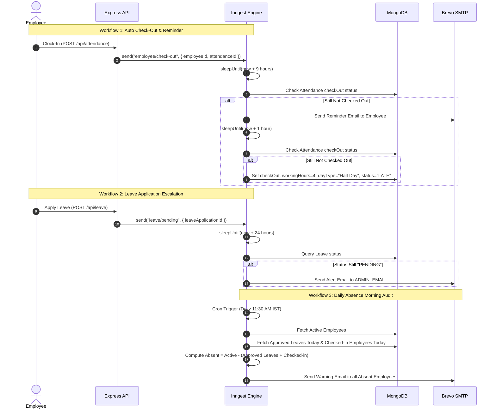
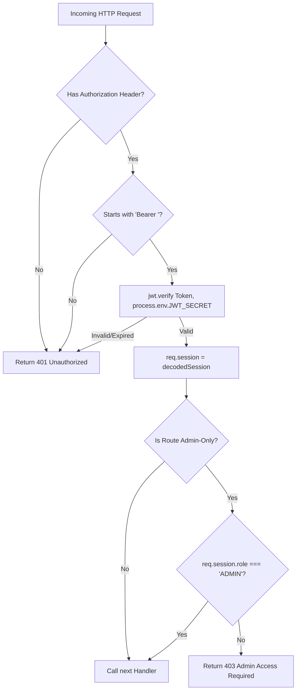
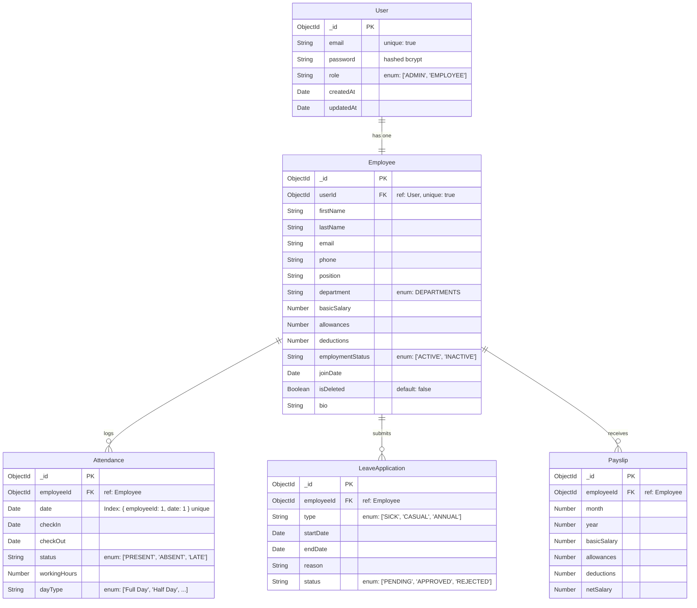

# StaffSync — Complete Technical Documentation & Interview Preparation Guide

---

## Table of Contents
1. [Section A: Project Overview](#section-a-project-overview)
2. [Section B: System Architecture](#section-b-system-architecture)
3. [Section C: Complete Feature-by-Feature Explanation](#section-c-complete-feature-by-feature-explanation)
4. [Section D: Backend, APIs, and Database Design](#section-d-backend-apis-and-database-design)
5. [Section E: Important Technical Concepts](#section-e-important-technical-concepts)
6. [Section F: Critical Code and Execution Flows](#section-f-critical-code-and-execution-flows)
7. [Section G: Security, Performance, and Scalability](#section-g-security-performance-and-scalability)
8. [Section H: Design Decisions and Trade-offs](#section-h-design-decisions-and-trade-offs)
9. [Section I: Technical Interview Questions & In-Depth Answers](#section-i-technical-interview-questions--in-depth-answers)
10. [Section J: Limitations and Future Improvements](#section-j-limitations-and-future-improvements)
11. [Section K: Final Interview Revision Sheet](#section-k-final-interview-revision-sheet)

---

## Section A: Project Overview

### 1. Problem Statement
Small-to-medium businesses frequently struggle with fragmented employee management. HR departments juggle disconnected spreadsheets for employee records, separate paper or punch systems for attendance, unstructured messaging threads for leave applications, and manual salary calculations for monthly payroll. This leads to:
- Discrepancies in attendance and hour logging.
- Missed or delayed leave approvals.
- High administrative overhead and errors in salary slips.
- Lack of self-service visibility for employees regarding their time off and compensation history.

### 2. Solution: StaffSync
**StaffSync** is a unified, full-stack Employee Management and Attendance System built to digitize and automate internal HR operations. It centralizes employee directory management, automated one-click daily clock-in/out, leave applications with approval lifecycles, and customizable payslip generation with printable PDF-ready outputs. Furthermore, it integrates a durable background event orchestration engine to handle automated reminders, absence detection, and auto-checkout routines without brittle, standalone server cron jobs.

### 3. Target Users & Key Use Cases
- **Administrators / HR Managers:**
  - Onboard new employees with structured compensation packages (basic salary, allowances, deductions) and assign company departments.
  - Monitor real-time organization metrics: active headcount, daily checked-in employees, and pending leaves.
  - Review, approve, or reject employee leave requests with immediate status propagation.
  - Generate monthly employee payslips and review organization-wide payout history.
  - Soft-delete departing employees while preserving historical attendance, leave, and payroll data.
- **Employees:**
  - Dual-portal authentication into a dedicated self-service interface.
  - One-click daily attendance clock-in and clock-out with automatic hour calculation and late arrival tracking.
  - Apply for leaves across defined categories (Sick, Casual, Annual) with date validation.
  - Access monthly payslip archives and launch clean, printable payslip documents.
  - Maintain personal profile bio information and self-manage account passwords.

### 4. Key Differentiators
- **Dual-Portal Role-Based Access Control:** Distinct, protected login landing gates for Admin and Employee access backed by cryptographically signed JWTs and backend middleware guards.
- **Durable Event-Driven Automation (Inngest):** Replaces volatile in-memory timers with persistent background step functions:
  - 9-hour auto check-out reminder and 10-hour automatic checkout fallback (crediting half-day).
  - 24-hour escalation reminders sent to administrators for unreviewed leave requests.
  - Daily 11:30 AM IST automated cron job scanning active employees, cross-referencing approved leaves and check-ins, and dispatching warning emails to absent personnel.
- **Resilient Data Architecture:** Strict composite uniqueness indexing preventing duplicate daily attendance records, combined with soft-deletion mechanisms to prevent orphaned relational data.
- **Modern, Responsive UI System:** Built with React 19, Tailwind CSS v4, and Lucide icons, featuring custom micro-animations, accessible tables, and clean layout transitions.

### 5. Technology Stack Summary
| Domain | Technology | Specific Purpose |
| :--- | :--- | :--- |
| **Frontend Framework** | **React 19** (`client`) | Component-based interactive UI with React Hooks and Context API |
| **Build & Tooling** | **Vite 8** | High-performance ESM development server and production bundler |
| **Styling** | **Tailwind CSS v4** (`@tailwindcss/vite`) | Utility-first styling with modern CSS theme variables and custom design tokens |
| **Routing** | **React Router DOM v7** | Declarative client-side routing, protected routes, and layout hierarchies |
| **HTTP Client** | **Axios** | Promised-based HTTP requests with automatic JWT Bearer token request interceptors |
| **Toast & Icons** | **React Hot Toast**, **Lucide React** | Contextual notifications and modern UI iconography |
| **Date Manipulation** | **date-fns** | Localized date formatting for attendance sheets and payslip generation |
| **Backend Framework** | **Node.js** with **Express 5** (`server`) | REST API endpoint routing, request parsing, and error handling |
| **Database & ODM** | **MongoDB** with **Mongoose 9** | NoSQL document storage with strict schemas, relational references, and compound indexes |
| **Authentication** | **jsonwebtoken (JWT)** & **bcrypt** | Stateless bearer token authentication and salted one-way password hashing (10 salt rounds) |
| **Workflow Engine** | **Inngest SDK v4.20** | Durable workflow orchestration for serverless sleep timers, event retries, and cron scheduling |
| **Email Relay** | **Nodemailer** with **Brevo SMTP** | Transactional email delivery for HR alerts and attendance notifications |
| **Form Parsing** | **Multer** (`multer().none()`) | Parses `multipart/form-data` payloads sent by client-side HTML FormData forms |

### 6. The 30–60 Second Elevator Pitch (Interview-Ready)
> *"StaffSync is a full-stack Employee Management System built using React 19, Node.js, Express 5, and MongoDB. It solves the operational fragmentation of HR workflows by unifying employee onboarding, real-time attendance tracking with late-detection logic, leave request approvals, and payroll calculation into a secure, role-based dual-portal application.
> 
> What makes StaffSync technically compelling is its event-driven automation layer powered by Inngest. Instead of relying on fragile server timers or external cron daemons, StaffSync executes durable multi-hour workflows—such as automatically notifying employees after 9 hours of work, triggering a 10-hour auto-checkout fallback, escalating pending leave requests to admins after 24 hours, and running daily cron audits to notify absent staff via Brevo SMTP. The architecture enforces strict data integrity via Mongoose compound indexes and soft-deletes to protect historical attendance and payroll audits."*

---

## Section B: System Architecture

### 1. Component Responsibilities
- **Frontend SPA (`client/`):**
  - Manages client-side route protection via React Router (`Layout.jsx`, `AuthContext.jsx`).
  - Implements role-specific views for Admin (`AdminDashboard`, `Employees`, `Payslips`, `Leave`) and Employee (`EmployeeDashboard`, `Attendance`, `Leave`, `Payslips`, `Settings`).
  - Intercepts outgoing requests to attach `Authorization: Bearer <token>` headers via Axios interceptors.
- **Backend API Gateway (`server/`):**
  - Exposes RESTful endpoints grouped by domain (`/api/auth`, `/api/employees`, `/api/attendance`, `/api/leave`, `/api/payslips`, `/api/dashboard`, `/api/profile`).
  - Enforces authentication (`protect`) and authorization (`protectAdmin`) middleware before passing control to domain controllers.
  - Serves the Inngest execution bridge at `/api/inngest` via `serve({ client: inngest, functions })`.
- **Database Layer (MongoDB Atlas / Local):**
  - Stores relational documents across 5 collections: `users`, `employees`, `attendances`, `leaveapplications`, `payslips`.
  - Ensures data uniqueness via indexes (e.g., unique email on `User`, compound `{ employeeId: 1, date: 1 }` on `Attendance`).
- **External Integration Services:**
  - **Inngest Cloud / Dev Server:** Listens for emitted events (`employee/check-out`, `leave/pending`, scheduled cron), persists workflow execution state across steps, and invokes the Express `/api/inngest` webhook.
  - **Brevo SMTP Relay:** Authenticated transport used by Nodemailer to dispatch formatted HTML emails.

### 2. Architecture & Data Flow Diagram

```mermaid
graph TD
    subgraph Browser ["Client Application (React 19 + Vite)"]
        UI["UI Components & Portals"]
        Ctx["AuthContext (JWT in localStorage)"]
        AxiosInst["Axios Instance (Request Interceptor)"]
        UI --> Ctx
        Ctx --> AxiosInst
    end

    subgraph ExpressApp ["Backend Application (Node.js + Express 5)"]
        Router["Express Router (/api/*)"]
        MulterMW["Multer (multipart/form-data)"]
        AuthMW["Auth Middleware (JWT Verify & Role Guard)"]
        Controllers["Domain Controllers (Business Logic)"]
        InngestServe["/api/inngest Endpoint (Inngest Serve Handler)"]
        
        Router --> MulterMW
        MulterMW --> AuthMW
        AuthMW --> Controllers
        Router --> InngestServe
    end

    subgraph Persistence ["Persistence Layer"]
        MongooseODM["Mongoose Models"]
        MongoDB[(MongoDB Database)]
        Controllers --> MongooseODM
        MongooseODM --> MongoDB
    end

    subgraph AsynchronousWorkflows ["Event-Driven Engine & External Services"]
        InngestClient["Inngest Client (Event Dispatcher)"]
        InngestCloud["Inngest Engine (Durable Steps & Crons)"]
        Mailer["Nodemailer Utility"]
        SMTPRelay["Brevo SMTP Server"]

        Controllers -->|inngest.send()| InngestClient
        InngestClient --> InngestCloud
        InngestCloud -->|Webhook Step Execution| InngestServe
        InngestServe --> Controllers
        InngestServe --> Mailer
        Mailer --> SMTPRelay
    end

    AxiosInst -->|HTTP REST + Bearer Token| Router
```

### 3. Communication Patterns
- **Synchronous Request-Response:** All standard CRUD operations (login, fetching metrics, creating records, updating leave status) use standard REST semantics over HTTP with JSON or multipart form payloads.
- **Asynchronous Event-Driven Workflows:** Operations that require time delays, scheduled tasks, or deferred alerts do not block API threads. Controllers emit an event via `await inngest.send({ name, data })` and immediately return HTTP 200/201 to the client. The Inngest orchestrator manages durable execution off-thread.

---

## Section C: Complete Feature-by-Feature Explanation

---

### Feature 1: Dual-Portal Authentication & Session Management

#### 1. Description & Purpose
Provides role-segregated entry points (`/login/admin` and `/login/employee`) ensuring that users only access portals aligned with their assigned corporate privilege level. Prevents privilege escalation and offers distinct UX flows.

#### 2. User Interaction
- User lands on `/login` and sees dual portal cards: **Admin Portal** and **Employee Portal**.
- Clicking a card opens `/login/admin` or `/login/employee`.
- User enters their email and password. Upon submission, a loading indicator displays; on success, the user is navigated to `/dashboard`. If credentials or role types mismatch, a clear toast alert appears.

#### 3. Frontend Implementation
- **Files:** `client/src/pages/LoginLanding.jsx`, `client/src/components/LoginForm.jsx`, `client/src/components/LoginLeftSide.jsx`, `client/src/context/AuthContext.jsx`.
- **State Management:** `AuthContext` maintains `{ user, token, loading }` in React state and synchronizes the bearer token to browser `localStorage`.
- **Session Rehydration:** When the app mounts, `AuthContext` calls `GET /api/auth/session`. If valid, user state is set; if invalid/expired, `localStorage.removeItem("token")` is called.

#### 4. Backend Implementation
- **Route:** `POST /api/auth/login` (Public), `GET /api/auth/session` (Protected).
- **Controller:** `server/controllers/authController.js` (`login`, `session`).
- **Logic:**
  1. Validates presence of `email`, `password`, and `role_type`.
  2. Queries `User.findOne({ email })`.
  3. Validates `role_type`: if `role_type === "admin"` but `user.role !== "ADMIN"`, rejects with HTTP 401 (`"Not authorized as admin"`).
  4. Runs `bcrypt.compare(password, user.password)`.
  5. Issues a signed JWT containing `{ userId, role, email }` with a 7-day expiration (`process.env.JWT_SECRET`).

#### 5. Database Interaction
- **Model:** `User.js` (`email`, `password`, `role`).
- **Query:** `User.findOne({ email })`.

#### 6. Edge Cases & Security Checks
- **Role Mismatch Prevention:** An employee attempting to log in via the Admin portal with valid employee credentials is explicitly blocked.
- **Token Invalidation:** If the server secret rotates or the token expires, `AuthContext` catches the 401 response and resets state to null, redirecting the user to `/login`.

---

### Feature 2: Employee Lifecycle & Directory Management

#### 1. Description & Purpose
Enables HR administrators to manage the complete employee lifecycle—from onboarding and salary package configuration to active roster search, record updates, and soft-deactivation.

#### 2. User Interaction
- Admin navigates to `/employees`.
- A header displays total team overview with an **"Add Employee"** button.
- A search input filters employees in real-time by First Name, Last Name, or Position. A department dropdown filters by defined corporate departments.
- Each employee card has action buttons to **Edit** (opens pre-filled modal) or **Delete** (displays confirmation prompt).

#### 3. Frontend Implementation
- **Files:** `client/src/pages/Employees.jsx`, `client/src/components/EmployeeCard.jsx`, `client/src/components/EmployeeForm.jsx`.
- **Form Handling:** Uses native `FormData(e.currentTarget)` containing personal info (name, phone, join date, bio) and compensation details (basic salary, allowances, deductions, department, password, role).
- **Dynamic Updates:** On modal submission or deletion, `fetchEmployees()` is triggered via callback to refresh the local roster.

#### 4. Backend Implementation
- **Routes:** 
  - `GET /api/employees` (Protected, Admin only)
  - `POST /api/employees` (Protected, Admin only)
  - `PUT /api/employees/:id` (Protected, Admin only)
  - `DELETE /api/employees/:id` (Protected, Admin only)
- **Controller:** `server/controllers/employeeController.js`.
- **Logic:**
  - `createEmployee`: Hashes the provided initial password (`bcrypt.hash(password, 10)`), creates a `User` document, and creates an `Employee` document referencing `user._id`.
  - `updateEmployee`: Updates employee profile fields. If email, role, or a new password is provided, updates the linked `User` record concurrently.
  - `deleteEmployee`: Sets `employee.isDeleted = true` and `employee.employmentStatus = "INACTIVE"`.

#### 5. Database Interaction
- **Models:** `Employee.js`, `User.js`.
- **Relationships:** `Employee.userId` references `User._id` with `{ unique: true }`.
- **Queries:** `Employee.find(where).sort({ createdAt: -1 }).populate("userId", "email role").lean()`.

#### 6. Edge Cases & Known Considerations
- **Email Uniqueness:** Handled by MongoDB duplicate key code `11000`; returns HTTP 400 (`"Email already exists"`).
- **Soft Delete Preservation:** Historical attendance and payroll records stay linked to the employee document even after deactivation.

---

### Feature 3: Attendance Tracking & Automated Work Hour Engine

#### 1. Description & Purpose
Provides a digitized punch-clock mechanism for employees to register daily check-ins and check-outs. Calculates exact working hours and categorizes days (Full Day, Half Day, etc.) while automatically flagging late arrivals.

#### 2. User Interaction
- Employee visits `/attendance`.
- If not checked in today: Shows a large interactive **"Check In"** button.
- If checked in: Shows an active **"Check Out"** button displaying current arrival time.
- If checked out: Displays a completed state card: *"Work Day Completed. Great job! See you tomorrow."*
- Below the button, an attendance statistics banner shows: Total Days Present, On-Time Days, Late Days, and Average Daily Hours.
- An attendance history table lists date, check-in, check-out, working hours, and status badges.

#### 3. Frontend Implementation
- **Files:** `client/src/pages/Attendance.jsx`, `client/src/components/attendance/CheckInButton.jsx`, `client/src/components/attendance/AttendanceStats.jsx`, `client/src/components/attendance/AttendanceHistory.jsx`.
- **State & Logic:** Compares `new Date(record.date).toDateString() === new Date().toDateString()` to evaluate today's attendance state.

#### 4. Backend Implementation
- **Routes:** `POST /api/attendance` (Clock in/out), `GET /api/attendance` (Fetch employee history).
- **Controller:** `server/controllers/attendanceController.js` (`clockInOut`, `getAttendance`).
- **Clock-In Logic:**
  - Queries `Attendance.findOne({ employeeId, date: today })`.
  - If no record exists: Evaluates check-in time. If after 09:00 AM (`hours >= 9 && minutes > 0`), marks status as `"LATE"`, otherwise `"PRESENT"`.
  - Creates the attendance record.
  - Emits Inngest background event `employee/check-out` with `{ employeeId, attendanceId }`.
- **Clock-Out Logic:**
  - If record exists and `checkOut` is null: Computes `diffHours = (now - checkIn) / 3600000`.
  - Determines `dayType`:
    - $\ge 8.0 \text{ hrs} \rightarrow$ `"Full Day"`
    - $\ge 6.0 \text{ hrs} \rightarrow$ `"Three Quarter Day"`
    - $\ge 4.0 \text{ hrs} \rightarrow$ `"Half Day"`
    - $< 4.0 \text{ hrs} \rightarrow$ `"Short Day"`
  - Sets `checkOut = now`, saves record, and returns updated data.

#### 5. Database Interaction
- **Model:** `Attendance.js`.
- **Indexes:** `attendanceSchema.index({ employeeId: 1, date: 1 }, { unique: true })`.

#### 6. Edge Cases & Resilience
- **Deactivated Employee Guard:** If `employee.isDeleted` is true, clock-in returns HTTP 403 (`"Your account is deactivated. You cannot clock in/out."`).
- **Double Check-In Protection:** Prevented at both controller logic level and database index level.

---

### Feature 4: Leave Application & Approval Management

#### 1. Description & Purpose
Digitizes time-off requests, categorizing them by leave type (Sick, Casual, Annual), validating date parameters, and giving administrators an approval dashboard.

#### 2. User Interaction
- **Employee View:** Displays leave category balance cards (Sick, Casual, Annual leaves taken). An **"Apply for Leave"** button opens a modal requesting leave type, start date, end date, and reason.
- **Admin View:** Displays an incoming queue of leave applications across all departments with quick **Approve** and **Reject** action buttons.

#### 3. Frontend Implementation
- **Files:** `client/src/pages/Leave.jsx`, `client/src/components/leave/ApplyLeaveModal.jsx`, `client/src/components/leave/LeaveHistory.jsx`.
- **Form Handling:** Validates that end date $\ge$ start date and dates are in the future prior to submission.
- **Admin Processing:** `handleStatusUpdate(id, status)` executes a `PATCH` request with visual spinner indicators while updating.

#### 4. Backend Implementation
- **Routes:** 
  - `POST /api/leave` (Protected, Employee applies)
  - `GET /api/leave` (Protected; Admin sees all, Employee sees own)
  - `PATCH /api/leave/:id` (Protected, Admin updates status)
- **Controller:** `server/controllers/leaveController.js`.
- **Validation Rules:**
  - `new Date(startDate) <= today` or `new Date(endDate) <= today` $\rightarrow$ Rejected (leaves must be future-dated).
  - `new Date(endDate) < new Date(startDate)` $\rightarrow$ Rejected.
- **Workflow Trigger:** On creation, dispatches Inngest event `leave/pending` with `{ leaveApplicationId }`.

#### 5. Database Interaction
- **Model:** `LeaveApplication.js`.
- **Populate Query:** Admin query runs `LeaveApplication.find(where).populate("employeeId").sort({ createdAt: -1 })`.

---

### Feature 5: Payroll & Payslip Generation Engine

#### 1. Description & Purpose
Provides structured monthly salary slip generation based on employee compensation settings, and includes a print-optimized payslip document.

#### 2. User Interaction
- **Admin:** Navigates to `/payslips` and clicks **"Generate Payslip"**. Selects an active employee, month, and year. Compensation numbers automatically pre-fill from employee master records (basic salary, allowances, deductions) and can be adjusted.
- **Employee / Admin:** Clicks **"View"** on any payslip card to open `/print/payslips/:id`, presenting an official salary voucher with an action button: **"Print Payslip"**.

#### 3. Frontend Implementation
- **Files:** `client/src/pages/Payslips.jsx`, `client/src/pages/PrintPayslip.jsx`, `client/src/components/payslip/GeneratePayslipForm.jsx`, `client/src/components/payslip/PayslipList.jsx`.
- **Print Optimization:** `PrintPayslip.jsx` includes `@media print` CSS utility classes (`print:hidden` on action buttons and backgrounds) to ensure clean PDF export or physical printing via `window.print()`.

#### 4. Backend Implementation
- **Routes:** 
  - `POST /api/payslips` (Protected, Admin only)
  - `GET /api/payslips` (Protected; Admin sees all, Employee sees own)
  - `GET /api/payslips/:id` (Protected)
- **Controller:** `server/controllers/payslipController.js`.
- **Calculation Formula:**
  $$\text{netSalary} = \text{basicSalary} + \text{allowances} - \text{deductions}$$

#### 5. Database Interaction
- **Model:** `Payslip.js` (`employeeId`, `month`, `year`, `basicSalary`, `allowances`, `deductions`, `netSalary`).

---

### Feature 6: Event-Driven Automation & Cron System (Inngest)

#### 1. Description & Purpose
Eliminates reliance on fragile server `setTimeout` calls or separate daemon cron processes by delegating long-running orchestration to Inngest.

#### 2. Workflows Implemented
Located in `server/inngest/index.js`:



---

### Feature 7: Profile & Security Settings

#### 1. Description & Purpose
Allows users to maintain their professional bio and update login credentials securely without administrative intervention.

#### 2. User Interaction
- User navigates to `/settings`.
- Displays public profile details and an editable **Bio** textarea.
- A **"Change Password"** action card opens a modal requiring `Current Password`, `New Password`, and `Confirm Password`.

#### 3. Frontend & Backend Implementation
- **Frontend:** `client/src/pages/Settings.jsx`, `client/src/components/ProfileForm.jsx`, `client/src/components/ChangePasswordModal.jsx`.
- **Backend Routes:** `GET /api/profile`, `POST /api/profile`, `POST /api/auth/change-password`.
- **Password Verification:** Queries `User.findById`, executes `bcrypt.compare(currentPassword, user.password)`, hashes the new password with 10 salt rounds, and commits `user.save()`.

---

## Section D: Backend, APIs, and Database Design

### 1. Complete REST API Reference Table

| Method | Endpoint | Protection | Role | Description |
| :--- | :--- | :--- | :--- | :--- |
| `POST` | `/api/auth/login` | Public | All | Authenticates user against portal role; returns JWT & user object |
| `GET` | `/api/auth/session` | Bearer Token | All | Validates session token and returns decoded session payload |
| `POST` | `/api/auth/change-password` | Bearer Token | All | Verifies old password and hashes/stores new password |
| `GET` | `/api/dashboard` | Bearer Token | All | Returns aggregate stats (Admin: counts; Employee: hours & slips) |
| `GET` | `/api/employees` | Bearer Token | `ADMIN` | Fetches employee roster with optional `?department=` filter |
| `POST` | `/api/employees` | Bearer Token | `ADMIN` | Creates new login credentials and employee master record |
| `PUT` | `/api/employees/:id` | Bearer Token | `ADMIN` | Updates employee details and synchronizes linked user account |
| `DELETE`| `/api/employees/:id` | Bearer Token | `ADMIN` | Soft-deletes employee (`isDeleted = true`, `status = INACTIVE`) |
| `POST` | `/api/attendance` | Bearer Token | `EMPLOYEE` | Clocks employee in (if new) or clocks out (calculates hours) |
| `GET` | `/api/attendance` | Bearer Token | `EMPLOYEE` | Retrieves personal attendance log with limit parameter |
| `POST` | `/api/leave` | Bearer Token | `EMPLOYEE` | Submits time-off application; triggers Inngest escalation timer |
| `GET` | `/api/leave` | Bearer Token | All | Fetches leaves (Admin: all leaves; Employee: own records) |
| `PATCH`| `/api/leave/:id` | Bearer Token | `ADMIN` | Approves or rejects a pending leave application |
| `POST` | `/api/payslips` | Bearer Token | `ADMIN` | Calculates and generates monthly salary slip document |
| `GET` | `/api/payslips` | Bearer Token | All | Returns payslips (Admin: org-wide; Employee: personal slips) |
| `GET` | `/api/payslips/:id` | Bearer Token | All | Retrieves single payslip populated with employee information |
| `GET` | `/api/profile` | Bearer Token | All | Returns profile info (Employee details or fallback Admin info) |
| `POST` | `/api/profile` | Bearer Token | All | Updates employee profile bio |
| `ALL` | `/api/inngest` | Public / Key | Inngest | Webhook endpoint serving Inngest SDK execution steps |

### 2. Authentication & Authorization Middleware Flow


### 3. Database Schema Models & Indexing



### 4. Configuration & Environment Variables
The application relies on the following configurations (stored in `.env` files, excluded from version control):

| Variable | Scope | Description |
| :--- | :--- | :--- |
| `PORT` | Server | HTTP port for the Express application (default: `4000`) |
| `MONGODB_URI` | Server | Connection string for MongoDB database instance |
| `JWT_SECRET` | Server | Cryptographic salt/key used to sign and verify JSON Web Tokens |
| `ADMIN_EMAIL` | Server | Master administrator email used by `seed.js` and Inngest alerts |
| `SMTP_USER` | Server | Brevo (Sendinblue) SMTP relay account username |
| `SMTP_PASS` | Server | Brevo SMTP relay account authorization key/password |
| `SENDER_EMAIL` | Server | Sender address displayed in automated employee emails |
| `VITE_BASE_URL` | Client | Base URL of backend REST server (default: `http://localhost:4000`) |

---

## Section E: Important Technical Concepts

### 1. React 19 & Modern Client Architecture
- **Single Page Application (SPA):** Uses client-side routing (`react-router-dom` v7). Page navigation updates browser history without triggering complete document reloads, preserving authentication state.
- **Context API vs Redux:** `AuthContext` provides global state for the authenticated user and token. For an application of this scale, Context API eliminates Redux boilerplate while handling session synchronization, token rehydration, and login/logout methods cleanly.
- **Custom CSS Theme Tokens in Tailwind v4:** Instead of legacy Tailwind configuration JavaScript files, Tailwind v4 uses `@theme` directives and CSS layer utilities in `index.css` (`@apply` classes for `.card`, `.btn-primary`, `.table-modern`), providing complete design consistency.

### 2. Stateless JWT Authentication & Cryptographic Hashing
- **JSON Web Tokens (JWT):** A compact, URL-safe means of representing claims between two parties. Composed of Header, Payload, and Signature. StaffSync uses stateless JWTs: the backend does not store session IDs in a cache or database. Every request carries the token in the `Authorization: Bearer <token>` header, verified mathematically via `jwt.verify(token, secret)`.
- **Bcrypt Password Hashing:** Passwords are never stored in plaintext. Bcrypt incorporates a salt (10 rounds) to protect against rainbow table attacks and uses an intentionally computationally intensive key derivation function to resist brute-force cracking.

### 3. Inngest Durable Execution vs Traditional Cron/Queue Systems
- **The Problem with Node Cron / setTimeout:** Running background timers in standard Node.js processes (`setTimeout(fn, 9 * 3600000)`) fails if the server restarts, scales down, or crashes during deployment.
- **How Inngest Solves This:** Inngest operates as a durable execution engine. Functions are declared with discrete execution steps (`step.sleepUntil()`, `step.run()`). If a step sleeps for 9 hours, Inngest pauses execution, schedules an event, and invokes the Express server's `/api/inngest` webhook exactly when the timer elapses. If a step fails, Inngest automatically retries only that specific step with exponential backoff.

### 4. Database Indexing & Soft Deletion
- **Compound Unique Index:** `Attendance.js` defines `attendanceSchema.index({ employeeId: 1, date: 1 }, { unique: true })`. This guarantees database-level uniqueness across two fields, ensuring that race conditions or multiple clicks can never insert duplicate attendance records for an employee on the same calendar day.
- **Soft Deletes (`isDeleted: true`):** When an employee leaves, hard-deleting their record from MongoDB would trigger foreign key integrity issues (e.g., historical payslips and attendance records referencing a non-existent `employeeId`). Soft deleting deactivates user login and hides the employee from active lists while preserving historical audits.

---

## Section F: Critical Code and Execution Flows

### Flow 1: User Registration via Admin & Account Creation
1. Admin opens the "Add Employee" modal on `/employees` and fills in employee and login details.
2. Form submits to `POST /api/employees`.
3. Multer parses multipart form data fields.
4. `protectAdmin` verifies that the caller has `ADMIN` role.
5. In `employeeController.js`:
   ```javascript
   // 1. Hash the password
   const hashed = await bcrypt.hash(password, 10);
   // 2. Create User credential record
   const user = await User.create({ email, password: hashed, role: role || "EMPLOYEE" });
   // 3. Create Employee profile linked via userId
   const employee = await Employee.create({
       userId: user._id,
       firstName, lastName, email, phone, position,
       department: department || "Engineering",
       basicSalary: Number(basicSalary) || 0,
       allowances: Number(allowances) || 0,
       deductions: Number(deductions) || 0,
       joinDate: new Date(joinDate),
       bio: bio || ""
   });
   ```
6. Server returns HTTP 201 with created employee data.

### Flow 2: Daily Attendance Clock-In & Hour Calculation
1. Employee clicks **"Check In"** on `/attendance`.
2. Client sends `POST /api/attendance` with JWT Bearer token.
3. `protect` middleware decodes session and identifies `userId`.
4. Controller retrieves employee profile via `Employee.findOne({ userId })`.
5. Evaluates today's date (midnight normalized) and queries `Attendance.findOne({ employeeId, date: today })`.
6. Since no record exists:
   - Evaluates current time against 09:00 AM.
   - If after 09:00 AM $\rightarrow$ `status = "LATE"`, otherwise `"PRESENT"`.
   - Saves record: `Attendance.create({ employeeId, date: today, checkIn: now, status })`.
   - Dispatches event to Inngest:
     ```javascript
     await inngest.send({
         name: "employee/check-out",
         data: { employeeId: employee._id, attendanceId: attendance._id }
     });
     ```
7. When employee clicks **"Check Out"** later in the day:
   - Controller finds the existing record.
   - Computes `diffHours = (now - checkIn) / (1000 * 60 * 60)`.
   - Calculates `dayType` (Full Day if $\ge 8$, Three Quarter if $\ge 6$, Half Day if $\ge 4$, else Short Day).
   - Commits `existing.checkOut = now`, `existing.workingHours`, `existing.dayType`.

### Flow 3: Leave Request Submission & Administrative Decision
1. Employee submits leave request on `/leave`.
2. Controller verifies start date and end date are in the future and end date $\ge$ start date.
3. Creates document in `LeaveApplication` with status `"PENDING"`.
4. Emits `leave/pending` event to Inngest, initiating a 24-hour escalation timer.
5. Admin visits `/leave`, views pending cards, and clicks **"Approve"** or **"Reject"**.
6. Client sends `PATCH /api/leave/:id` with `{ status: "APPROVED" }`.
7. Controller executes `LeaveApplication.findByIdAndUpdate(id, { status }, { returnDocument: "after" })`.

---

## Section G: Security, Performance, and Scalability

### 1. Implemented Security Controls
- **Stateless Role-Based Protection:** Route handlers use `protect` to enforce authentication and `protectAdmin` to prevent employee accounts from calling administrative routes.
- **Salted Password Hashing:** Bcrypt with 10 salt rounds prevents offline credential theft.
- **Database Index Constraints:** Unique email indexes and compound attendance indexes prevent state duplication.
- **Sanitized Profile Data:** Passwords are not returned in standard directory queries (`.populate("userId", "email role")`).

### 2. Identified Vulnerabilities & Gaps (Honest Assessment)
- **Lack of Rate Limiting:** The login and clock-in endpoints do not implement rate limiters (e.g., `express-rate-limit`), leaving the authentication route vulnerable to credential stuffing and brute-force attacks.
- **Non-Atomic User/Employee Creation:** In `employeeController.js`, `User.create` and `Employee.create` are executed sequentially without a MongoDB replica set multi-document transaction (`session.startTransaction()`). If `Employee.create` fails (e.g., due to schema validation), an orphaned `User` document remains in MongoDB. Subsequent attempts to register with that email fail with a duplicate key error.
- **Timezone Inconsistency:** Inngest cron tasks explicitly use `Asia/Kolkata` (`TZ=Asia/Kolkata`), but Express controllers (`attendanceController.js` and `dashboardController.js`) use server system time (`new Date().setHours(0, 0, 0, 0)`). If deployed to cloud environments running on UTC, attendance records may split across days incorrectly.
- **Missing CSRF & Security Headers:** The Express API does not include `helmet` for HTTP security headers (e.g., CSP, X-Content-Type-Options) or CORS origin restriction (currently `cors()` allows all origins `*`).

### 3. Performance & Scaling Considerations
- **Database Query Pagination:** `getAttendance` supports query pagination (`limit`), but `getEmployees`, `getLeaves`, and `getPayslips` return unbounded result sets. For enterprise scaling (thousands of employees), cursor-based or skip/limit pagination must be introduced.
- **In-Memory Lean Queries:** MongoDB queries utilize `.lean()` where possible to bypass Mongoose document hydration overhead, returning plain JavaScript objects for faster JSON serialization.

---

## Section H: Design Decisions and Trade-offs

### 1. Inngest Workflows vs BullMQ / Redis Queue
- **Decision:** Used Inngest SDK instead of BullMQ with Redis.
- **Rationale:** StaffSync requires multi-hour delays (9-hour and 24-hour sleep timers) and scheduled daily audits. BullMQ requires provisioning, securing, and maintaining a persistent Redis instance. Inngest provides serverless-native step execution with zero infrastructure maintenance.
- **Trade-off:** Inngest introduces an external cloud dependency for production event delivery. In isolated enterprise air-gapped environments, an internal BullMQ/Redis cluster would be preferred.

### 2. MongoDB Document Model vs Relational SQL Database
- **Decision:** MongoDB with Mongoose ODM.
- **Rationale:** Accelerates rapid development with flexible JSON schemas, accommodating variable employee compensation structures, unstructured bios, and extensible leave types.
- **Trade-off:** Lacks native ACID transactions across collections without configuring a MongoDB replica set. In an enterprise financial/payroll system, PostgreSQL with strict foreign keys and atomic multi-table transactions provides stronger financial audit guarantees.

### 3. JWT in LocalStorage vs HttpOnly Refresh Cookies
- **Decision:** JWT bearer tokens stored in browser `localStorage`.
- **Rationale:** Simplifies cross-origin frontend-backend deployment (client on Vercel, server on Render or AWS) without complex third-party cookie handling or CORS credentials configuration.
- **Trade-off:** Tokens stored in `localStorage` are vulnerable to Cross-Site Scripting (XSS). An enterprise-grade architecture would use short-lived access tokens in memory combined with HttpOnly, Secure, SameSite refresh cookies.

### 4. Soft Delete vs Hard Delete
- **Decision:** Soft deletion via `isDeleted: true` and `employmentStatus: "INACTIVE"`.
- **Rationale:** Preserves historical referential integrity. Deleting an employee row would orphan previous attendance logs and past payroll records.
- **Trade-off:** All queries must explicitly filter `{ isDeleted: { $ne: true } }`, increasing query complexity.

---

## Section I: Technical Interview Questions & In-Depth Answers

### Category 1: Project Overview & Architecture

#### Q1: Can you walk me through the architecture of StaffSync and explain how the various components interact?
**Answer:**
> *"StaffSync is built as a decoupled full-stack application following a three-tier architecture:
> 1. **Client Tier:** A React 19 Single Page Application bundled with Vite. It manages authentication state via Context API, uses React Router for protected navigation, and communicates with the backend via an Axios instance configured with request interceptors to attach JWT Bearer tokens.
> 2. **Application Tier:** An Express 5 REST API running on Node.js using ES Modules. It processes incoming requests through Multer for form parsing, passes them through authentication and role-guard middleware, and routes them to domain controllers (Employees, Attendance, Leave, Payslip, Dashboard).
> 3. **Data & Workflow Tier:** A MongoDB database managed via Mongoose 9 schemas with compound indexes. Alongside MongoDB, the system integrates Inngest as a durable event orchestration layer. Instead of running synchronous background threads, controllers emit events to Inngest, which manages step-based sleep timers (e.g., 9-hour auto check-out, 24-hour leave escalation) and triggers daily cron tasks to send email alerts via Brevo SMTP."*

#### Q2: What was the primary motivation behind building this project?
**Answer:**
> *"Small to medium-sized organizations often use fragmented tools: spreadsheets for rosters, manual logbooks for attendance, and email chains for leave requests. This causes calculation errors, delayed approvals, and significant HR overhead. StaffSync was designed to unify these operations into a single platform with dual-portal access (separating Admin oversight from Employee self-service) while automating tedious follow-ups—such as checking out employees who forget to clock out or emailing employees who are absent—using durable background workflows."*

---

### Category 2: Feature Implementation & Code-Level Details

#### Q3: How does the attendance tracking system calculate work hours and handle late arrivals?
**Answer:**
> *"When an employee hits `/api/attendance` via POST, the controller normalizes today's date to midnight and queries the database:
> - **Check-In:** If no record exists, it checks the arrival time. If it is past 09:00 AM (`now.getHours() >= 9 && now.getMinutes() > 0`), the record is created with `status: 'LATE'`; otherwise, `'PRESENT'`. It then dispatches an `employee/check-out` event to Inngest.
> - **Check-Out:** If a record already exists with an empty `checkOut` field, it calculates `diffHours = (now - checkIn) / 3600000`. Based on this duration, it categorizes `dayType`: Full Day for 8+ hours, Three Quarter Day for 6+ hours, Half Day for 4+ hours, and Short Day for anything under 4 hours. It then commits `checkOut`, `workingHours`, and `dayType` to MongoDB."*

#### Q4: How did you implement printable payslips in React without an external PDF library?
**Answer:**
> *"In `PrintPayslip.jsx`, I used browser-native print capabilities combined with CSS print media queries (`@media print` utilities in Tailwind). The payslip is styled as an official voucher table. When the user clicks 'Print Payslip', it triggers `window.print()`. Using Tailwind's `print:hidden` class, buttons, sidebars, and navigation headers are excluded from the printed document, allowing the browser to render a clean, professional PDF or paper slip without loading heavy PDF canvas generation libraries like jsPDF or html2canvas."*

---

### Category 3: Technical Deep Dive & Workflows

#### Q5: Why did you choose Inngest instead of standard `node-cron` or `setInterval` for background jobs?
**Answer:**
> *"Standard in-memory timers like `setTimeout` or `setInterval` are ephemeral. If the server process restarts, crashes, or is redeployed during a 9-hour timer, the timer is lost, and the employee will never be checked out or reminded. 
> `node-cron` solves scheduled execution but still runs in the server's single Node.js process, complicating horizontal scaling across multiple containers where jobs would duplicate unless backed by Redis locks.
> Inngest provides **durable execution**. When I call `step.sleepUntil('wait-for-9-hours')`, Inngest suspends execution, stores the state externally, and wakes up my `/api/inngest` webhook exactly when the time arrives. If an email step fails due to an SMTP timeout, Inngest retries only that step without re-executing previous steps."*

#### Q6: How does the daily 11:30 AM absence detection cron work internally?
**Answer:**
> *"In `server/inngest/index.js`, the function `attendanceReminderCron` triggers on `cron: 'TZ=Asia/Kolkata 30 11 * * *'`. It executes five sequential steps:
> 1. Calculates today's start and end timestamps in Indian Standard Time (IST).
> 2. Queries all active, non-deleted employees (`Employee.find({ isDeleted: false, employmentStatus: 'ACTIVE' })`).
> 3. Queries `LeaveApplication` for employees on approved leave overlapping today.
> 4. Queries `Attendance` for employees who already clocked in today.
> 5. Filters active employees who are neither on approved leave nor checked in:
>    ```javascript
>    const absent = activeEmployees.filter(e => !onLeaveIds.includes(e._id) && !checkedInIds.includes(e._id));
>    ```
> 6. Dispatches reminder emails to all absent employees via Nodemailer and Brevo SMTP."*

---

### Category 4: Debugging, Edge Cases & Data Integrity

#### Q7: How do you prevent race conditions when two check-in requests are submitted simultaneously?
**Answer:**
> *"Race conditions are handled at two distinct layers:
> 1. **Application Logic:** The controller checks `Attendance.findOne({ employeeId, date: today })` before attempting creation.
> 2. **Database Constraint:** In `Attendance.js`, a compound unique index is enforced:
>    ```javascript
>    attendanceSchema.index({ employeeId: 1, date: 1 }, { unique: true });
>    ```
> Even if two requests bypass the application check simultaneously due to asynchronous concurrency, MongoDB's storage engine enforces index uniqueness. The second insert throws a duplicate key error (E11000), preventing duplicate daily records."*

#### Q8: What happens if an employee account is deleted while historical payslips or attendance records exist?
**Answer:**
> *"StaffSync uses **soft deletion**. In `employeeController.js`, `deleteEmployee` updates `employee.isDeleted = true` and `employmentStatus = 'INACTIVE'`. The employee record is never removed from the database. Consequently, historical attendance entries and past payslips continue to populate their relational references without breaking. Furthermore, if a deactivated employee attempts to clock in or request leave, middleware guards intercept their ID and return HTTP 403 Forbidden."*

---

### Category 5: Security, Vulnerabilities & System Design

#### Q9: What security vulnerabilities or architecture flaws exist in the current implementation, and how would you fix them?
**Answer:**
> *"An honest audit of the codebase reveals four primary areas for improvement:
> 1. **Missing MongoDB Transactions during Onboarding:** In `createEmployee`, `User.create()` runs before `Employee.create()`. If `Employee.create()` fails, an orphaned `User` document remains. This should be wrapped in a Mongoose session transaction (`session.startTransaction()`) so both succeed or fail atomically.
> 2. **No Rate Limiting:** The auth routes lack rate limiting. In production, I would add `express-rate-limit` to throttle failed login attempts.
> 3. **Timezone Discrepancy:** Inngest uses `Asia/Kolkata`, but Express controllers use server local time (`new Date().setHours(0,0,0,0)`). On UTC cloud servers, early morning check-ins will split across dates incorrectly. All date normalizations should use a unified timezone utility.
> 4. **Storage of JWTs in LocalStorage:** Vulnerable to XSS. In a production upgrade, I would transition to short-lived in-memory tokens refreshed via HttpOnly, SameSite cookies."*

#### Q10: How would you scale StaffSync if the workforce grew from 100 to 50,000 employees?
**Answer:**
> *"Scaling to 50,000 employees introduces specific bottlenecks that require architectural evolution:
> 1. **Pagination & Indexing:** Endpoints like `GET /api/employees` and `GET /api/payslips` currently return full unpaginated arrays. I would implement cursor-based pagination with indexed compound keys (`{ department: 1, createdAt: -1 }`).
> 2. **Database Read/Write Splitting & Caching:** Attendance clock-in creates high write bursts around 08:30–09:00 AM. I would introduce a Redis cache for employee profile lookups and session verification, and configure MongoDB read replicas for dashboard aggregations.
> 3. **Asynchronous Batching for Absence Detection:** Querying 50,000 employees in memory during the 11:30 AM cron would cause Node.js buffer exhaustion. I would chunk the employee query using MongoDB cursors (`cursor.batchSize(500)`) and fan out email dispatch jobs across worker queues rather than running a single `Promise.all`."*

---

## Section J: Limitations and Future Improvements

### Actual Codebase Limitations Identified
1. **Frontend Exception Handling Bug in EmployeeForm:** In `client/src/components/EmployeeForm.jsx` line 28, the catch block catches `error` but references undefined variable `err` (`toast.error(err.response?.data?.error || err.message)`), triggering an uncaught `ReferenceError` when an error occurs.
2. **Generic Error Message in ChangePasswordModal:** In `ChangePasswordModal.jsx`, `error.message` is rendered instead of checking `error.response?.data?.error`, showing generic Axios network strings rather than backend validation errors (e.g., *"Current password is incorrect"*).
3. **Admin Attendance View Limitation:** While administrators can view organization attendance totals on the Dashboard, the `Attendance` tab is hidden from the Admin sidebar (`Sidebar.jsx`), preventing admins from viewing or filtering individual employee attendance sheets.
4. **Timezone Discrepancy:** The Express controller normalizes dates via local server time (`setHours(0,0,0,0)`), while Inngest functions use `Asia/Kolkata`, creating potential date mismatches on UTC-hosted production environments.

### Prioritized Roadmap for Future Development

| Priority | Enhancement | Technical Description | Impact |
| :---: | :--- | :--- | :--- |
| **P0** | **Fix Frontend Error Handling Bugs** | Correct `err` $\rightarrow$ `error` in `EmployeeForm.jsx` and read server response error strings in `ChangePasswordModal.jsx`. | Prevents unhandled client runtime exceptions. |
| **P0** | **Atomic Mongoose Transactions** | Wrap `User.create` and `Employee.create` inside a Mongoose replica transaction session. | Eliminates orphaned user records on registration failure. |
| **P1** | **Unified Timezone Utility** | Standardize all date boundaries across Express and Inngest using `date-fns-tz` to `Asia/Kolkata` (or company timezone). | Prevents attendance date drift on cloud servers. |
| **P1** | **Admin Attendance Dashboard** | Expose `/attendance` to Admins with employee/department dropdown filters and CSV export. | Enables HR to audit daily logs and export payroll hours. |
| **P2** | **Rate Limiting & Security Hardening** | Implement `express-rate-limit` on `/api/auth/*` and configure `helmet` HTTP security headers. | Protects against brute-force and credential stuffing attacks. |
| **P3** | **Cursor-Based Pagination** | Introduce pagination (`limit`, `cursor`) on `/api/employees`, `/api/leave`, and `/api/payslips`. | Prevents memory saturation as records scale. |

---

## Section K: Final Interview Revision Sheet

### 1. 30-Second Elevator Pitch
*"StaffSync is a full-stack Employee Management and Attendance System built with React 19, Express 5, and MongoDB. It streamlines workforce administration through role-based dual portals, providing automated attendance hour logging, late arrival detection, leave request approval lifecycles, and customizable payslip generation. Its standout feature is an event-driven automation layer built with Inngest, which manages multi-hour workflows—such as 9-hour auto check-out alerts, half-day checkout enforcement, and daily absence cron audits via Brevo SMTP—without fragile server-side timers."*

### 2. Core Tech Stack Cheat Sheet
- **Client:** React 19, Vite 8, Tailwind CSS v4, React Router DOM v7, Axios, Lucide React, date-fns, React Hot Toast.
- **Server:** Node.js, Express 5, MongoDB, Mongoose 9, Inngest SDK v4.20, Nodemailer, Bcrypt, JWT, Multer.

### 3. Top 5 Implementation Details to Remember
1. **Compound Indexing for Uniqueness:** Attendance uses `{ employeeId: 1, date: 1 }` with `{ unique: true }` to enforce single daily entries at the database level.
2. **Dual Clock Logic:** Clock-in sets `status = 'LATE'` if past 09:00 AM; clock-out calculates duration and categorizes into Full Day ($\ge 8\text{h}$), Three Quarter ($\ge 6\text{h}$), Half Day ($\ge 4\text{h}$), or Short Day.
3. **Durable Inngest Workflows:** Replaces cron daemons with step functions (`step.sleepUntil()`, `step.run()`) for auto-checkout, leave reminders, and daily absence scans.
4. **Soft-Delete Architecture:** Deleting an employee updates `isDeleted: true` and `employmentStatus: "INACTIVE"`, preserving historical payslip and attendance records.
5. **Print-Optimized Styling:** Payslips utilize CSS `@media print` rules (`print:hidden`) to generate clean PDF vouchers directly via the browser's native print engine.

### 4. Key Design Decisions & Trade-Offs
- **Inngest over BullMQ:** Chosen for serverless-ready durable sleep timers without managing a persistent Redis cluster; trade-off is an external cloud service dependency.
- **Stateless JWT over Sessions:** Chosen for cross-origin flexibility and zero server session state; trade-off is token invalidation complexity before expiration.
- **Soft Deletion over Hard Deletion:** Chosen for audit compliance and referential integrity; trade-off is requiring `{ isDeleted: false }` filters on queries.

### 5. Critical Files to Revisit Before an Interview
- `server/controllers/attendanceController.js` — Core clock in/out business logic and hour calculation.
- `server/inngest/index.js` — Three automated workflows (auto check-out, leave reminders, absence cron).
- `server/controllers/employeeController.js` — Dual User and Employee onboarding logic.
- `server/middleware/auth.js` — JWT verification and admin role-guard implementation.
- `client/src/context/AuthContext.jsx` — Client session rehydration and axios interceptor management.
- `client/src/pages/PrintPayslip.jsx` — Print-ready styling and calculation display.
